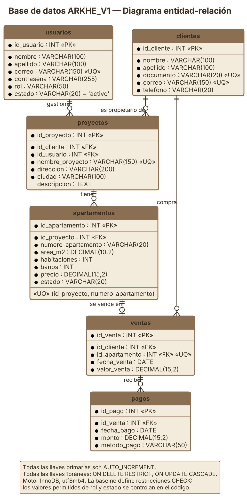

# Diccionario de datos — base `ARKHE_V1`

## Control del documento

| Dato | Valor |
|---|---|
| Código | ARKHE-DD-001 |
| Documento | Diccionario de datos |
| Versión | 1.0 |
| Fecha | 2026-11-14 |
| Elaborado por | Pedro Alba Méndez |

### Historial de cambios

| Versión | Fecha | Autor | Descripción |
|---|---|---|---|
| 1.0 | 2026-11-14 | Pedro Alba Méndez | Versión inicial. |

Describe las seis tablas de la base de datos del sistema: qué guarda cada campo, de qué tipo es y qué reglas de negocio lo afectan.

**Fuente:** la estructura se verificó el 2026-11-14 contra la base real (MySQL 8.4.8) consultando `information_schema`, y coincide con `database/esquema.sql`. Las reglas de negocio se tomaron del código (`models/`, `routes/` y `utils/validaciones.py`). El diagrama se generó con PlantUML a partir de `diagrama_er.puml`.

## Diagrama entidad-relación



## Datos generales

| Aspecto | Valor |
|---|---|
| Motor | InnoDB en las seis tablas |
| Juego de caracteres | `utf8mb4`, intercalación `utf8mb4_0900_ai_ci` |
| Llaves primarias | Un entero `AUTO_INCREMENT` por tabla |
| Llaves foráneas | Seis, todas `ON DELETE RESTRICT` y `ON UPDATE CASCADE` |
| Restricciones `CHECK` | Ninguna |
| Disparadores, vistas, procedimientos | No se usan |

Dos consecuencias de este diseño:

- **`ON DELETE RESTRICT`** significa que la base rechaza borrar un registro del que dependen otros (por ejemplo, un cliente con ventas). El sistema revisa antes cada caso y muestra un mensaje claro; la llave foránea es la segunda barrera.
- **Moneda:** los tres campos de dinero (`apartamentos.precio`, `ventas.valor_venta` y `pagos.monto`) están en **pesos colombianos (COP)**. La base guarda solo el número, sin símbolo ni código de moneda: el sistema maneja una única moneda.
- **Como no hay `CHECK` ni `ENUM`**, las listas de valores permitidos (rol, estado, método de pago) y los rangos (precio mayor que cero, por ejemplo) **se controlan en el código Python**, no en MySQL. Las mismas funciones de validación sirven a los formularios y a la API.

## Cómo leer las tablas

| Columna | Significado |
|---|---|
| Nulo | "No" si el campo es obligatorio (`NOT NULL`). |
| Clave | **PK** llave primaria, **FK** llave foránea, **UQ** valor único. |
| Por defecto | Valor que pone MySQL si no se envía el campo. "—" si no tiene. |

## Relaciones

| Tabla hija | Campo | Tabla padre | Cardinalidad | Significado |
|---|---|---|---|---|
| proyectos | id_cliente | clientes | Un cliente, cero o muchos proyectos | Cliente propietario o promotor del proyecto. |
| proyectos | id_usuario | usuarios | Un usuario, cero o muchos proyectos | Usuario que gestiona el proyecto. |
| apartamentos | id_proyecto | proyectos | Un proyecto, cero o muchos apartamentos | Proyecto al que pertenece la unidad. |
| ventas | id_cliente | clientes | Un cliente, cero o muchas ventas | Cliente comprador. |
| ventas | id_apartamento | apartamentos | Un apartamento, cero o una venta | Unidad vendida. Es única: un apartamento se vende una sola vez. |
| pagos | id_venta | ventas | Una venta, cero o muchos pagos | Venta a la que se abona. |

---

## usuarios

Personas que inician sesión en el sistema.

| Campo | Tipo | Nulo | Clave | Por defecto | Descripción |
|---|---|---|---|---|---|
| id_usuario | INT | No | PK | AUTO_INCREMENT | Identificador del usuario. |
| nombre | VARCHAR(100) | No | | — | Nombres. Solo letras y espacios. |
| apellido | VARCHAR(100) | No | | — | Apellidos. Solo letras y espacios. |
| correo | VARCHAR(150) | No | UQ | — | Correo electrónico. Es el dato con el que se inicia sesión. |
| contrasena | VARCHAR(255) | No | | — | **Hash** de la contraseña, nunca el texto. |
| rol | VARCHAR(50) | No | | — | `Administrador`, `Vendedor` o `Gerente`. |
| estado | VARCHAR(20) | No | | `'activo'` | `activo` o `inactivo`. |

**Reglas de negocio**

- No existe un campo "usuario": el inicio de sesión es por correo, sin distinguir mayúsculas de minúsculas.
- La contraseña se guarda como hash con `werkzeug.security`. Debe tener mínimo 8 caracteres, sin espacios al inicio ni al final. La API nunca la devuelve, ni siquiera el hash.
- El rol decide qué puede hacer la persona (matriz `PERMISOS`, en `utils/seguridad.py`).
- Un usuario `inactivo` no puede iniciar sesión, y si ya tenía la sesión abierta pierde el acceso en su siguiente petición.
- Nadie puede eliminar ni desactivar su propia cuenta.
- El sistema nunca puede quedar sin un Administrador activo: al último no se le puede eliminar, desactivar ni cambiar de rol.
- No se puede eliminar un usuario que gestiona proyectos; se puede desactivar.
- Solo un usuario activo puede asignarse como gestor de un proyecto.

## clientes

Personas naturales, identificadas por nombre y apellido. Un cliente puede ser el propietario o promotor de un proyecto, el comprador de un apartamento, o ambos.

| Campo | Tipo | Nulo | Clave | Por defecto | Descripción |
|---|---|---|---|---|---|
| id_cliente | INT | No | PK | AUTO_INCREMENT | Identificador del cliente. |
| nombre | VARCHAR(100) | No | | — | Nombres. Solo letras y espacios. |
| apellido | VARCHAR(100) | No | | — | Apellidos. Solo letras y espacios. |
| documento | VARCHAR(20) | No | UQ | — | Número de documento de identidad. |
| correo | VARCHAR(150) | No | UQ | — | Correo electrónico de contacto. |
| telefono | VARCHAR(20) | No | | — | Teléfono de contacto. |

**Reglas de negocio**

- El documento admite solo números, de 6 a 15 dígitos, aunque la columna es de texto.
- El teléfono admite solo números, de 7 a 15 dígitos.
- No puede haber dos clientes con el mismo documento ni con el mismo correo.
- La tabla no tiene campo de dirección.
- La tabla está pensada para personas naturales: no tiene campos de razón social ni NIT, y el nombre y el apellido solo admiten letras y espacios. Los clientes empresa son una mejora futura (ver [Limitaciones y mejoras futuras](#limitaciones-y-mejoras-futuras)).
- No se puede eliminar un cliente que tiene proyectos o ventas.
- El "nombre completo" que muestran las pantallas y la API no es un campo: se arma con nombre y apellido.

## proyectos

Proyectos inmobiliarios. Cada uno agrupa apartamentos.

| Campo | Tipo | Nulo | Clave | Por defecto | Descripción |
|---|---|---|---|---|---|
| id_proyecto | INT | No | PK | AUTO_INCREMENT | Identificador del proyecto. |
| id_cliente | INT | No | FK → clientes | — | Cliente propietario o promotor. |
| id_usuario | INT | No | FK → usuarios | — | Usuario gestor del proyecto. |
| nombre_proyecto | VARCHAR(150) | No | UQ | — | Nombre del proyecto. |
| direccion | VARCHAR(200) | No | | — | Dirección del proyecto. |
| ciudad | VARCHAR(100) | No | | — | Ciudad. Solo letras y espacios. |
| descripcion | TEXT | Sí | | `NULL` | Descripción libre. Es el único campo opcional de la base. |

**Reglas de negocio**

- No puede haber dos proyectos con el mismo nombre.
- El cliente y el usuario gestor deben existir, y el gestor debe estar activo.
- No se puede eliminar un proyecto que tiene apartamentos.
- El conteo de apartamentos del proyecto (total, disponibles, reservados y vendidos) no se guarda: se calcula cada vez.

## apartamentos

Unidades de vivienda de un proyecto.

| Campo | Tipo | Nulo | Clave | Por defecto | Descripción |
|---|---|---|---|---|---|
| id_apartamento | INT | No | PK | AUTO_INCREMENT | Identificador del apartamento. |
| id_proyecto | INT | No | FK → proyectos | — | Proyecto al que pertenece. |
| numero_apartamento | VARCHAR(20) | No | UQ junto con id_proyecto | — | Número o nombre de la unidad, por ejemplo `301` o `Torre A-502`. |
| area_m2 | DECIMAL(10,2) | No | | — | Área en metros cuadrados. |
| habitaciones | INT | No | | — | Cantidad de habitaciones. |
| banos | INT | No | | — | Cantidad de baños. |
| precio | DECIMAL(15,2) | No | | — | Precio de lista, en pesos colombianos (COP). |
| estado | VARCHAR(20) | No | | — | `disponible`, `reservado` o `vendido`. |

**Reglas de negocio**

- La pareja (proyecto, número) es única: el número `301` puede repetirse en proyectos distintos, pero no dentro del mismo.
- El número admite letras, números, guion y espacios.
- El área debe ser mayor que 0 y hasta 9999.99 m². Las habitaciones y los baños, un entero entre 1 y 10. El precio, mayor que 0.
- El campo `estado` no tiene valor por defecto en la base: la aplicación asigna `disponible` cuando no se indica.
- Desde el módulo de apartamentos solo se puede elegir `disponible` o `reservado`. El estado `vendido` lo asigna únicamente el módulo de ventas.
- Un apartamento `disponible` o `reservado` se puede vender; uno `vendido`, no.
- **El estado de un apartamento vendido solo cambia al anular su venta.** Si al editar la unidad se pide otro estado, los demás campos se guardan, el estado permanece en `vendido` y el sistema lo avisa: con un mensaje en la pantalla y con el campo `aviso` en la respuesta de la API.
- Cuando la venta se anula, el apartamento queda `disponible` (ver la tabla de ventas).
- **Un apartamento vendido no puede cambiar de proyecto ni de precio**: son los datos con los que se hizo la venta. El área, las habitaciones y los baños sí se pueden corregir.
- No se puede eliminar un apartamento que tiene una venta.

## ventas

Venta de un apartamento a un cliente.

| Campo | Tipo | Nulo | Clave | Por defecto | Descripción |
|---|---|---|---|---|---|
| id_venta | INT | No | PK | AUTO_INCREMENT | Identificador de la venta. |
| id_cliente | INT | No | FK → clientes | — | Cliente comprador. |
| id_apartamento | INT | No | FK → apartamentos, UQ | — | Apartamento vendido. |
| fecha_venta | DATE | No | | — | Fecha en que se hizo la venta. |
| valor_venta | DECIMAL(15,2) | No | | — | Valor acordado, en pesos colombianos (COP). Puede ser distinto del precio de lista. |

**Reglas de negocio**

- Un apartamento se vende una sola vez: `id_apartamento` es único.
- La venta controla el estado del apartamento. Estos son los cuatro casos:

| Operación | Apartamento | Estado en que queda |
|---|---|---|
| Registrar una venta | El vendido (estaba `disponible` o `reservado`) | `vendido` |
| Anular (eliminar) una venta | El que estaba vendido | `disponible` |
| Editar una venta cambiando el apartamento | El anterior | `disponible` |
| Editar una venta cambiando el apartamento | El nuevo (debe estar `disponible` o `reservado`) | `vendido` |

- **Al anular una venta, el apartamento queda siempre `disponible`.** El sistema no recuerda si antes de venderse estaba `reservado`. Si debía seguir reservado, el usuario lo cambia manualmente desde el módulo de apartamentos. Lo mismo aplica al apartamento anterior cuando una venta se cambia de unidad.
- Editar una venta sin cambiar el apartamento no modifica ningún estado.
- La fecha de venta no puede ser futura. Al editar, tampoco puede quedar posterior al primer pago ya registrado.
- El valor debe ser mayor que 0. Al editar, no puede quedar por debajo de lo que el cliente ya pagó. Mientras se valida y se guarda la edición, la fila de la venta queda bloqueada, igual que al registrar un pago.
- No se puede eliminar una venta que tiene pagos.
- **La tabla no tiene campo de estado.** Estos tres valores se calculan a partir de los pagos y no se guardan:

| Valor calculado | Cómo se obtiene |
|---|---|
| Total pagado | Suma de los montos de los pagos de la venta. |
| Saldo | `valor_venta` menos el total pagado. |
| Estado | `pendiente` sin pagos, `en-pago` con abonos parciales, `pagada` con saldo en cero. |

## pagos

Abonos que el cliente hace a una venta. Cada fila es un pago ya realizado, no una cuota programada.

| Campo | Tipo | Nulo | Clave | Por defecto | Descripción |
|---|---|---|---|---|---|
| id_pago | INT | No | PK | AUTO_INCREMENT | Identificador del pago. |
| id_venta | INT | No | FK → ventas | — | Venta a la que se abona. |
| fecha_pago | DATE | No | | — | Fecha en que se recibió el pago. |
| monto | DECIMAL(15,2) | No | | — | Valor del abono, en pesos colombianos (COP). |
| metodo_pago | VARCHAR(50) | No | | — | Medio con el que se pagó. |

**Reglas de negocio**

- El monto debe ser mayor que 0 y no puede superar el saldo de la venta. La suma de los pagos nunca pasa del valor de la venta.
- Para garantizarlo cuando dos personas registran pagos a la vez, el sistema bloquea la fila de la venta (`SELECT ... FOR UPDATE`) mientras valida el saldo y guarda el pago.
- La fecha de pago no puede ser futura ni anterior a la fecha de la venta.
- El método de pago debe ser uno de estos seis valores, que se guardan **sin tilde**: `Efectivo`, `Transferencia`, `Tarjeta de credito`, `Tarjeta debito`, `Cheque`, `Credito hipotecario`. Las pantallas los muestran con tilde; la API recibe y devuelve el valor sin tilde.
- Eliminar un pago no tiene restricciones de datos: el saldo y el estado de la venta se recalculan solos.

---

## Índices

| Tabla | Índice | Campos | Tipo |
|---|---|---|---|
| usuarios | PRIMARY | id_usuario | Llave primaria |
| usuarios | correo | correo | Único |
| clientes | PRIMARY | id_cliente | Llave primaria |
| clientes | documento | documento | Único |
| clientes | correo | correo | Único |
| proyectos | PRIMARY | id_proyecto | Llave primaria |
| proyectos | nombre_proyecto | nombre_proyecto | Único |
| proyectos | fk_proyectos_cliente | id_cliente | De búsqueda (llave foránea) |
| proyectos | fk_proyectos_usuario | id_usuario | De búsqueda (llave foránea) |
| apartamentos | PRIMARY | id_apartamento | Llave primaria |
| apartamentos | uq_apartamento | id_proyecto, numero_apartamento | Único; sirve también a la llave foránea |
| ventas | PRIMARY | id_venta | Llave primaria |
| ventas | uq_apartamento_vendido | id_apartamento | Único; sirve también a la llave foránea |
| ventas | fk_ventas_cliente | id_cliente | De búsqueda (llave foránea) |
| pagos | PRIMARY | id_pago | Llave primaria |
| pagos | fk_pagos_venta | id_venta | De búsqueda (llave foránea) |

## Llaves foráneas

| Nombre | Campo | Referencia | Al borrar | Al actualizar |
|---|---|---|---|---|
| fk_proyectos_cliente | proyectos.id_cliente | clientes.id_cliente | RESTRICT | CASCADE |
| fk_proyectos_usuario | proyectos.id_usuario | usuarios.id_usuario | RESTRICT | CASCADE |
| fk_apartamentos_proyecto | apartamentos.id_proyecto | proyectos.id_proyecto | RESTRICT | CASCADE |
| fk_ventas_cliente | ventas.id_cliente | clientes.id_cliente | RESTRICT | CASCADE |
| fk_ventas_apartamento | ventas.id_apartamento | apartamentos.id_apartamento | RESTRICT | CASCADE |
| fk_pagos_venta | pagos.id_venta | ventas.id_venta | RESTRICT | CASCADE |

## Lo que la base no guarda

- **Fechas de creación o modificación y autor del cambio.** Ninguna tabla las tiene; por eso el sistema no ofrece historial de cambios.
- **Quién registró una venta o un cliente.** Las tablas `ventas` y `clientes` no tienen `id_usuario`.
- **Valores calculados:** nombre completo, total pagado, saldo y estado de una venta, y conteo de apartamentos por estado. Se calculan al consultarlos para que nunca queden desactualizados.

## Limitaciones y mejoras futuras

- **Clientes empresa (razón social y NIT).** La tabla `clientes` solo modela personas naturales. Registrar una empresa exigiría campos nuevos, como tipo de cliente, razón social y NIT, y ajustar las validaciones.
- **Estado anterior del apartamento.** Al anular una venta no se restaura el estado `reservado`: el apartamento queda `disponible` y el cambio es manual.
- **Historial de cambios.** La base no registra quién creó o modificó cada dato ni cuándo.
- **Una sola moneda.** Los valores están en pesos colombianos (COP) y no hay campo de moneda.

## Cómo volver a verificar este documento

```sql
SELECT TABLE_NAME, COLUMN_NAME, COLUMN_TYPE, IS_NULLABLE, COLUMN_KEY, COLUMN_DEFAULT
FROM information_schema.COLUMNS
WHERE TABLE_SCHEMA = 'ARKHE_V1'
ORDER BY TABLE_NAME, ORDINAL_POSITION;
```

Si la estructura cambia, hay que actualizar a la vez el modelo de `models/`, `database/esquema.sql`, este diccionario y el diagrama.
