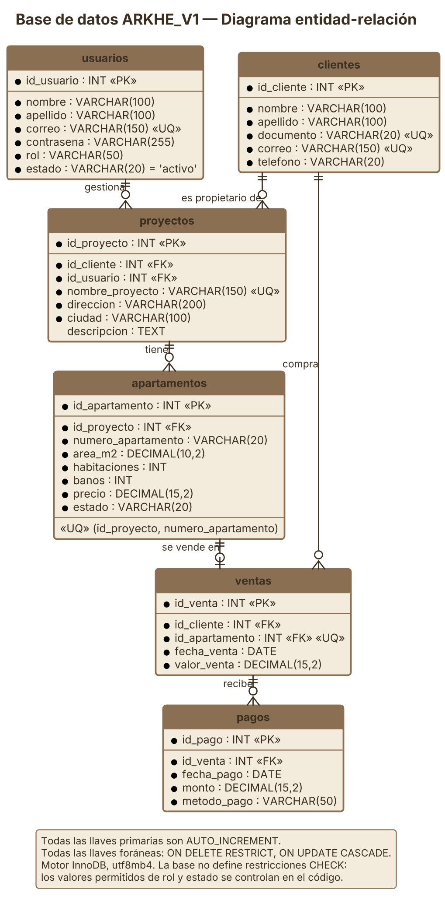

# Manual técnico

## Control del documento

| Dato | Valor |
|---|---|
| Código | ARKHE-MT-001 |
| Documento | Manual técnico |
| Versión | 1.0 |
| Fecha | 2026-11-14 |
| Elaborado por | Pedro Alba Méndez |

### Historial de cambios

| Versión | Fecha | Autor | Descripción |
|---|---|---|---|
| 1.0 | 2026-11-14 | Pedro Alba Méndez | Versión inicial. |

Explica cómo está construido el sistema por dentro: su arquitectura, su seguridad, la API, las pruebas y la instalación. Está dirigido a quien vaya a mantener o evaluar el código.

Documentos relacionados: el `README.md` de la raíz (uso e instalación paso a paso), el [diccionario de datos](diccionario_de_datos.md) (tablas y campos) y el [diagrama entidad-relación](diagrama_er.png), cuyo código fuente es `diagrama_er.puml`.

Todo lo que aquí se afirma se verificó el 2026-11-14 contra el código y la base de datos real.

## Contenido

1. [Visión general](#1-visión-general)
2. [Arquitectura](#2-arquitectura)
3. [Seguridad](#3-seguridad)
4. [API REST](#4-api-rest)
5. [Pruebas](#5-pruebas)
6. [Instalación](#6-instalación)
7. [Limitaciones conocidas](#7-limitaciones-conocidas)

## 1. Visión general

El sistema es una aplicación web de gestión inmobiliaria de propósito general, para empresas que comercializan apartamentos. No está atado a ninguna empresa en particular.

Cubre el ciclo **Cliente → Proyecto → Apartamento → Venta → Pago**, más la administración de usuarios. Ofrece los mismos datos de dos formas: pantallas HTML para las personas y una API REST en JSON para otros programas.

| Capa | Tecnología | Versión |
|---|---|---|
| Lenguaje | Python | 3.13 (el instalador acepta desde 3.10) |
| Servidor web | Flask | 3.1.3 |
| Acceso a datos | Flask-SQLAlchemy (ORM) | 3.1.1 |
| Driver de MySQL | PyMySQL, con `cryptography` | 1.2.0 / 50.0.2 |
| Protección CSRF | Flask-WTF (solo `CSRFProtect`) | 1.3.0 |
| Configuración | python-dotenv | 1.2.3 |
| Base de datos | MySQL | 8.4 |
| Interfaz | HTML con Jinja, CSS y JavaScript propios | Sin frameworks |
| Pruebas | pytest | 9.2.0 |

Las versiones están fijas en `requirements.txt` (ejecución) y `requirements-dev.txt` (agrega pytest).

## 2. Arquitectura

### 2.1 Capas

El código se organiza en cuatro partes, más la base de datos. Es una arquitectura sencilla, propia de una aplicación Flask de este tamaño.

| Parte | Carpeta | Qué hace realmente |
|---|---|---|
| Presentación | `templates/`, `static/` | Lo que ve la persona: plantillas Jinja, `arkhe.css` y `arkhe.js`. |
| Rutas | `routes/` | Reciben la petición, **validan los datos, aplican las reglas de negocio**, guardan con el ORM y responden con HTML o JSON. |
| Utilidades | `utils/` | Piezas compartidas: seguridad (sesión y permisos), validadores de formato, cifras del resumen y formato de valores. |
| Modelos | `models/` | Una clase por tabla (ORM), las listas de valores permitidos y los valores calculados, como el saldo y el estado de una venta. |
| Datos | MySQL | Las seis tablas de la base, con sus llaves y restricciones de unicidad. |

**No hay una capa de servicios.** La lógica de negocio no está separada en módulos propios: vive en los archivos de rutas. La pantalla y la API son dos entradas al mismo sistema, y la lógica se reparte entre ellas de dos maneras:

- **Lo que se comparte** está escrito una sola vez, en una función que usan las dos entradas. Aquí están todas las validaciones.
- **Lo que se repite** está escrito dos veces, una en la ruta de la pantalla y otra en la ruta de la API, porque ocurre después de validar, dentro de la propia ruta.

El detalle de qué cae en cada grupo está en [2.4](#24-blueprints). `routes/api.py` importa las funciones compartidas de los demás archivos de rutas, de modo que la API depende de los módulos de las pantallas.

Extraer la lógica a una capa de servicios (por ejemplo, `services/ventas.py` con `registrar_venta()` y `anular_venta()`, usada por la pantalla y por la API) eliminaría las repeticiones. Es una mejora futura: ver [Limitaciones conocidas](#7-limitaciones-conocidas).

Las seis tablas y sus relaciones:



Los clientes son personas naturales, registradas con nombre y apellido. El detalle de cada campo está en el [diccionario de datos](diccionario_de_datos.md).

`app.py` arma la aplicación y `config.py` lee la configuración del archivo `.env`.

### 2.2 Estructura de carpetas

```
ARKHE-software/
├── app.py                  create_app(): arma la aplicación
├── config.py               Configuración leída del .env
├── instalar.ps1            Instalador para Windows
├── requirements.txt        Dependencias de ejecución
├── requirements-dev.txt    Las anteriores más pytest
├── models/                 usuario, cliente, proyecto, apartamento, venta, pago
├── routes/                 auth, dashboard, clientes, usuarios, proyectos,
│                           apartamentos, ventas, pagos y api
├── utils/                  seguridad, validaciones, resumen, formato
├── templates/              base.html, _componentes.html y una carpeta por módulo
├── static/                 css/arkhe.css, js/arkhe.js, img/
├── scripts/                preparar_base, datos_demo, cambiar_contrasena
├── database/esquema.sql    Estructura de las seis tablas
├── tests/                  Pruebas con pytest
├── docs/                   Esta documentación y la colección de Postman
└── Mockups/                Diseños de referencia de la interfaz
```

### 2.3 La aplicación: `create_app()`

`app.py` usa el patrón *application factory*: una función, `create_app(clase_config)`, crea y devuelve la aplicación. Así las pruebas pueden crear una aplicación con otra configuración (una base temporal) sin tocar la real.

En orden, `create_app()` hace lo siguiente:

1. Carga la configuración y **se detiene si falta `SECRET_KEY`**.
2. Conecta el ORM (`db.init_app`).
3. Registra `exigir_sesion` para que corra antes de cada petición.
4. Pone a disposición de todas las plantillas `usuario_actual`, `puede(módulo, acción)` y `puede_cambiar_estado(cuenta)`.
5. Activa la protección CSRF para toda la aplicación.
6. Agrega las cabeceras de seguridad a cada respuesta.
7. Registra las páginas de error (400 de CSRF, 403, 404 y 500).
8. Registra los nueve blueprints y deja la API exenta del token CSRF.

### 2.4 Blueprints

Un *blueprint* es un grupo de rutas de Flask. Hay uno por módulo.

| Blueprint | Archivo | Prefijo | Qué atiende |
|---|---|---|---|
| `auth` | `routes/auth.py` | (ninguno) | `GET` y `POST /login`, `POST /logout`. |
| `dashboard` | `routes/dashboard.py` | (ninguno) | `/`: cifras generales y ventas de los últimos seis meses. |
| `clientes` | `routes/clientes.py` | `/clientes` | Listado y formularios de clientes. |
| `usuarios` | `routes/usuarios.py` | `/usuarios` | Listado y formularios de usuarios; activar y desactivar. |
| `proyectos` | `routes/proyectos.py` | `/proyectos` | Listado y formularios de proyectos. |
| `apartamentos` | `routes/apartamentos.py` | `/apartamentos` | Listado y formularios de apartamentos. |
| `ventas` | `routes/ventas.py` | `/ventas` | Listado y formularios de ventas. |
| `pagos` | `routes/pagos.py` | `/pagos` | Listado y formularios de pagos. |
| `api` | `routes/api.py` | `/api` | API REST en JSON de todos los módulos. |

En las pantallas, **toda acción que cambia datos es un `POST`** (crear, actualizar, eliminar, cambiar estado, cerrar sesión). Los `GET` solo consultan.

Dos convenciones del proyecto:

- Las plantillas se piden siempre con el prefijo del módulo, por ejemplo `render_template("ventas/lista.html")`. Los blueprints no declaran `template_folder`, porque los nombres de plantilla chocarían entre módulos.
- **Las validaciones se comparten entre la pantalla y la API.** Cada módulo tiene una función `validar_datos_*` en su archivo de rutas, y la API importa esa misma función. Lo que no es validación se repite en las dos rutas, como se detalla a continuación.

#### Qué se comparte y qué se repite

**Compartido: escrito una sola vez y usado por la pantalla y por la API.**

| Función | Archivo | Qué decide |
|---|---|---|
| `validar_datos_*` (una por módulo) | `routes/<módulo>.py` | Todas las validaciones de los datos: campos obligatorios, formatos, longitudes y unicidad. También las reglas que dependen de otros registros: que el apartamento esté disponible para la venta, que el pago no supere el saldo, las fechas de ventas y pagos, y que un apartamento vendido no cambie de proyecto ni de precio. |
| `venta_con_bloqueo` | `routes/pagos.py` | El bloqueo de la fila de la venta al validar un pago o editar una venta. |
| `aviso_estado_vendido` | `routes/apartamentos.py` | El aviso al pedir otro estado para un apartamento vendido. |
| `motivo_bloqueo_usuario` | `routes/usuarios.py` | Que nadie elimine o desactive su propia cuenta y que siempre quede un Administrador activo. |
| `autenticar` | `routes/auth.py` | El inicio de sesión. |
| `PERMISOS`, `rol_requerido`, `puede_cambiar_estado` | `utils/seguridad.py` | Qué puede hacer cada rol. |
| `calcular_resumen` | `utils/resumen.py` | Las cifras del dashboard y de `/api/resumen`. |
| Propiedades de los modelos | `models/` | Total pagado, saldo y estado de una venta; conteo de apartamentos de un proyecto. |

**Repetido: escrito dos veces, en la ruta de la pantalla y en la ruta de la API.**

| Regla | Dónde está cada copia |
|---|---|
| Al registrar una venta, el apartamento pasa a `vendido`. | `crear_venta` y `api_crear_venta` |
| Al cambiar el apartamento de una venta, el anterior queda `disponible` y el nuevo `vendido`. | `actualizar_venta` y `api_actualizar_venta` |
| No se elimina una venta con pagos; al eliminarla, el apartamento queda `disponible`. | `eliminar_venta` y `api_eliminar_venta` |
| No se elimina un proyecto con apartamentos. | `eliminar_proyecto` y `api_eliminar_proyecto` |
| No se elimina un apartamento con venta. | `eliminar_apartamento` y `api_eliminar_apartamento` |
| No se elimina un cliente con proyectos o ventas. | `eliminar_cliente` y `api_eliminar_cliente` |
| No se elimina un usuario que gestiona proyectos. | `eliminar_usuario` y `api_eliminar_usuario` |
| El mensaje cuando la base rechaza un dato único repetido (clientes y usuarios). | Las rutas de crear y actualizar de cada uno |

Las rutas de la pantalla están en `routes/<módulo>.py` y las de la API en `routes/api.py`. Quien cambie una regla de la segunda tabla debe cambiarla en los dos lugares. Las pruebas cubren todas estas reglas por la API (`tests/test_reglas.py`). Por la pantalla cubren tres: el cambio de apartamento de una venta, y la eliminación de un cliente y de un usuario con dependencias. Las demás copias de la pantalla (registrar y eliminar una venta, eliminar un proyecto o un apartamento) no tienen prueba propia, así que un cambio en ellas debe revisarse a mano.

### 2.5 Flujo de una petición

Ejemplo: un Vendedor registra un pago desde el formulario (`POST /pagos/crear`).

```
Navegador
   │  POST /pagos/crear  (cookie de sesión + csrf_token + datos)
   ▼
1. exigir_sesion          ¿Hay sesión de un usuario activo?
   │                      No → redirige a /login (en la API: 401)
   ▼
2. CSRFProtect            ¿El token del formulario es válido?
   │                      No → 400 "Formulario vencido"
   ▼
3. @rol_requerido         ¿El rol puede "editar" en "pagos"?
   │                      No → 403 "Acceso no permitido"
   ▼
4. crear_pago()           validar_datos_pago(): venta existente, fecha,
   │                      monto contra el saldo, método permitido
   │                      Con errores → vuelve al formulario con los mensajes
   ▼
5. Modelo Pago            El ORM inserta la fila en MySQL (commit)
   ▼
6. Respuesta              Mensaje flash de éxito y redirección al listado
   ▼
7. Cabeceras              Se agregan las cabeceras de seguridad (CSP, etc.)
   ▼
Navegador
```

Una petición a la API sigue el mismo camino con tres diferencias: no pasa por el token CSRF, recibe y devuelve JSON, y los rechazos son códigos HTTP (401, 403, 400, 404, 409) en lugar de redirecciones o páginas.

### 2.6 Interfaz

- `templates/base.html` es el diseño común: menú lateral, encabezado con el nombre y el rol del usuario, y el botón de cerrar sesión. Las demás plantillas lo extienden.
- `templates/_componentes.html` tiene macros reutilizables, entre ellas `alertas()` para los mensajes flash y `estado_vacio()` para las tablas sin registros.
- `static/js/arkhe.js` da el comportamiento a toda la interfaz: ventanas modales, confirmación antes de eliminar y cierre de mensajes. **Las plantillas no llevan JavaScript en línea**: cada elemento declara lo que necesita con un atributo `data-...` (por ejemplo, `data-confirmar="texto"`) y el archivo lo interpreta.
- El menú y los botones se muestran u ocultan según el rol con `puede(módulo, acción)`. Ocultar es solo comodidad: quien decide es el servidor.

## 3. Seguridad

Toda la lógica común está en `utils/seguridad.py`.

### 3.1 Contraseñas

Se guarda únicamente el hash, generado con `werkzeug.security.generate_password_hash`. Para comprobar una contraseña se usa `check_password_hash`. A partir del hash no se puede recuperar la contraseña original.

### 3.2 Inicio de sesión

La función `autenticar()` de `routes/auth.py` la usan la pantalla de login y `POST /api/login`, de modo que las reglas son las mismas en ambos.

- El inicio de sesión es por correo, sin distinguir mayúsculas de minúsculas.
- El mensaje es el mismo si el correo no existe o si la contraseña es incorrecta ("Correo o contraseña incorrectos."), para no revelar qué correos están registrados.
- Cuando el correo no existe, se compara de todos modos contra un hash de relleno, para que la respuesta tarde lo mismo.
- Un usuario inactivo no puede entrar.
- Tras iniciar sesión, la pantalla solo redirige a rutas internas: se rechaza cualquier dirección externa en el parámetro `next`.
- Cerrar sesión es un `POST`, no un enlace.

### 3.3 Sesión

Flask guarda la sesión en una cookie **firmada** con `SECRET_KEY`. Si alguien la altera, la firma no coincide y se descarta.

| Aspecto | Cómo está resuelto |
|---|---|
| Contenido de la cookie | Solo el ID del usuario. Nunca la contraseña ni el rol. |
| Lectura del usuario | En cada petición se consulta la base. Un usuario desactivado o eliminado pierde el acceso de inmediato. |
| `HttpOnly` | El JavaScript de la página no puede leer la cookie. |
| `SameSite=Lax` | El navegador no la envía en formularios `POST` que vengan de otro sitio. |
| Caducidad | Ocho horas. |
| `SECRET_KEY` | Solo se lee del `.env`. No hay valor por defecto en el código. |

`exigir_sesion` corre antes de **cada** petición. Solo tres destinos son públicos: la pantalla de login, `POST /api/login` y los archivos estáticos. Una ruta nueva queda protegida aunque nadie le ponga un decorador.

### 3.4 Roles y permisos

La matriz está en un solo lugar: el diccionario `PERMISOS`. Las acciones son `ver`, `editar` (crear y modificar), `eliminar` y `estado` (activar o desactivar, solo en usuarios).

| Módulo | Administrador | Vendedor | Gerente |
|---|---|---|---|
| Dashboard | Consulta | Consulta | Consulta |
| Clientes | Consulta, crea, edita y elimina | Consulta, crea y edita | Consulta |
| Proyectos | Consulta, crea, edita y elimina | Consulta | Consulta |
| Apartamentos | Consulta, crea, edita y elimina | Consulta | Consulta |
| Ventas | Consulta, crea, edita y elimina | Consulta, crea y edita | Consulta |
| Pagos | Consulta, crea, edita y elimina | Consulta, crea y edita | Consulta |
| Usuarios | Consulta, crea, edita, elimina, activa y desactiva | Sin acceso | Consulta; activa y desactiva solo cuentas de Vendedor |

Cómo se aplica:

- Cada ruta declara el permiso que exige con `@rol_requerido(módulo, acción)`. Sin sesión responde 401 (API) o redirige al login; con sesión pero sin permiso, 403.
- La regla del Gerente depende de la cuenta destino, así que no cabe en la matriz: la resuelve `puede_cambiar_estado()`, que se comprueba dentro de la ruta.
- La API usa los mismos decoradores, de modo que aplica la misma matriz.
- Una prueba (`test_pe01_todas_las_rutas_declaran_su_permiso`) recorre todas las rutas y falla si alguna quedó sin declarar su permiso.

Dos reglas adicionales protegen las cuentas (`motivo_bloqueo_usuario`, en `routes/usuarios.py`): nadie puede eliminar ni desactivar su propia cuenta, y el sistema nunca puede quedar sin un Administrador activo.

### 3.5 CSRF

Un ataque CSRF consiste en que otro sitio web envíe un formulario al sistema aprovechando la sesión abierta de la víctima.

- `CSRFProtect` (Flask-WTF) está activo para toda la aplicación. Cada formulario `POST` lleva un campo oculto `csrf_token`; si falta, venció o no coincide, la respuesta es 400 con la página "Formulario vencido".
- **La API está exenta** del token (`csrf.exempt(api_bp)`), porque no usa formularios HTML. Sigue exigiendo sesión y rol.

La exención es segura porque se cumplen tres condiciones a la vez:

| Condición | Cómo se cumple | Qué impide |
|---|---|---|
| La API solo acepta JSON | Toda petición con cuerpo debe declarar `Content-Type: application/json`. Si no, `_leer_json()` responde 400 y no se guarda nada, aunque el texto sea JSON válido. | Un formulario HTML de otro sitio solo puede enviar `application/x-www-form-urlencoded`, `multipart/form-data` o `text/plain`: los tres se rechazan. |
| No hay CORS | La aplicación no instala ninguna extensión de CORS ni envía cabeceras `Access-Control-*`. | El JavaScript de otro sitio no puede enviar JSON con la cookie ni leer las respuestas: el navegador lo bloquea. |
| Cookie `SameSite=Lax` | Configurada en `config.py`. | El navegador no adjunta la cookie de sesión en peticiones `POST`, `PUT` o `DELETE` iniciadas desde otro sitio. |

Si alguna vez se habilitara CORS o se aceptaran otros tipos de cuerpo en la API, habría que volver a protegerla con un token. Las pruebas SG-16 a SG-18 (`tests/test_seguridad.py`) fallan si alguna de las dos primeras condiciones deja de cumplirse.

### 3.6 CSP y cabeceras de seguridad

Cada respuesta lleva estas cabeceras:

| Cabecera | Valor | Para qué sirve |
|---|---|---|
| `Content-Security-Policy` | Ver abajo | Le dice al navegador de dónde puede cargar cada recurso. |
| `X-Frame-Options` | `DENY` | La aplicación no se puede incrustar en un `<iframe>`. |
| `X-Content-Type-Options` | `nosniff` | El navegador respeta el tipo de archivo que declara el servidor. |
| `Referrer-Policy` | `same-origin` | No se envía la dirección interna a otros sitios. |

Directivas de la política CSP:

| Directiva | Efecto |
|---|---|
| `default-src 'self'` | Por defecto, todo se carga solo desde el propio servidor. |
| `script-src 'self'` | Solo archivos `.js` propios. Se bloquean los `<script>` en línea y los `onclick`. |
| `style-src 'self' 'unsafe-inline'` | Hojas de estilo propias y atributos `style`. |
| `img-src 'self' data:` | Imágenes propias. |
| `object-src 'none'` | Sin complementos del navegador. |
| `base-uri 'self'`, `form-action 'self'` | Los formularios solo envían al propio servidor. |
| `frame-ancestors 'none'` | La aplicación no se incrusta en otro sitio. |

La CSP es una segunda barrera contra el XSS. La primera es que Jinja escapa todos los datos que se muestran.

### 3.7 Otras medidas

- **Inyección SQL:** todas las consultas de la aplicación pasan por el ORM, que envía los datos como parámetros.
- **Errores:** las páginas de error y las respuestas de la API no muestran detalles técnicos. Ante un error 500 se deshace la transacción en curso.
- **Modo depuración:** apagado por defecto. Solo se enciende con `FLASK_DEBUG=1` en el `.env`.
- **Secretos:** el `.env` no se sube al repositorio.
- **Concurrencia en pagos y ventas:** al crear o editar un pago, y al editar una venta, `venta_con_bloqueo()` (`routes/pagos.py`) lee la venta con `SELECT ... FOR UPDATE`. MySQL bloquea esa fila hasta el final de la transacción, de modo que una segunda petición sobre la misma venta espera y valida contra el saldo ya actualizado. Sin el bloqueo, dos pagos simultáneos podrían pasar la validación y superar entre los dos el valor de la venta. Los pagos de la venta se leen bajo el mismo bloqueo, porque en MySQL una lectura normal no vería lo que otra transacción acaba de confirmar.

## 4. API REST

Todas las rutas están bajo `/api`, en `routes/api.py`. Reciben y devuelven JSON.

Esta sección es el resumen. Los campos obligatorios y opcionales de cada recurso, un ejemplo de cuerpo, una respuesta típica y la estructura de los errores están en la [referencia de la API](api.md).

### 4.1 Autenticación

La API exige sesión. El primer paso es:

```
POST /api/login
{"correo": "...", "contrasena": "..."}
```

Si las credenciales son correctas, responde 200 con los datos del usuario y la cookie de sesión, que debe enviarse en las peticiones siguientes. Si no, responde 401.

### 4.2 Endpoints

Los seis recursos (`clientes`, `usuarios`, `proyectos`, `apartamentos`, `ventas`, `pagos`) tienen las mismas cinco operaciones:

| Método | Ruta | Acción | Permiso | Respuesta correcta |
|---|---|---|---|---|
| GET | `/api/<recurso>` | Listar | `ver` | 200 |
| GET | `/api/<recurso>/<id>` | Consultar uno | `ver` | 200 |
| POST | `/api/<recurso>` | Crear | `editar` | 201 |
| PUT | `/api/<recurso>/<id>` | Actualizar (se envían todos los campos) | `editar` | 200 |
| DELETE | `/api/<recurso>/<id>` | Eliminar | `eliminar` | 200 |

Rutas adicionales:

| Método | Ruta | Acción |
|---|---|---|
| POST | `/api/login` | Iniciar sesión. Es la única ruta que no exige sesión. |
| GET | `/api` | Índice de servicios. |
| GET | `/api/resumen` | Cifras del dashboard. |
| PUT | `/api/usuarios/<id>/estado` | Activar o desactivar un usuario: `{"estado": "activo"}` o `{"estado": "inactivo"}`. |

En total son 34 combinaciones de método y ruta.

Filtros de los listados:

| Ruta | Devuelve |
|---|---|
| `/api/apartamentos?estado=disponible` | Apartamentos en ese estado. |
| `/api/apartamentos?proyecto=<id>` | Apartamentos de un proyecto. |
| `/api/ventas?estado=en-pago` | Ventas en ese estado calculado. |
| `/api/pagos?venta=<id>` | Pagos de una venta. |

### 4.3 Respuestas

- Una venta incluye los valores calculados `total_pagado`, `saldo` y `estado`. Al consultarla por su ID trae además la lista de sus pagos.
- Un apartamento incluye `id_venta`, que es `null` si no se ha vendido.
- Al actualizar un apartamento vendido pidiendo otro estado, la respuesta sigue siendo 200: los demás campos se guardan, el estado se conserva en `vendido` y el cuerpo trae un campo adicional `aviso` con la explicación ("El estado de un apartamento vendido solo cambia al anular su venta…"). En la pantalla, el mismo texto aparece como mensaje informativo.
- Un usuario **nunca** incluye la contraseña, ni siquiera su hash.
- `GET /api/resumen` devuelve: `clientes`, `usuarios`, `proyectos`, `apartamentos` (conteo por estado), `ventas` (conteo por estado), `valor_vendido`, `recaudado` y `saldo_por_cobrar`. Sale de la misma función que usa el dashboard (`utils/resumen.py`), así que la pantalla y la API siempre coinciden.

### 4.4 Códigos de respuesta

| Código | Cuándo | Cuerpo |
|---|---|---|
| 200 | Consulta, actualización o eliminación correcta. | El registro o `{"mensaje": "..."}` |
| 201 | Registro creado. | El registro creado |
| 400 | El cuerpo no es un objeto JSON o los datos no pasan las validaciones. | `{"errores": ["...", "..."]}` |
| 401 | No hay sesión, o las credenciales del login son incorrectas. | `{"error": "..."}` |
| 403 | El rol no tiene permiso para la acción. | `{"error": "..."}` |
| 404 | El registro o la ruta no existe. | `{"error": "..."}` |
| 409 | La operación rompe una regla de negocio o un dato único ya existe. | `{"error": "..."}` |
| 500 | Error no previsto. | `{"error": "Error interno del servidor."}` |

Casos que responden 409:

- Eliminar un proyecto con apartamentos, un apartamento con venta, una venta con pagos, un cliente con proyectos o ventas, o un usuario que gestiona proyectos.
- Crear o actualizar un cliente con un documento o correo que ya existe, o un usuario con un correo que ya existe.
- Eliminar o desactivar la propia cuenta, o dejar el sistema sin un Administrador activo.

Los demás datos incorrectos responden 400 con la lista de errores. Esto incluye un nombre de proyecto repetido, un número de apartamento repetido dentro del proyecto, vender un apartamento que no está disponible, registrar un pago que supera el saldo o cambiar el proyecto o el precio de un apartamento vendido: todos se detectan en la validación.

También responde 400 una petición con cuerpo que no declara `Content-Type: application/json`.

## 5. Pruebas

### 5.1 pytest

```powershell
venv\Scripts\activate
pytest
```

Son **272 pruebas** y todas pasan (ejecución del 2026-11-14).

**No tocan la base real.** `tests/conftest.py` crea para cada prueba una aplicación con una base SQLite en memoria, que nace vacía y desaparece al terminar. Tres detalles de esa preparación:

- Se activa `PRAGMA foreign_keys=ON` para que SQLite rechace, como MySQL, borrar un registro del que dependen otros.
- SQLite no hace cumplir la longitud de `VARCHAR(n)`. Por eso las longitudes máximas se validan en el código Python y se prueban ahí.
- SQLite ignora `FOR UPDATE`. Las pruebas del bloqueo de pagos y ventas comprueban que la aplicación pide el bloqueo; la espera real entre dos transacciones solo ocurre en MySQL y no tiene prueba automática.
- El token CSRF se desactiva en las pruebas generales y se vuelve a activar en `tests/test_seguridad.py`, que prueba la protección misma.

| Archivo | Pruebas | Qué comprueba |
|---|---|---|
| `tests/test_validaciones.py` | 46 | Validadores y conversores de `utils/validaciones.py`. |
| `tests/test_formato.py` | 4 | Formato de pesos y de métodos de pago. |
| `tests/test_reglas.py` | 33 | Reglas de negocio de ventas, pagos y eliminaciones; cambio de apartamento al editar una venta; apartamento vendido (estado, proyecto y precio fijos); bloqueo de la venta al validar un pago o editar la venta. |
| `tests/test_auth.py` | 29 | Inicio y cierre de sesión, usuarios inactivos. |
| `tests/test_permisos.py` | 72 | La matriz de permisos en pantallas y API. |
| `tests/test_seguridad.py` | 29 | Token CSRF, mensajes de error, páginas de error, exigencia de JSON en la API y ausencia de CORS. |
| `tests/test_interfaz.py` | 33 | Confirmaciones, mensajes, estados vacíos, accesibilidad, CSP. |
| `tests/test_instalacion.py` | 26 | Esquema SQL, datos de demostración e instalador. |

### 5.2 Postman

`docs/ARKHE_API.postman_collection.json` prueba la API contra el servidor encendido y la base real. Tiene **36 peticiones y 37 pruebas**, en nueve carpetas: índice (con el inicio de sesión), clientes, usuarios, proyectos, apartamentos, ventas, pagos, reglas de negocio y limpieza.

1. Con el servidor encendido, importe el archivo en Postman.
2. En la pestaña **Variables** de la colección, escriba el correo y la contraseña de un Administrador activo en `correo_login` y `contrasena_login`, **solo en la columna "Current value"**. Ese valor no se exporta, así que ninguna contraseña queda en el repositorio.
3. Ejecute la colección completa con el *Runner*.

La primera petición inicia sesión y Postman conserva la cookie para las demás. La última carpeta elimina todo lo que la colección creó.

### 5.3 Criterio de aceptación

Un cambio no se da por terminado si `pytest` no pasa completo o si falla alguna petición de la colección. Si un cambio modifica el contrato de la API (rutas, cuerpos o códigos), la colección se actualiza en el mismo cambio.

## 6. Instalación

### 6.1 Requisitos

- Windows 10 u 11 con PowerShell.
- Python 3.10 o superior, agregado al PATH.
- MySQL 8 encendido y un usuario con permiso para crear bases de datos.

### 6.2 Instalación automática

```powershell
.\instalar.ps1
```

| Paso | Qué hace |
|---|---|
| 1 | Comprueba que haya Python 3.10 o superior. |
| 2 | Crea el entorno virtual `venv\`, o lo reutiliza si ya existe. |
| 3 | Instala las dependencias de `requirements-dev.txt`. |
| 4 | Ejecuta `scripts\preparar_base.py`. |

`scripts\preparar_base.py`, a su vez:

1. Lee el `.env` si existe; si no, pregunta los datos de conexión a MySQL y el nombre de la base.
2. Comprueba si esa base ya existe. **Si existe, se detiene y no cambia nada.**
3. Escribe el `.env` con una `SECRET_KEY` nueva, solo si no había `.env`.
4. Crea la base vacía y ejecuta `database/esquema.sql`.
5. Carga los datos de demostración.

El instalador nunca modifica ni borra una base existente y nunca sobrescribe un `.env`.

Si Windows bloquea el script:

```powershell
powershell -ExecutionPolicy Bypass -File .\instalar.ps1
```

### 6.3 Instalación manual

```powershell
python -m venv venv
venv\Scripts\activate
pip install -r requirements-dev.txt
python scripts\preparar_base.py
```

Para conectarse a una base que ya existe, copie `.env.example` como `.env` y complete los valores a mano.

### 6.4 Variables del archivo `.env`

| Variable | Obligatoria | Descripción |
|---|---|---|
| `DB_HOST` | No (por defecto `localhost`) | Servidor de MySQL. |
| `DB_PORT` | No (por defecto `3306`) | Puerto de MySQL. |
| `DB_USER` | No (por defecto `root`) | Usuario de MySQL. |
| `DB_PASSWORD` | No (por defecto vacía) | Contraseña de MySQL. |
| `DB_NAME` | No (por defecto `ARKHE_V1`) | Nombre de la base. |
| `SECRET_KEY` | **Sí** | Clave con la que se firma la sesión. Sin ella la aplicación no arranca. |
| `FLASK_DEBUG` | No (por defecto `0`) | `1` activa el modo depuración. Solo para desarrollo. |

Si un valor contiene `#`, debe ir entre comillas dobles.

**Los valores por defecto son solo para desarrollo local.** Existen para que el sistema arranque en el equipo de quien lo desarrolla, donde MySQL suele tener el usuario `root`. En un servidor de producción:

- Todas las variables se definen de forma explícita; no se depende de ningún valor por defecto.
- **No se usa `root`.** Se crea un usuario de MySQL propio para la aplicación, con una contraseña robusta y permisos mínimos: solo `SELECT`, `INSERT`, `UPDATE` y `DELETE` sobre la base del sistema. La aplicación no crea ni modifica tablas mientras funciona, así que no necesita más.
- El usuario con permiso para crear bases de datos solo hace falta durante la instalación (`scripts\preparar_base.py`).
- `FLASK_DEBUG` queda en `0` y `SECRET_KEY` es una clave propia de ese servidor.

Ejemplo de creación del usuario de la aplicación (lo ejecuta un administrador de MySQL; el nombre y la contraseña son ilustrativos):

```sql
CREATE USER 'arkhe_app'@'localhost' IDENTIFIED BY 'una-contraseña-robusta';
GRANT SELECT, INSERT, UPDATE, DELETE ON ARKHE_V1.* TO 'arkhe_app'@'localhost';
```

### 6.5 Iniciar el sistema

```powershell
venv\Scripts\activate
python app.py
```

Abra http://localhost:5000 e inicie sesión. Los usuarios de demostración están en el `README.md`.

### 6.6 Scripts de apoyo

| Comando | Para qué sirve |
|---|---|
| `python scripts\datos_demo.py` | Carga los datos de demostración. Solo funciona sobre una base vacía. |
| `python scripts\datos_demo.py --solo-usuarios` | Agrega únicamente los tres usuarios de demostración que falten. |
| `python scripts\cambiar_contrasena.py` | Restablece la contraseña de un usuario desde la consola. |

## 7. Limitaciones conocidas

- **Sin paginación.** Los listados cargan todos los registros; el buscador y los filtros trabajan en el navegador sobre lo ya cargado.
- **Sin límite de intentos de inicio de sesión.** No hay bloqueo tras varios intentos fallidos.
- **Sin recuperación de contraseña por correo.** La restablece un Administrador o el script `scripts\cambiar_contrasena.py`.
- **Sin historial de cambios.** Las tablas no registran quién creó o modificó cada dato ni cuándo.
- **El estado reservado no se restaura.** Al anular la venta de un apartamento que estaba reservado, queda disponible y no reservado; si debía seguir reservado, se cambia manualmente.
- **Sin capa de servicios.** Las reglas de negocio viven en las rutas y algunas están escritas dos veces, una para la pantalla y otra para la API (ver [2.1](#21-capas)). Extraerlas a una capa de servicios es una mejora futura.
- **Solo clientes persona natural.** Un cliente se registra con nombre y apellido. Los clientes empresa (razón social y NIT) son una mejora futura.
- **Métodos de pago.** Se guardan sin tilde ("Tarjeta de credito") y se muestran con tilde en pantalla; la API recibe y devuelve el valor sin tilde.
- **Servidor de desarrollo.** `python app.py` usa el servidor de Flask, pensado para desarrollo. Para un uso real haría falta un servidor de producción y HTTPS.
- **Instalador solo para Windows.** En otros sistemas se siguen los pasos de la instalación manual.
- **La cabecera CSP permite estilos en línea**, porque el gráfico del dashboard fija el tamaño de sus barras con el atributo `style`. Los scripts en línea sí están bloqueados.
