# Manual de usuario

## Control del documento

| Dato | Valor |
|---|---|
| Código | ARKHE-MU-001 |
| Documento | Manual de usuario |
| Versión | 1.0 |
| Fecha | 2026-11-16 |
| Elaborado por | Pedro Alba Méndez |

### Historial de cambios

| Versión | Fecha | Autor | Descripción |
|---|---|---|---|
| 1.0 | 2026-11-16 | Pedro Alba Méndez | Versión inicial. |

Explica cómo usar el sistema en el trabajo diario: entrar, moverse por las pantallas y registrar clientes, proyectos, apartamentos, ventas y pagos. Está dirigido a las personas que usan el sistema; no hace falta ningún conocimiento técnico.

Documentos relacionados: el [manual técnico](manual_tecnico.md), para quien instala o mantiene el sistema.

Las pantallas de ejemplo usan datos de demostración inventados: ninguna persona, documento o correo que aparezca en ellas es real.

## Contenido

1. [Introducción](#1-introducción)
2. [Acceso al sistema](#2-acceso-al-sistema)
3. [La interfaz](#3-la-interfaz)
4. [Roles: qué puede hacer cada persona](#4-roles-qué-puede-hacer-cada-persona)
5. [Dashboard](#5-dashboard)
6. [Clientes](#6-clientes)
7. [Proyectos](#7-proyectos)
8. [Apartamentos](#8-apartamentos)
9. [Ventas](#9-ventas)
10. [Pagos](#10-pagos)
11. [Usuarios](#11-usuarios)
12. [Ejemplo completo: de un cliente nuevo a una venta pagada](#12-ejemplo-completo-de-un-cliente-nuevo-a-una-venta-pagada)
13. [Mensajes frecuentes y qué significan](#13-mensajes-frecuentes-y-qué-significan)
14. [Preguntas frecuentes](#14-preguntas-frecuentes)

## 1. Introducción

El sistema es una aplicación web para empresas que venden apartamentos. Se usa desde el navegador (Chrome, Edge, Firefox u otro), en un computador o en un celular, y no hay que instalar nada en el equipo de cada persona.

Sirve para llevar en un solo lugar:

- **Clientes:** las personas que compran apartamentos o que son dueñas de un proyecto.
- **Proyectos:** los edificios o conjuntos que se comercializan.
- **Apartamentos:** las unidades de cada proyecto, con su precio y su estado (disponible, reservado o vendido).
- **Ventas:** qué apartamento compró cada cliente, cuándo y por cuánto.
- **Pagos:** los abonos que hace el cliente a su venta, hasta completar el valor.
- **Usuarios:** las personas que pueden entrar al sistema y lo que puede hacer cada una.

El trabajo sigue siempre el mismo orden:

**Cliente → Proyecto → Apartamento → Venta → Pagos**

Es decir: para registrar una venta deben existir antes el cliente y el apartamento, y para registrar un pago debe existir antes la venta. El [capítulo 12](#12-ejemplo-completo-de-un-cliente-nuevo-a-una-venta-pagada) recorre ese camino completo con un ejemplo.

El sistema hace varias cuentas por usted: calcula el saldo de cada venta, cambia el estado del apartamento cuando se vende y no deja registrar datos que no tienen sentido (por ejemplo, un pago mayor que lo que el cliente debe).

## 2. Acceso al sistema

### 2.1 Iniciar sesión

1. Abra el navegador y escriba la dirección que le indicó el administrador. En una instalación en el propio equipo es `http://localhost:5000`.
2. Escriba su **correo electrónico** y su **contraseña**.
3. Pulse **Iniciar sesión**.

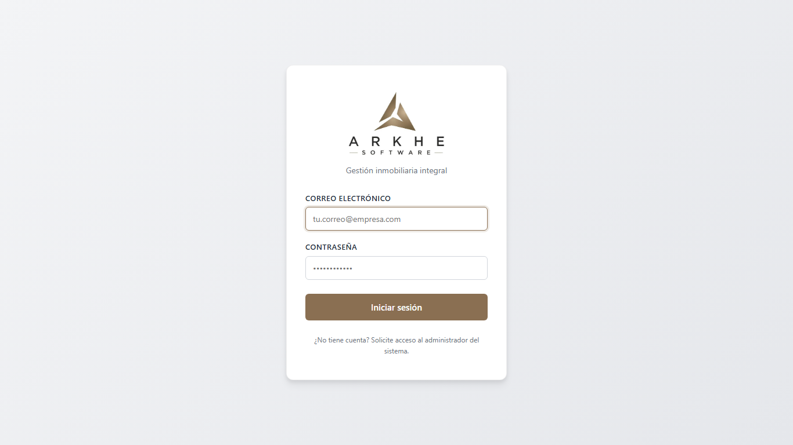

Si los datos son correctos, entra al Dashboard. Si no, la pantalla muestra uno de estos mensajes:

| Mensaje | Qué pasó | Qué hacer |
|---|---|---|
| Correo o contraseña incorrectos. | El correo no está registrado o la contraseña no coincide. Por seguridad, el sistema no dice cuál de los dos falló. | Revise que el correo esté bien escrito y que no tenga activadas las mayúsculas. |
| Su cuenta está inactiva. Comuníquese con el administrador. | Su cuenta fue desactivada. | Pida a un Administrador que la active de nuevo. |

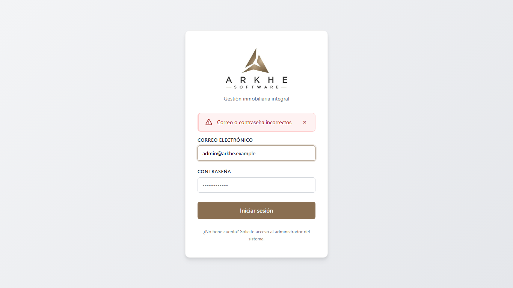

No hay registro libre: las cuentas las crea un Administrador. Si no tiene cuenta, solicítela.

### 2.2 Cerrar sesión

Pulse el botón **Cerrar sesión**, arriba a la derecha. El sistema vuelve a la pantalla de inicio de sesión con el mensaje *"Sesión cerrada correctamente."*

Cierre siempre la sesión al terminar, sobre todo en un equipo compartido.

### 2.3 Duración de la sesión

La sesión se cierra sola después de **8 horas sin usar el sistema** (una jornada de trabajo). Cada vez que abre una pantalla, el plazo vuelve a empezar.

Cuando la sesión se vence, al pulsar cualquier opción el sistema lo lleva a la pantalla de inicio de sesión. Entre de nuevo y volverá a la página que estaba consultando. Si estaba llenando un formulario, tendrá que escribirlo otra vez.

La sesión también termina de inmediato si un Administrador desactiva o elimina su cuenta.

### 2.4 Si olvida la contraseña

El sistema **no envía correos para recuperar la contraseña** y la pantalla de inicio no tiene la opción "olvidé mi contraseña". Para recuperar el acceso:

1. Avise a un Administrador.
2. El Administrador entra a **Usuarios**, pulsa **Editar** en su cuenta, escribe una contraseña nueva en el campo **Nueva contraseña** y guarda (ver [11.3](#113-editar-un-usuario-y-cambiar-su-contraseña)).
3. Entre con la contraseña nueva que le entreguen.

Si quien olvidó la contraseña es el único Administrador, debe restablecerla la persona encargada del soporte técnico, con el procedimiento del manual técnico.

Nadie puede ver la contraseña actual de otra persona, ni siquiera un Administrador: solo se puede reemplazar por una nueva.

## 3. La interfaz

Todas las pantallas, salvo la de inicio de sesión, tienen las mismas partes.

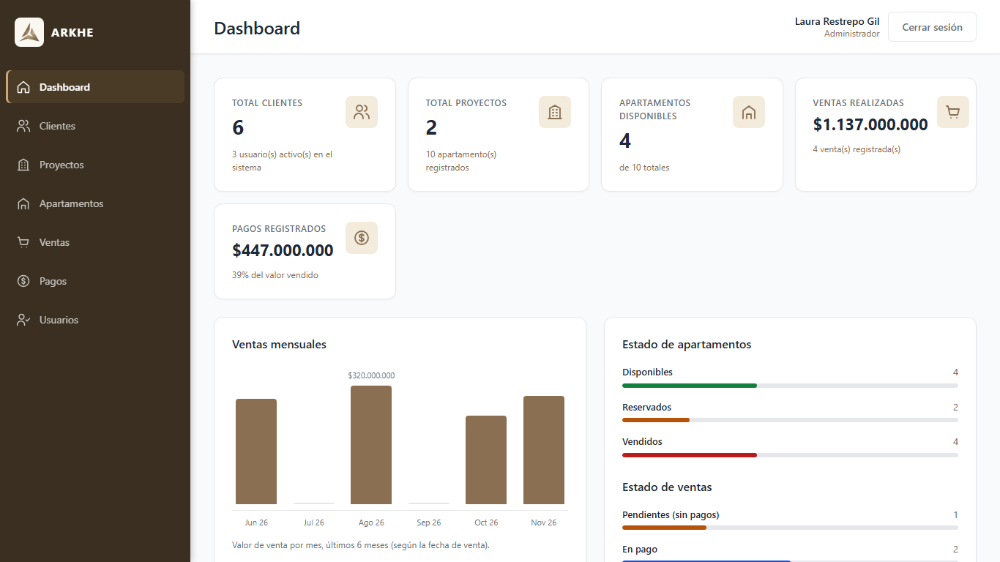

### 3.1 Menú lateral

Está a la izquierda. Cada opción abre un módulo: **Dashboard, Clientes, Proyectos, Apartamentos, Ventas, Pagos** y **Usuarios**. La opción del módulo donde usted está aparece resaltada.

El menú solo muestra los módulos que su rol puede consultar. Por ejemplo, un Vendedor no ve la opción Usuarios.

Al pulsar el logo, arriba del menú, se vuelve al Dashboard.

### 3.2 Encabezado

Es la franja superior. Muestra:

- El **título** de la pantalla actual (por ejemplo, *Gestión de Clientes*).
- Su **nombre** y su **rol**.
- El botón **Cerrar sesión**.

### 3.3 Listados, buscador y filtros

Cada módulo abre con un listado en forma de tabla. Encima de la tabla están:

- El botón para **crear** un registro nuevo (por ejemplo, **+ Nuevo Cliente**), si su rol lo permite.
- El **buscador**: escriba cualquier parte de un dato (un nombre, un número, una ciudad) y la tabla muestra solo las filas que lo contienen. Filtra mientras escribe; no hay que pulsar ningún botón.
- En algunos módulos, **listas para filtrar** por estado, proyecto, método de pago o rol. Se pueden combinar con el buscador.

Debajo de la tabla, el texto *"Mostrando X de Y"* indica cuántas filas se ven con la búsqueda actual. Si nada coincide, aparece *"Ningún registro coincide con la búsqueda o los filtros."* Para volver a ver todo, borre el buscador y deje los filtros en "Todos".

En la última columna, **Acciones**, están los botones de cada fila: **Editar**, **Eliminar** y otros propios de cada módulo. Si su rol solo puede consultar, en algunos módulos aparece el texto *"Solo consulta"* en lugar de los botones.

### 3.4 Formularios

Para crear o editar se llena un formulario. Tenga en cuenta:

- En Clientes y Usuarios **todos los campos son obligatorios**. En los demás módulos, los obligatorios llevan un asterisco (**\***).
- Si deja vacío un campo obligatorio o escribe algo con un formato que no corresponde, el navegador señala el campo y no envía el formulario.
- Los valores en dinero se escriben **sin puntos ni comas de miles**: `285000000`, no `285.000.000`. El sistema los muestra después con el formato `$285.000.000`.
- Las fechas se eligen en el calendario del campo. En los listados se muestran como día/mes/año.
- El botón **Cancelar** vuelve al listado sin guardar nada.

### 3.5 Mensajes

Después de cada acción, el sistema muestra un mensaje en la parte superior del contenido:

| Color | Significado | Ejemplo |
|---|---|---|
| Verde | La acción se hizo. | Cliente 'Valentina Rojas Pineda' creado correctamente. |
| Rojo | La acción **no** se hizo. El mensaje explica por qué. | El monto supera el saldo pendiente de la venta ($292.000.000). |
| Azul | Aviso o información. | Sesión cerrada correctamente. |

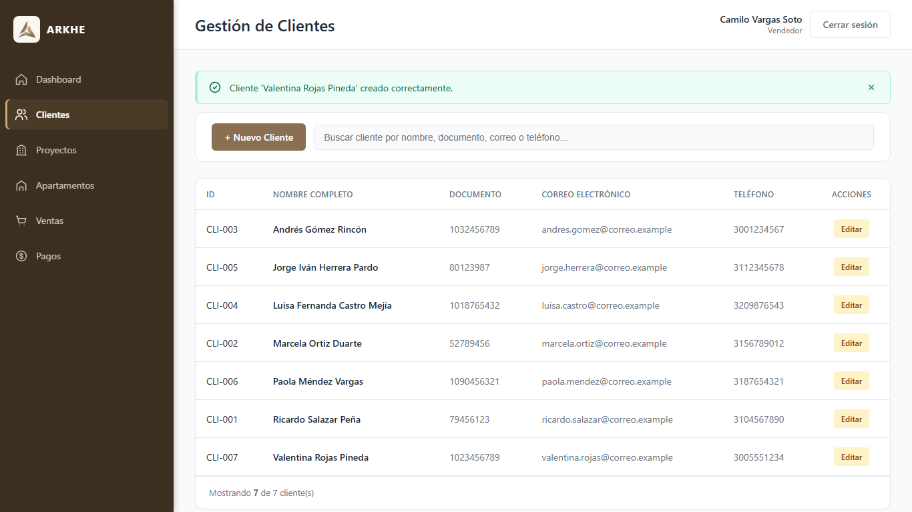

Un mensaje se cierra con la **×** de su derecha. Si hay varios errores a la vez, aparece un mensaje por cada uno. Cuando hay un error, lo que usted escribió casi siempre se conserva para que solo corrija lo que falló.

### 3.6 Confirmación al eliminar

Al pulsar **Eliminar**, el sistema no borra de inmediato: abre una ventana que pregunta, por ejemplo, *"¿Eliminar a Paola Méndez Vargas?"* y advierte *"Esta acción no se puede deshacer."*

- **Eliminar** confirma y borra el registro.
- **Cancelar**, la **×**, la tecla **Esc** o un clic fuera de la ventana la cierran sin borrar nada.

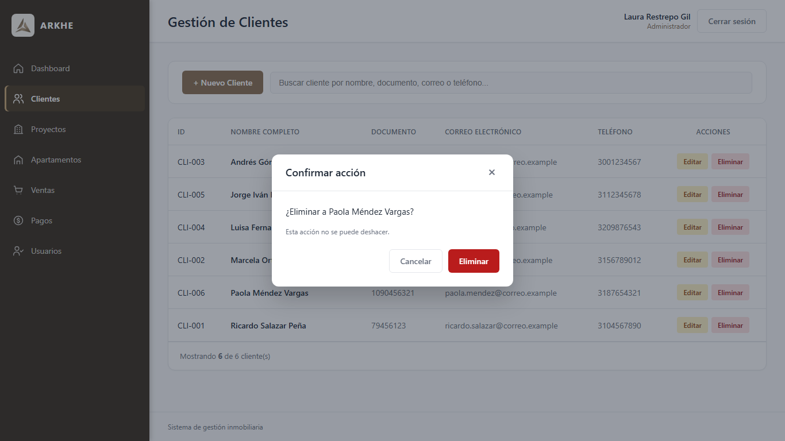

Lo eliminado no se puede recuperar. Además, el sistema impide eliminar un registro del que dependen otros; cada capítulo explica esos casos.

### 3.7 Uso en celular

El sistema se adapta a pantallas pequeñas:

- El menú lateral se oculta. Para abrirlo, toque el botón de las **tres rayas** (☰), arriba a la izquierda. Se cierra al tocar fuera del menú.
- En pantallas muy angostas, el encabezado deja de mostrar su nombre y su rol; el botón **Cerrar sesión** sigue visible.
- Los formularios pasan a una sola columna y los botones ocupan todo el ancho.
- Si una tabla no cabe, **deslícela con el dedo hacia los lados** para ver las demás columnas.

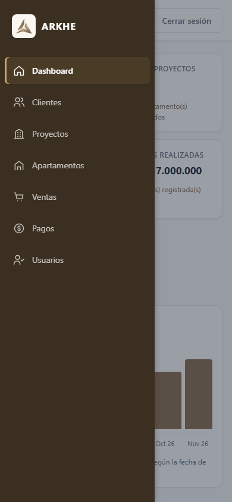

## 4. Roles: qué puede hacer cada persona

Cada cuenta tiene un rol, que decide qué módulos ve y qué puede hacer en ellos. Su rol aparece en el encabezado, debajo de su nombre.

- **Administrador:** tiene acceso completo.
- **Vendedor:** atiende clientes y registra ventas y pagos.
- **Gerente:** consulta toda la información para hacer seguimiento; no la modifica.

| Módulo | Administrador | Vendedor | Gerente |
|---|---|---|---|
| Dashboard | Consulta | Consulta | Consulta |
| Clientes | Consulta, crea, edita y elimina | Consulta, crea y edita | Consulta |
| Proyectos | Consulta, crea, edita y elimina | Consulta | Consulta |
| Apartamentos | Consulta, crea, edita y elimina | Consulta | Consulta |
| Ventas | Consulta, crea, edita y elimina | Consulta, crea y edita | Consulta |
| Pagos | Consulta, crea, edita y elimina | Consulta, crea y edita | Consulta |
| Usuarios | Consulta, crea, edita, activa, desactiva y elimina | Sin acceso | Consulta; activa y desactiva solo cuentas de Vendedor |

En resumen:

- **Eliminar es exclusivo del Administrador**, en todos los módulos.
- El sistema solo muestra los botones que su rol puede usar. Si no ve un botón que aparece en este manual, su rol no tiene ese permiso.
- Si intenta abrir una página que su rol no permite, aparece la pantalla *"Acceso no permitido"* (ver [capítulo 13](#13-mensajes-frecuentes-y-qué-significan)).

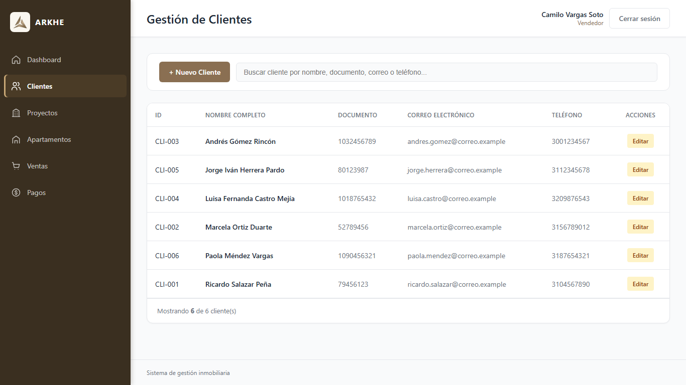

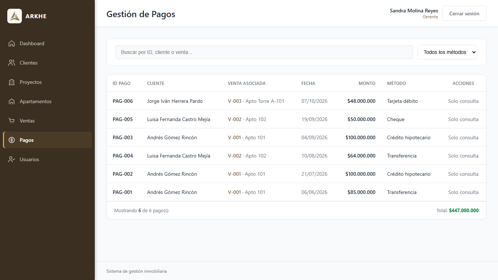

## 5. Dashboard

**Para qué sirve:** es la pantalla de inicio. Resume el estado del negocio de un vistazo. Solo se consulta: aquí no se crea ni se modifica nada. Lo ven los tres roles.

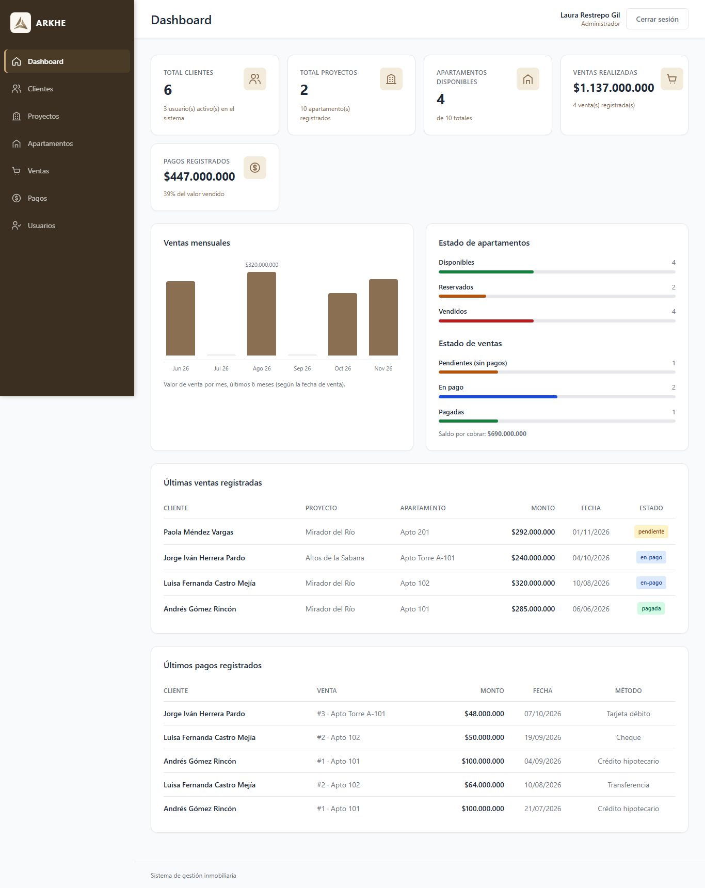

De arriba hacia abajo muestra:

**Tarjetas de resumen.** Al pulsar una tarjeta se abre el módulo correspondiente.

| Tarjeta | Qué indica |
|---|---|
| Total clientes | Cuántos clientes hay registrados. Debajo, cuántos usuarios activos tiene el sistema. |
| Total proyectos | Cuántos proyectos hay y cuántos apartamentos suman entre todos. |
| Apartamentos disponibles | Cuántos apartamentos se pueden vender todavía, del total. |
| Ventas realizadas | La suma del valor de todas las ventas y cuántas ventas son. |
| Pagos registrados | La suma de todo el dinero recibido y qué porcentaje del valor vendido representa. |

**Ventas mensuales.** Un gráfico de barras con el valor vendido en cada uno de los últimos seis meses, según la fecha de cada venta. Al pasar el cursor sobre una barra se ve el valor del mes y el número de ventas.

**Estado de apartamentos.** Cuántos están disponibles, reservados y vendidos.

**Estado de ventas.** Cuántas ventas están pendientes (sin ningún pago), en pago (con abonos, pero con saldo) y pagadas. Debajo aparece el **saldo por cobrar**: lo que falta por recibir entre todas las ventas.

**Últimas ventas registradas** y **Últimos pagos registrados.** Las cinco ventas y los cinco pagos más recientes.

Todas las cifras se calculan en el momento con los datos reales. Para actualizarlas, recargue la página.

## 6. Clientes

**Para qué sirve:** guarda los datos de las personas con las que trabaja la empresa. Un cliente puede ser **comprador** de un apartamento, **propietario o promotor** de un proyecto, o las dos cosas.

Los clientes son personas: se registran con nombre y apellido. El sistema no maneja clientes empresa.

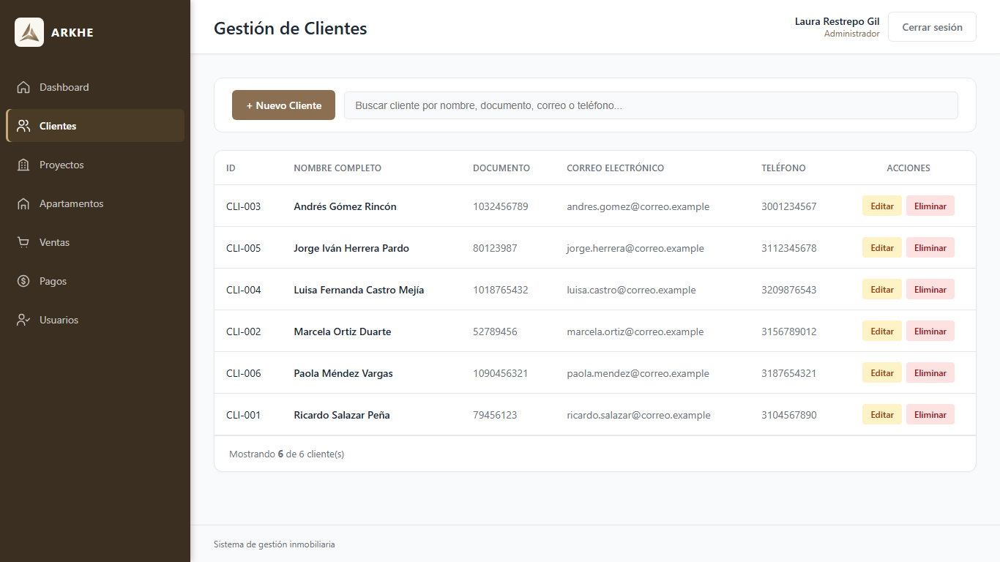

### 6.1 Crear un cliente

*Roles: Administrador y Vendedor.*

1. En el menú, pulse **Clientes**.
2. Pulse **+ Nuevo Cliente**. Se abre una ventana sobre el listado.
3. Llene los campos y pulse **Guardar cliente**.

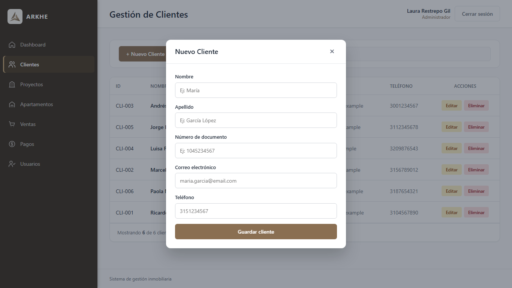

Todos los campos son obligatorios:

| Campo | Qué acepta |
|---|---|
| Nombre | Solo letras y espacios. Máximo 100 caracteres. |
| Apellido | Solo letras y espacios. Máximo 100 caracteres. |
| Número de documento | Solo números, entre 6 y 15 dígitos. Sin puntos ni espacios. |
| Correo electrónico | Una dirección con formato válido, como `nombre@correo.com`. Máximo 150 caracteres. |
| Teléfono | Solo números, entre 7 y 15 dígitos. Sin espacios ni guiones. |

Si algún dato no cumple, la ventana sigue abierta, muestra los errores en rojo y conserva lo que escribió.

### 6.2 Editar un cliente

*Roles: Administrador y Vendedor.*

1. En la fila del cliente, pulse **Editar**.
2. Cambie los datos y pulse **Guardar cambios**.

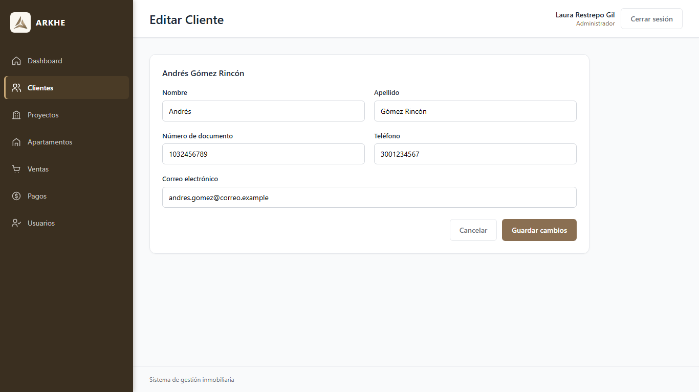

Se aplican las mismas reglas que al crear.

### 6.3 Buscar un cliente

Escriba en el buscador parte del nombre, del documento, del correo o del teléfono.

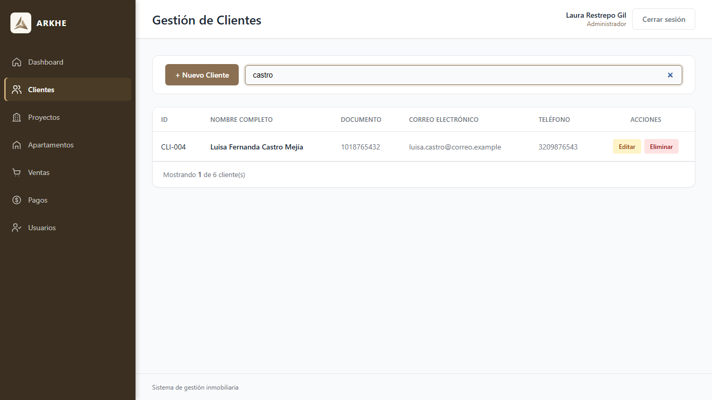

### 6.4 Eliminar un cliente

*Rol: Administrador.*

Pulse **Eliminar** en la fila del cliente y confirme.

### 6.5 Reglas del sistema

- **No puede haber dos clientes con el mismo documento ni con el mismo correo.** Si lo intenta, verá *"Ya existe un cliente registrado con ese documento o correo."*
- **Un cliente que tiene proyectos o ventas no se puede eliminar.** Verá *"No se puede eliminar: el cliente tiene proyectos o ventas asociados."* Sus datos sí se pueden editar.

## 7. Proyectos

**Para qué sirve:** registra los edificios o conjuntos que se comercializan. Cada proyecto agrupa sus apartamentos, tiene un **propietario o promotor** (un cliente) y un **usuario gestor** (la persona de la empresa responsable del proyecto).

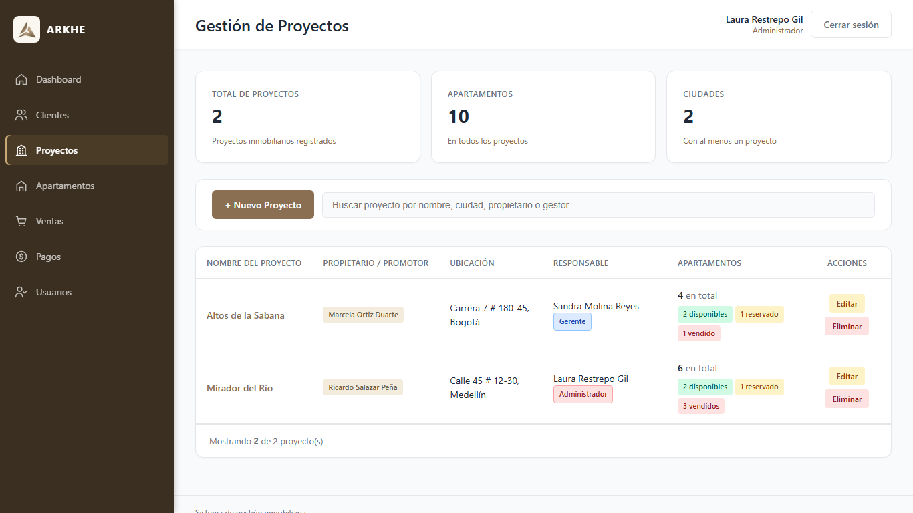

Arriba hay tres tarjetas: el total de proyectos, el total de apartamentos y el número de ciudades. En la tabla, la columna **Apartamentos** muestra cuántos tiene cada proyecto y cuántos están disponibles, reservados y vendidos.

El Vendedor y el Gerente ven *"Solo consulta"* en la columna Acciones.

### 7.1 Crear un proyecto

*Rol: Administrador.*

Antes de empezar, deben existir el cliente propietario (capítulo 6) y el usuario gestor (capítulo 11).

1. En el menú, pulse **Proyectos**.
2. Pulse **+ Nuevo Proyecto**.
3. Llene el formulario y pulse **Crear proyecto**.

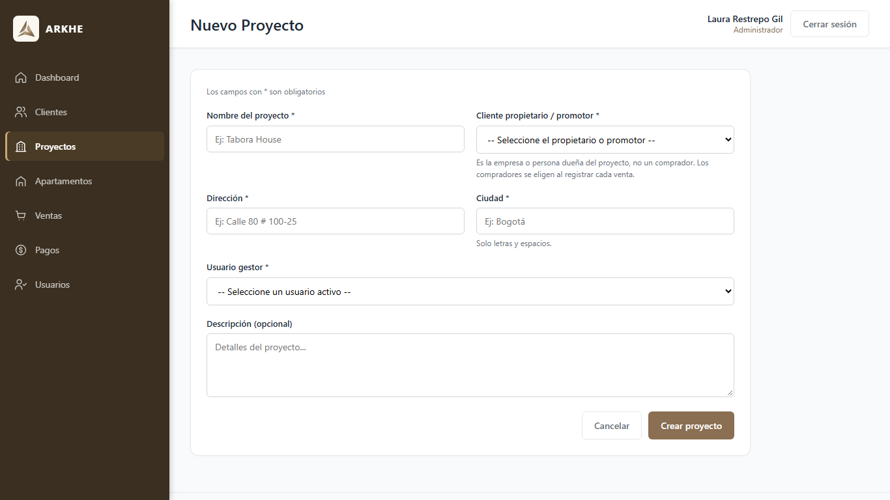

| Campo | Obligatorio | Qué acepta |
|---|---|---|
| Nombre del proyecto | Sí | Texto de hasta 150 caracteres. No se puede repetir. |
| Cliente propietario / promotor | Sí | Se elige de la lista de clientes. Es el dueño del proyecto, **no** un comprador: los compradores se eligen al registrar cada venta. |
| Dirección | Sí | Texto de hasta 200 caracteres. |
| Ciudad | Sí | Solo letras y espacios. Máximo 100 caracteres. |
| Usuario gestor | Sí | Se elige de la lista de usuarios **activos**. |
| Descripción | No | Texto libre con detalles del proyecto. |

### 7.2 Editar un proyecto

*Rol: Administrador.*

Pulse **Editar** en la fila del proyecto, cambie los datos y pulse **Guardar cambios**.

### 7.3 Buscar un proyecto

Escriba en el buscador parte del nombre, de la ciudad, del propietario o del gestor.

### 7.4 Eliminar un proyecto

*Rol: Administrador.*

Pulse **Eliminar** en la fila del proyecto y confirme.

### 7.5 Reglas del sistema

- **No puede haber dos proyectos con el mismo nombre.** Verá *"Ya existe un proyecto con este nombre."*
- **El gestor debe ser un usuario activo.** Si el gestor de un proyecto fue desactivado, al editar el proyecto tendrá que elegir otro.
- **Un proyecto que tiene apartamentos no se puede eliminar.** Verá *"No se puede eliminar: el proyecto tiene apartamentos registrados. Elimine primero sus apartamentos."*

## 8. Apartamentos

**Para qué sirve:** registra las unidades de cada proyecto, con sus características, su precio y su estado.

Un apartamento está en uno de tres estados:

| Estado | Significado | Quién lo asigna |
|---|---|---|
| Disponible | Se puede vender. | El Administrador, al crear o editar el apartamento. |
| Reservado | Un cliente lo apartó. Todavía se puede vender. | El Administrador, al crear o editar el apartamento. |
| Vendido | Tiene una venta registrada. | **El sistema**, al registrar la venta. No se asigna a mano. |

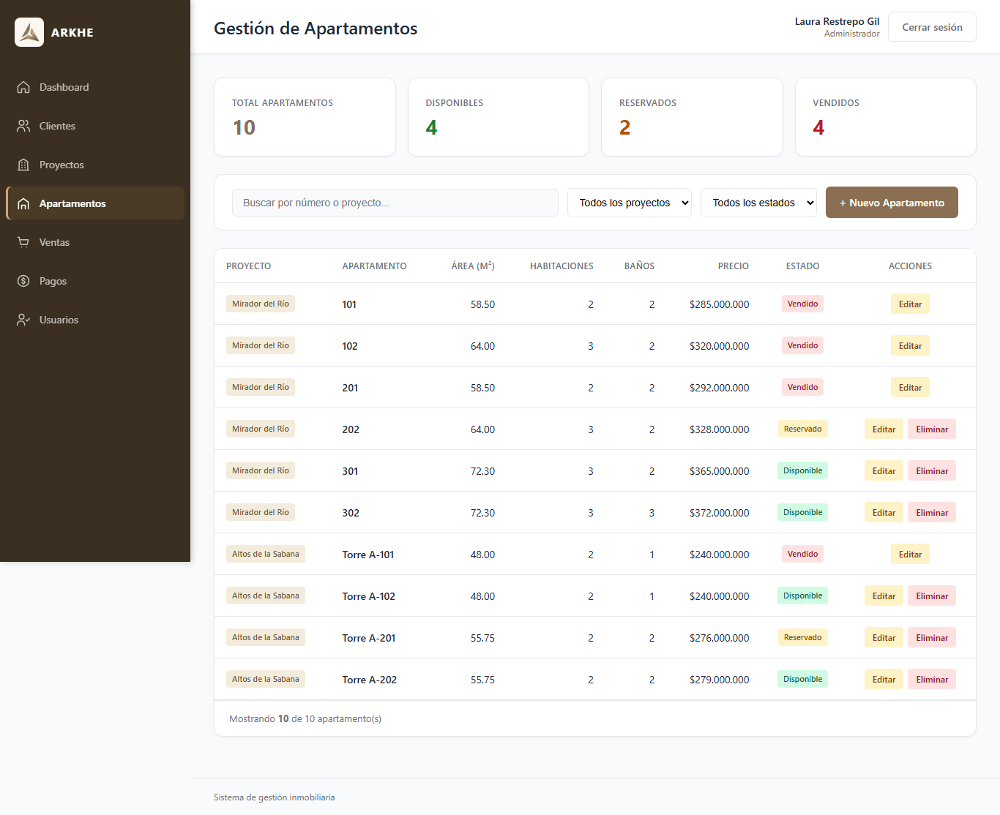

Arriba hay cuatro tarjetas: el total de apartamentos y cuántos hay en cada estado.

### 8.1 Crear un apartamento

*Rol: Administrador.*

Antes de empezar, debe existir el proyecto (capítulo 7).

1. En el menú, pulse **Apartamentos**.
2. Pulse **+ Nuevo Apartamento**.
3. Llene el formulario y pulse **Crear apartamento**.

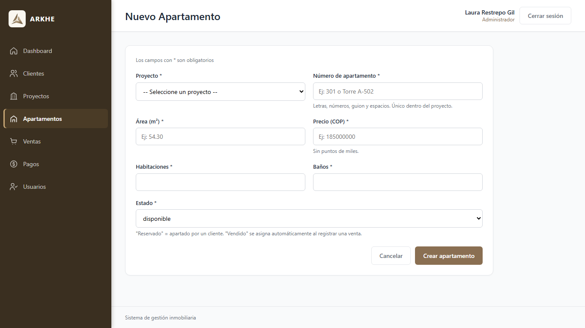

Todos los campos son obligatorios:

| Campo | Qué acepta |
|---|---|
| Proyecto | Se elige de la lista de proyectos. |
| Número de apartamento | Letras, números, guion y espacios, hasta 20 caracteres. Ejemplos: `301`, `Torre A-502`. No se puede repetir dentro del mismo proyecto. |
| Área (m²) | Un número mayor que 0 y hasta 9999.99. Los decimales se escriben con punto: `54.30`. |
| Precio (COP) | Un número mayor que 0, sin puntos de miles: `185000000`. |
| Habitaciones | Un número entero entre 1 y 10. |
| Baños | Un número entero entre 1 y 10. |
| Estado | Disponible o reservado. |

### 8.2 Editar un apartamento

*Rol: Administrador.*

Pulse **Editar** en la fila del apartamento, cambie los datos y pulse **Guardar cambios**.

Si el apartamento ya está **vendido**, el formulario lo indica: el estado aparece fijo, con el número de la venta, y bajo los campos Proyecto y Precio hay una nota que dice que no se pueden cambiar.

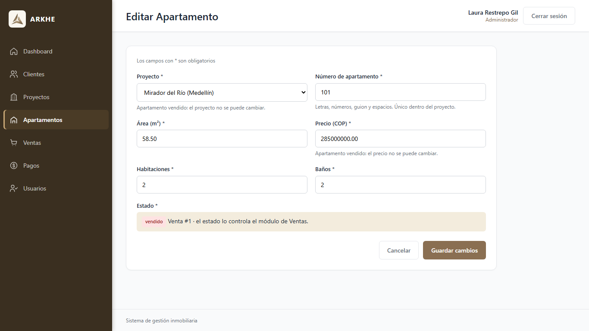

### 8.3 Buscar un apartamento

Tiene tres herramientas, que se pueden combinar:

- El **buscador**, por número de apartamento o nombre del proyecto.
- La lista **Todos los proyectos**, para ver solo los de un proyecto.
- La lista **Todos los estados**, para ver solo los disponibles, los reservados o los vendidos.

### 8.4 Eliminar un apartamento

*Rol: Administrador.*

Pulse **Eliminar** en la fila del apartamento y confirme. Los apartamentos vendidos no tienen el botón Eliminar.

### 8.5 Reglas del sistema

- **El número no se repite dentro de un proyecto.** Verá *"Ya existe el apartamento '301' en ese proyecto."* Dos proyectos distintos sí pueden tener cada uno su apartamento 301.
- **Un apartamento vendido no cambia de proyecto ni de precio**, porque son los datos con los que se hizo la venta. Verá *"Un apartamento vendido no puede cambiar de precio. Para corregirlo, anule primero su venta."* (o el mensaje equivalente para el proyecto). El número, el área, las habitaciones y los baños sí se pueden corregir.
- **El estado "vendido" lo controla el módulo de Ventas.** Un apartamento pasa a vendido al registrar su venta, y deja de estarlo solo al eliminar esa venta.
- **Un apartamento con venta no se puede eliminar.** Primero habría que eliminar la venta.

## 9. Ventas

**Para qué sirve:** registra qué apartamento compró cada cliente, en qué fecha y por qué valor. A partir de la venta se reciben los pagos.

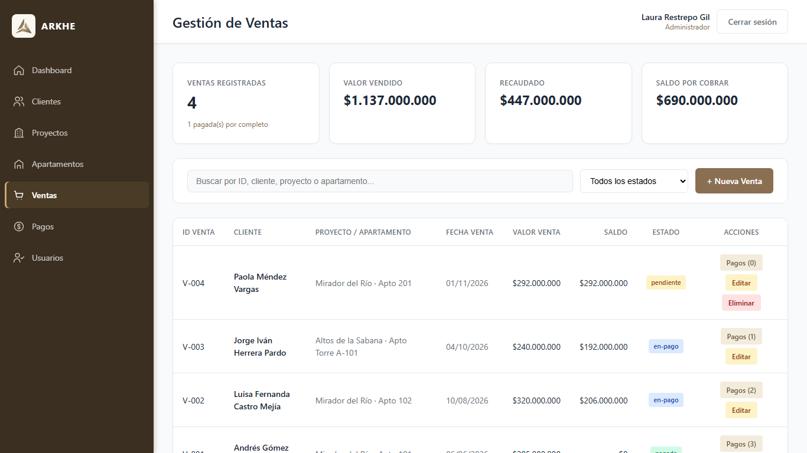

Arriba hay cuatro tarjetas: el número de ventas (y cuántas están pagadas por completo), el **valor vendido**, lo **recaudado** y el **saldo por cobrar**.

En la tabla, cada venta muestra su **saldo** (lo que falta por pagar) y su **estado**. El estado no se escribe: el sistema lo calcula con los pagos recibidos.

| Estado | Significado |
|---|---|
| pendiente | La venta todavía no tiene ningún pago. |
| en-pago | Hay abonos, pero queda saldo. |
| pagada | Los pagos completan el valor de la venta: el saldo es $0. |

En la columna Acciones, el botón **Pagos (n)** abre los pagos de esa venta; el número entre paréntesis indica cuántos tiene. Lo ven todos los roles.

### 9.1 Registrar una venta

*Roles: Administrador y Vendedor.*

Antes de empezar, deben existir el cliente comprador (capítulo 6) y un apartamento disponible o reservado (capítulo 8).

1. En el menú, pulse **Ventas**.
2. Pulse **+ Nueva Venta**.
3. Llene el formulario y pulse **Registrar venta**.

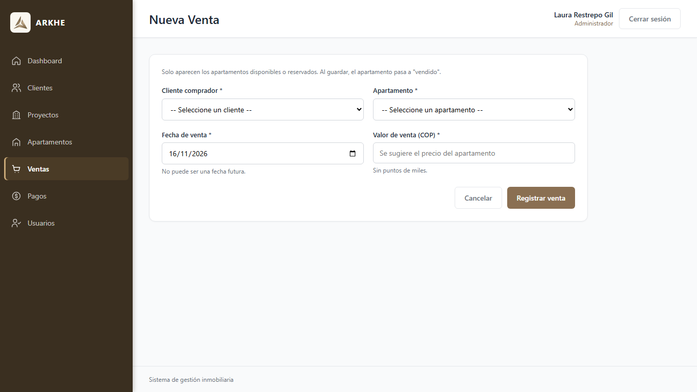

Todos los campos son obligatorios:

| Campo | Qué acepta |
|---|---|
| Cliente comprador | Se elige de la lista de clientes. |
| Apartamento | Se elige de la lista. **Solo aparecen los disponibles y los reservados**, con su proyecto y su precio. |
| Fecha de venta | Viene con la fecha de hoy. Se puede cambiar por una anterior, pero no por una futura. |
| Valor de venta (COP) | Un número mayor que 0, sin puntos de miles. Al elegir el apartamento, el sistema propone su precio si el campo está vacío; puede cambiarlo si se acordó otro valor. |

Al guardar, **el apartamento pasa automáticamente a "vendido"** y la venta queda en estado pendiente, lista para recibir pagos.

Si no hay ningún apartamento disponible o reservado, en lugar del formulario aparece el aviso *"No hay apartamentos disponibles o reservados para vender."*

### 9.2 Editar una venta

*Roles: Administrador y Vendedor.*

Pulse **Editar** en la fila de la venta, cambie los datos y pulse **Guardar cambios**. Bajo el campo del valor, el formulario recuerda cuánto se ha pagado ya.

Si cambia el apartamento de la venta, el anterior vuelve a quedar **disponible** y el nuevo pasa a **vendido**.

### 9.3 Buscar una venta

- El **buscador**, por número de venta, cliente, proyecto o apartamento.
- La lista **Todos los estados**, para ver solo las pendientes, las que están en pago o las pagadas.

### 9.4 Eliminar una venta

*Rol: Administrador.*

Pulse **Eliminar** en la fila de la venta y confirme. La ventana de confirmación recuerda que el apartamento volverá a estar disponible. Las ventas que ya tienen pagos no muestran el botón Eliminar.

### 9.5 Reglas del sistema

- **Un apartamento se vende una sola vez.** Los vendidos no aparecen en la lista. Si alguien más lo vendió mientras usted llenaba el formulario, verá *"El apartamento '301' no está disponible para la venta."*
- **La fecha de venta no puede ser futura.**
- **Al editar, el valor no puede quedar por debajo de lo ya pagado.** Verá *"El valor de venta no puede ser menor que lo ya pagado por el cliente."*
- **Al editar, la fecha no puede quedar después del primer pago.** Verá *"La fecha de venta no puede ser posterior al primer pago registrado."*
- **Una venta con pagos no se puede eliminar.** Un Administrador tendría que eliminar primero sus pagos.
- **Al eliminar una venta, el apartamento queda "disponible"**, aunque antes de venderse estuviera reservado. Si debe seguir reservado, un Administrador lo cambia a mano en Apartamentos.

## 10. Pagos

**Para qué sirve:** registra el dinero que el cliente entrega para pagar su venta. Cada pago es un **abono ya recibido** (no una cuota programada a futuro): reduce el saldo de la venta y, cuando el saldo llega a cero, la venta queda pagada.

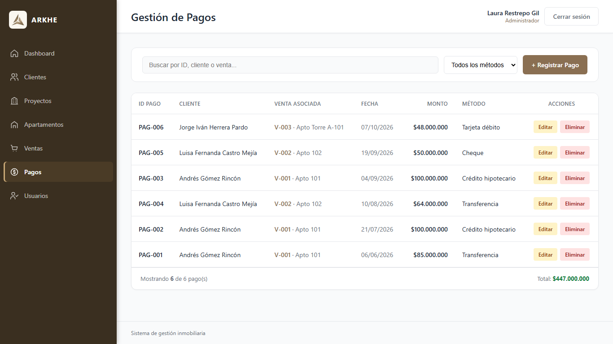

Debajo de la tabla, a la derecha, aparece el **total** de los pagos que se están mostrando.

### 10.1 Ver los pagos de una venta

Hay dos caminos:

- En **Ventas**, pulse **Pagos (n)** en la fila de la venta.
- En **Pagos**, pulse el número de la venta (por ejemplo, **V-002**) en la columna *Venta asociada*.

La pantalla muestra entonces solo los pagos de esa venta y, arriba, un resumen: el cliente, el apartamento, el **valor**, lo **pagado**, el **saldo** y el estado. El botón **Ver todos los pagos** vuelve al listado completo.

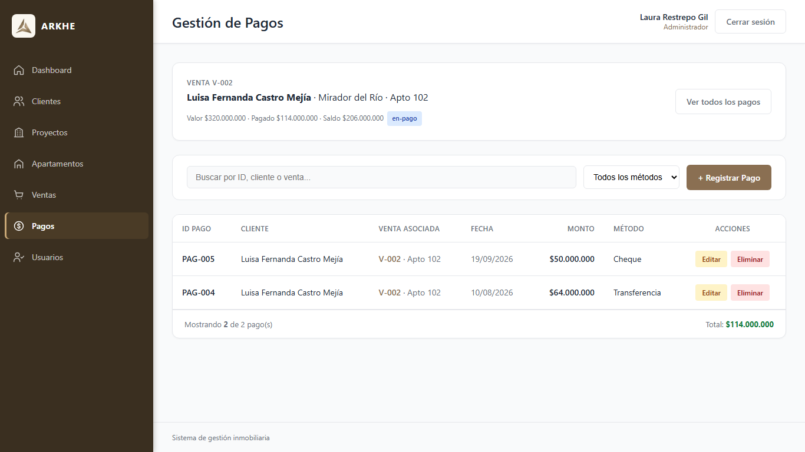

### 10.2 Registrar un pago

*Roles: Administrador y Vendedor.*

Antes de empezar, debe existir la venta (capítulo 9).

1. En el menú, pulse **Pagos** y luego **+ Registrar Pago**. Si lo hace desde los pagos de una venta ([10.1](#101-ver-los-pagos-de-una-venta)), esa venta ya viene elegida.
2. Llene el formulario y pulse **Registrar pago**.

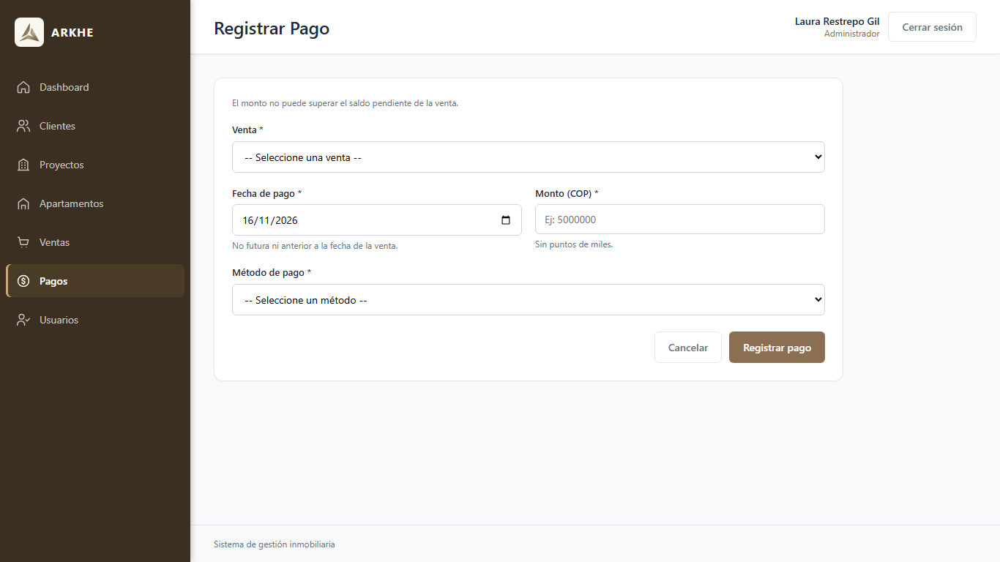

Todos los campos son obligatorios:

| Campo | Qué acepta |
|---|---|
| Venta | Se elige de la lista. **Solo aparecen las ventas que todavía tienen saldo**; cada una muestra el cliente, el apartamento y el saldo. |
| Fecha de pago | Viene con la fecha de hoy. No puede ser futura ni anterior a la fecha de la venta. |
| Monto (COP) | Un número mayor que 0, sin puntos de miles. No puede superar el saldo de la venta. |
| Método de pago | Efectivo, Transferencia, Tarjeta de crédito, Tarjeta débito, Cheque o Crédito hipotecario. |

Al guardar, el sistema vuelve al listado de todos los pagos. El saldo y el estado de la venta se actualizan solos.

Si no queda ninguna venta con saldo, en lugar del formulario aparece el aviso *"No hay ventas con saldo pendiente."*

### 10.3 Editar un pago

*Roles: Administrador y Vendedor.*

Pulse **Editar** en la fila del pago, corrija los datos y pulse **Guardar cambios**. Se aplican las mismas reglas que al registrar.

### 10.4 Buscar un pago

- El **buscador**, por número de pago, cliente o venta.
- La lista **Todos los métodos**, para ver solo los pagos hechos con un método.

### 10.5 Eliminar un pago

*Rol: Administrador.*

Pulse **Eliminar** en la fila del pago y confirme. El saldo de la venta vuelve a subir en ese monto y su estado se recalcula.

### 10.6 Reglas del sistema

- **Un pago no puede superar el saldo de la venta.** Si lo intenta, el mensaje indica cuánto es el saldo: *"El monto supera el saldo pendiente de la venta ($292.000.000)."*
- **La fecha no puede ser futura** ni **anterior a la fecha de la venta.**
- **El método debe ser uno de la lista.**
- **Una venta pagada no recibe más pagos:** deja de aparecer en la lista del formulario.

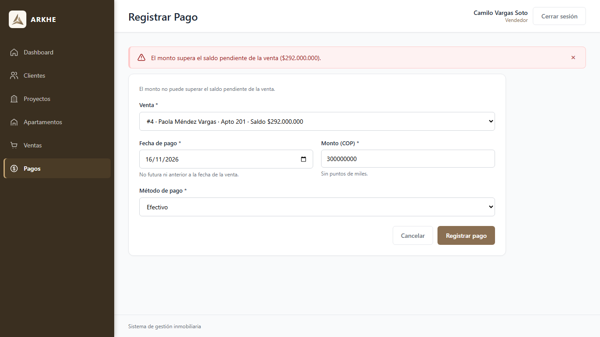

## 11. Usuarios

**Para qué sirve:** administra las cuentas de las personas que entran al sistema: quiénes son, qué rol tienen y si su cuenta está activa.

*El Administrador hace todo en este módulo. El Gerente lo consulta y puede activar o desactivar cuentas de Vendedor. El Vendedor no tiene acceso.*

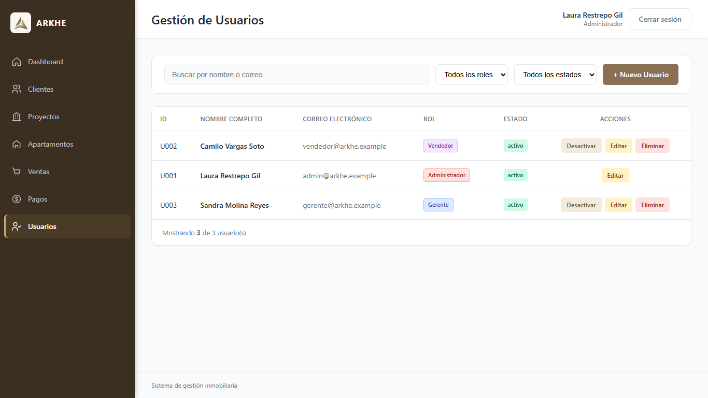

Cada cuenta tiene un **estado**:

- **activo:** la persona puede iniciar sesión.
- **inactivo:** la persona no puede iniciar sesión, pero su cuenta y su historial se conservan.

### 11.1 Crear un usuario

*Rol: Administrador.*

1. En el menú, pulse **Usuarios**.
2. Pulse **+ Nuevo Usuario**. Se abre una ventana sobre el listado.
3. Llene los campos y pulse **Guardar usuario**.

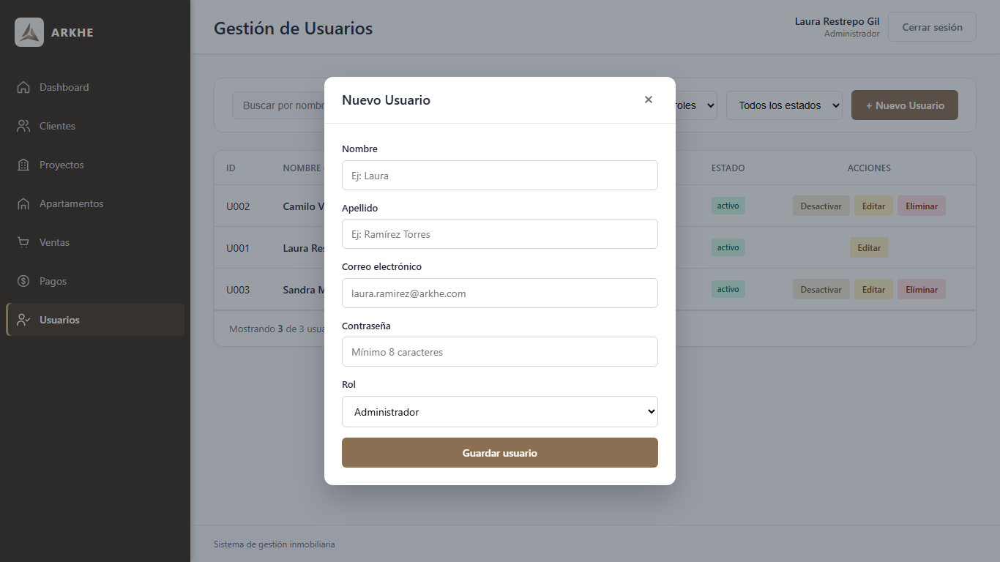

Todos los campos son obligatorios:

| Campo | Qué acepta |
|---|---|
| Nombre | Solo letras y espacios. Máximo 100 caracteres. |
| Apellido | Solo letras y espacios. Máximo 100 caracteres. |
| Correo electrónico | Una dirección con formato válido. Es el dato con el que la persona inicia sesión. No se puede repetir. |
| Contraseña | Mínimo 8 caracteres, sin espacios al principio ni al final. |
| Rol | Administrador, Gerente o Vendedor (ver [capítulo 4](#4-roles-qué-puede-hacer-cada-persona)). |

La cuenta nueva queda **activa**. Entregue el correo y la contraseña a la persona por un medio seguro.

Si hay un error, la ventana conserva lo escrito, excepto la contraseña: por seguridad, hay que escribirla otra vez.

### 11.2 Activar o desactivar un usuario

*Roles: Administrador (cualquier cuenta) y Gerente (solo cuentas de Vendedor).*

En la fila del usuario, pulse **Desactivar** o **Activar**. Al desactivar, el sistema pide confirmación y recuerda que la persona no podrá iniciar sesión hasta que se active de nuevo.

Desactivar es la forma recomendada de retirar el acceso a alguien que ya no trabaja en la empresa: surte efecto de inmediato, aunque la persona tenga la sesión abierta, y se puede revertir.

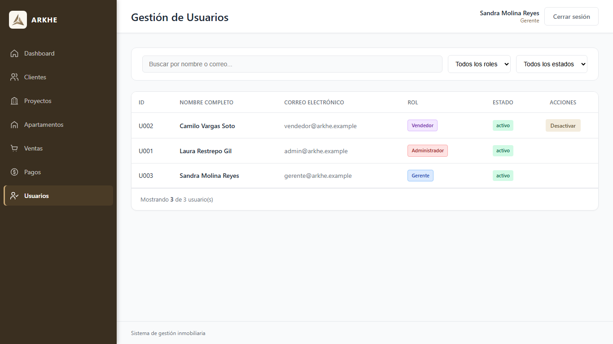

### 11.3 Editar un usuario y cambiar su contraseña

*Rol: Administrador.*

1. Pulse **Editar** en la fila del usuario.
2. Cambie lo necesario: nombre, apellido, correo, rol o estado.
3. Para cambiar la contraseña, escriba la nueva en **Nueva contraseña**. **Si deja ese campo en blanco, la contraseña actual se conserva.**
4. Pulse **Guardar cambios**.

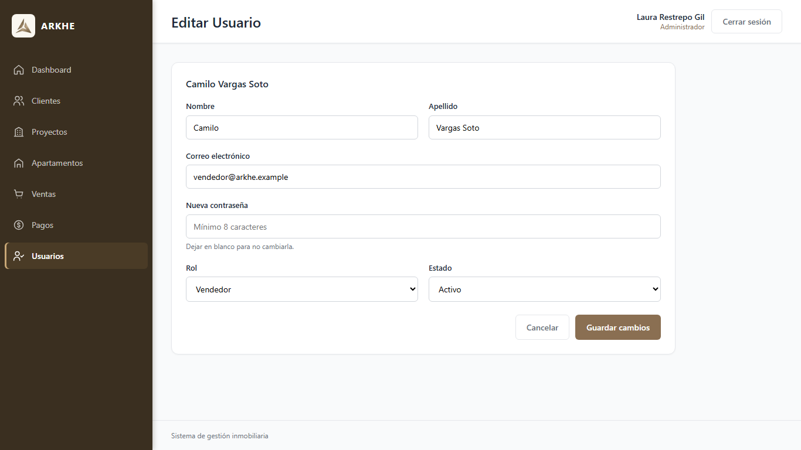

### 11.4 Buscar un usuario

- El **buscador**, por nombre o correo.
- Las listas **Todos los roles** y **Todos los estados**.

### 11.5 Eliminar un usuario

*Rol: Administrador.*

Pulse **Eliminar** en la fila del usuario y confirme. Su propia cuenta no muestra los botones Eliminar ni Desactivar.

### 11.6 Reglas del sistema

- **No puede haber dos usuarios con el mismo correo.** Verá *"Ya existe un usuario registrado con ese correo."*
- **Nadie puede eliminar ni desactivar su propia cuenta.**
- **El sistema nunca queda sin un Administrador activo.** Al último Administrador activo no se le puede eliminar, desactivar ni cambiar el rol. Verá *"No se permite: el sistema quedaría sin ningún Administrador activo."*
- **Un usuario que es gestor de algún proyecto no se puede eliminar.** Verá *"No se puede eliminar: el usuario gestiona proyectos. Puede desactivarlo."* Para eliminarlo, asigne antes otro gestor a esos proyectos.

## 12. Ejemplo completo: de un cliente nuevo a una venta pagada

Este ejemplo recorre el camino completo con los datos de demostración. Lo puede hacer un **Vendedor** o un **Administrador**.

**La situación:** Valentina Rojas Pineda compra el apartamento **301** del proyecto **Mirador del Río**, que vale **$365.000.000**. Paga en tres abonos: $65.000.000, $150.000.000 y $150.000.000.

**Antes de empezar** deben existir el proyecto y el apartamento, que crea un Administrador (capítulos 7 y 8). En los datos de demostración ya existen, y el apartamento 301 está *disponible*.

### Paso 1. Registrar al cliente

1. Entre a **Clientes** y pulse **+ Nuevo Cliente**.
2. Escriba: nombre `Valentina`, apellido `Rojas Pineda`, documento `1023456789`, correo `valentina.rojas@correo.example`, teléfono `3005551234`.
3. Pulse **Guardar cliente**.

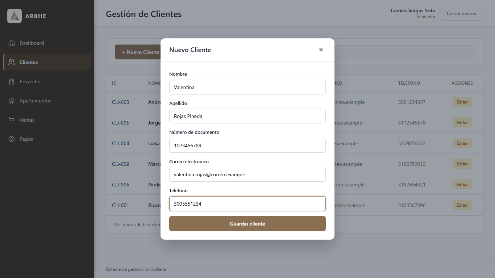

Aparece el mensaje verde *"Cliente 'Valentina Rojas Pineda' creado correctamente."* y el cliente queda en el listado.

### Paso 2. Registrar la venta

1. Entre a **Ventas** y pulse **+ Nueva Venta**.
2. En **Cliente comprador**, elija a Valentina Rojas Pineda.
3. En **Apartamento**, elija *Mirador del Río · Apto 301 · $365.000.000*. El campo **Valor de venta** se llena solo con `365000000`.
4. Deje la fecha de hoy.
5. Pulse **Registrar venta**.

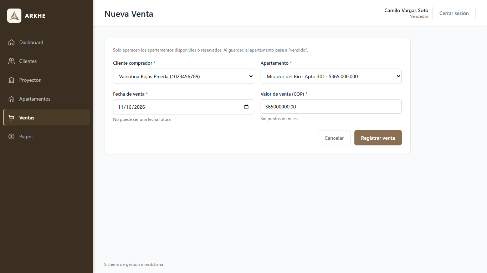

Aparece *"Venta del apartamento '301' registrada correctamente."* En el listado, la venta nueva tiene saldo **$365.000.000** y estado **pendiente**. Si consulta Apartamentos, el 301 ahora está **vendido**.

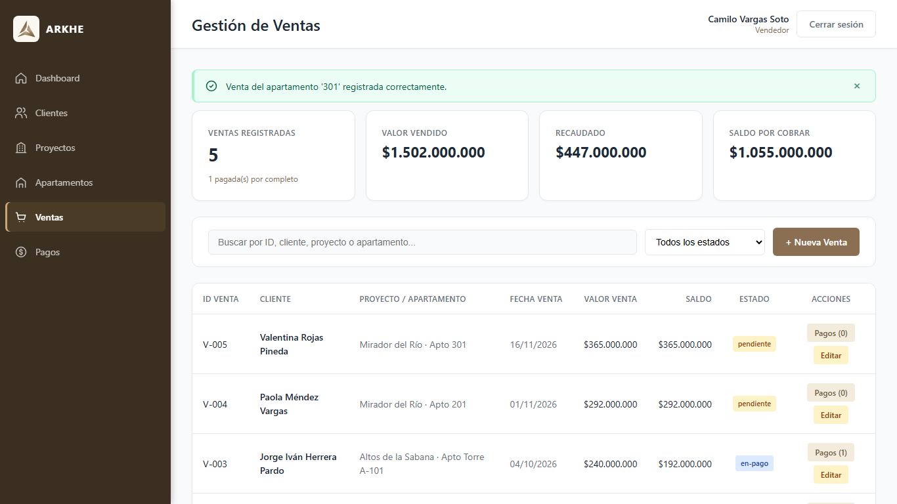

### Paso 3. Registrar el primer pago

1. En el listado de **Ventas**, pulse **Pagos (0)** en la fila de la venta de Valentina.
2. Pulse **+ Registrar Pago**. La venta ya viene elegida.
3. Escriba el monto `65000000`, elija el método **Transferencia** y deje la fecha de hoy.
4. Pulse **Registrar pago**.

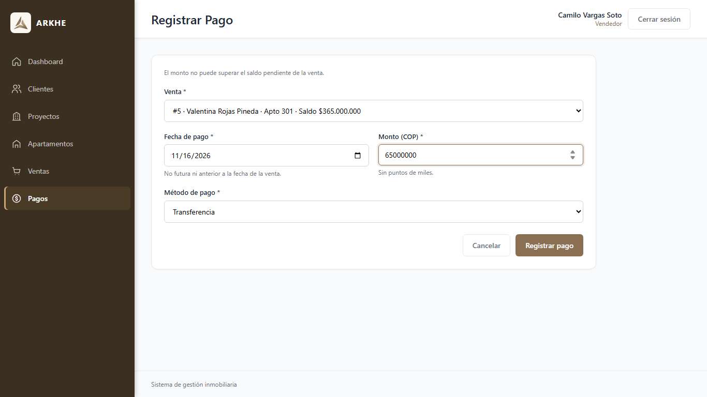

Aparece el mensaje verde que confirma el pago de $65.000.000. Vuelva a los pagos de la venta (**Ventas → Pagos (1)**): el resumen muestra *Pagado $65.000.000 · Saldo $300.000.000* y el estado **en-pago**.

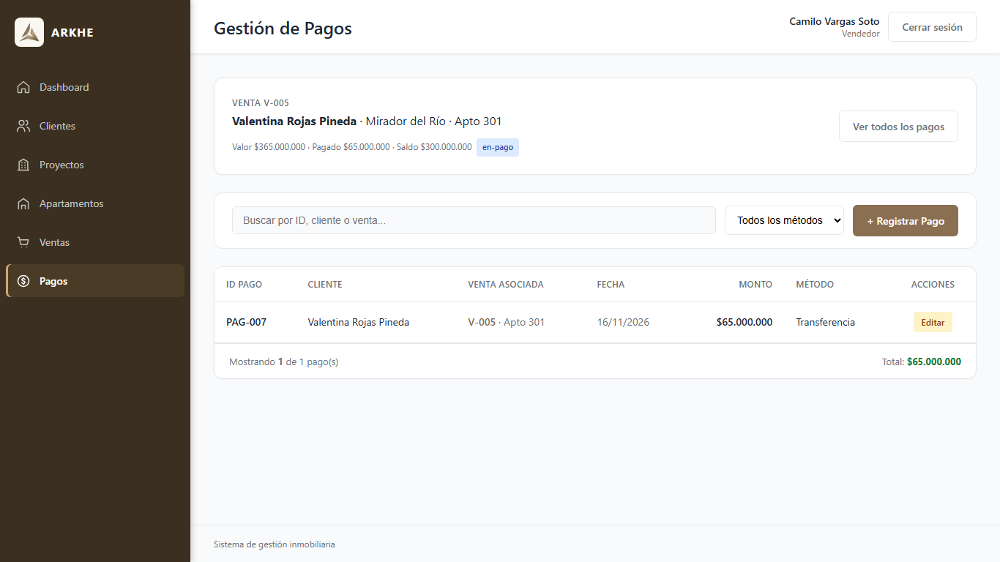

### Paso 4. Completar los pagos

Repita el paso 3 dos veces más, cuando el cliente entregue cada abono:

| Pago | Monto | Método | Saldo que queda |
|---|---|---|---|
| Segundo | `150000000` | Crédito hipotecario | $150.000.000 |
| Tercero | `150000000` | Crédito hipotecario | $0 |

Si en el tercer pago escribiera un monto mayor que $150.000.000, el sistema lo rechazaría y le recordaría el saldo.

### Paso 5. Comprobar el resultado

Abra los pagos de la venta: hay tres pagos, el saldo es **$0** y el estado es **pagada**.

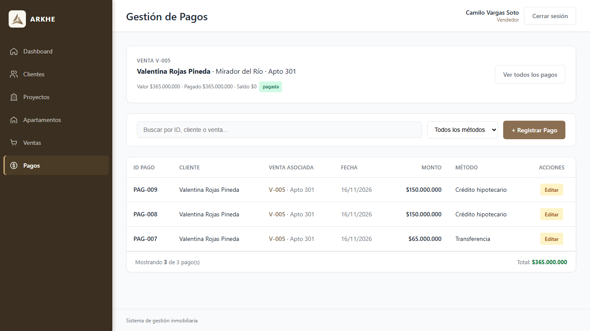

A partir de aquí:

- La venta ya no aparece en la lista del formulario de pagos, porque no tiene saldo.
- En el Dashboard suben las cifras de *Ventas realizadas* y *Pagos registrados*, y la venta cuenta entre las *Pagadas*.

## 13. Mensajes frecuentes y qué significan

### 13.1 Al iniciar sesión

| Mensaje | Qué significa | Qué hacer |
|---|---|---|
| Correo o contraseña incorrectos. | Alguno de los dos datos no coincide. | Revise ambos. Si olvidó la contraseña, vea [2.4](#24-si-olvida-la-contraseña). |
| Su cuenta está inactiva. Comuníquese con el administrador. | Su cuenta fue desactivada. | Pida a un Administrador que la active. |
| Sesión cerrada correctamente. | Usted cerró la sesión. | Nada. |

### 13.2 Al guardar

| Mensaje | Qué significa | Qué hacer |
|---|---|---|
| El nombre (o el apellido) solo puede contener letras y espacios. | Escribió números o símbolos. | Quite los números y los símbolos. |
| El documento debe contener solo números (6 a 15 dígitos). | Tiene letras, puntos o espacios, o le faltan o le sobran dígitos. | Escriba solo los números. |
| El teléfono debe contener solo números (7 a 15 dígitos). | Tiene espacios, guiones o el signo +. | Escriba solo los números. |
| El correo electrónico no tiene un formato válido. | Falta la @ o el dominio. | Use la forma `nombre@correo.com`. |
| Ya existe un cliente registrado con ese documento o correo. | Otro cliente tiene ese documento o ese correo. | Búsquelo en el listado: puede que ya esté registrado. |
| Ya existe un proyecto con este nombre. | El nombre está en uso. | Use otro nombre. |
| La ciudad solo puede contener letras y espacios (sin números). | La ciudad tiene números o símbolos. | Escriba solo el nombre de la ciudad. |
| El usuario debe estar activo para gestionar un proyecto. | El gestor elegido está inactivo. | Elija otro gestor o pida que activen esa cuenta. |
| Ya existe el apartamento '…' en ese proyecto. | Ese número ya se usó en el proyecto. | Use otro número o revise el proyecto elegido. |
| El precio (o el valor de venta, o el monto) debe ser un número mayor que 0 (sin puntos de miles). | Escribió puntos, comas, letras o un valor de cero. | Escriba solo los dígitos: `285000000`. |
| Un apartamento vendido no puede cambiar de precio (o de proyecto). Para corregirlo, anule primero su venta. | Intentó cambiar un dato fijo de un apartamento vendido. | Deje ese dato como estaba. Si de verdad hay que corregirlo, un Administrador debe eliminar la venta. |
| El estado de un apartamento vendido solo cambia al anular su venta: el apartamento sigue como 'vendido'. | Aviso: los demás cambios sí se guardaron; el estado no cambió. | Nada. |
| El apartamento '…' no está disponible para la venta. | Ya fue vendido. | Elija otro apartamento. |
| La fecha de venta (o de pago) no puede ser futura. | Eligió una fecha posterior a hoy. | Elija hoy o una fecha anterior. |
| La fecha de pago no puede ser anterior a la fecha de la venta. | El pago tiene una fecha previa a la venta. | Corrija la fecha del pago. |
| El monto supera el saldo pendiente de la venta ($…). | El pago es mayor que lo que falta por pagar. | Escriba un monto igual o menor al saldo que indica el mensaje. |
| El valor de venta no puede ser menor que lo ya pagado por el cliente. | Al editar la venta, bajó el valor por debajo de los pagos recibidos. | Use un valor igual o mayor a lo pagado. |
| La fecha de venta no puede ser posterior al primer pago registrado. | Al editar la venta, puso una fecha posterior a un pago que ya existe. | Use una fecha igual o anterior a la del primer pago. |
| La contraseña debe tener mínimo 8 caracteres, sin espacios al inicio ni al final. | La contraseña es corta o empieza o termina con un espacio. | Escriba una contraseña de 8 caracteres o más. |
| Ya existe un usuario registrado con ese correo. | Otra cuenta usa ese correo. | Use otro correo o edite la cuenta existente. |

### 13.3 Al eliminar o desactivar

| Mensaje | Qué significa | Qué hacer |
|---|---|---|
| No se puede eliminar: el cliente tiene proyectos o ventas asociados. | El cliente es propietario de un proyecto o tiene una venta. | Consérvelo. Sus datos se pueden editar. |
| No se puede eliminar: el proyecto tiene apartamentos registrados. Elimine primero sus apartamentos. | El proyecto no está vacío. | Elimine antes sus apartamentos, si corresponde. |
| No se puede eliminar: el apartamento ya tiene una venta registrada. | El apartamento está vendido. | Consérvelo. |
| No se puede eliminar: la venta tiene pagos registrados. Elimine primero sus pagos. | La venta ya recibió dinero. | Un Administrador debe eliminar antes los pagos, si de verdad hay que anular la venta. |
| No se puede eliminar: el usuario gestiona proyectos. Puede desactivarlo. | El usuario es gestor de al menos un proyecto. | Desactívelo, o asigne otro gestor a sus proyectos y luego elimínelo. |
| No puede eliminar (o desactivar) su propia cuenta. | Intentó hacerlo sobre la cuenta con la que entró. | Pídalo a otro Administrador. |
| No se permite: el sistema quedaría sin ningún Administrador activo. | Es el último Administrador activo. | Cree o active antes otro Administrador. |

### 13.4 Pantallas de aviso

Estas pantallas ocupan toda la ventana y tienen el botón **Volver al inicio**.

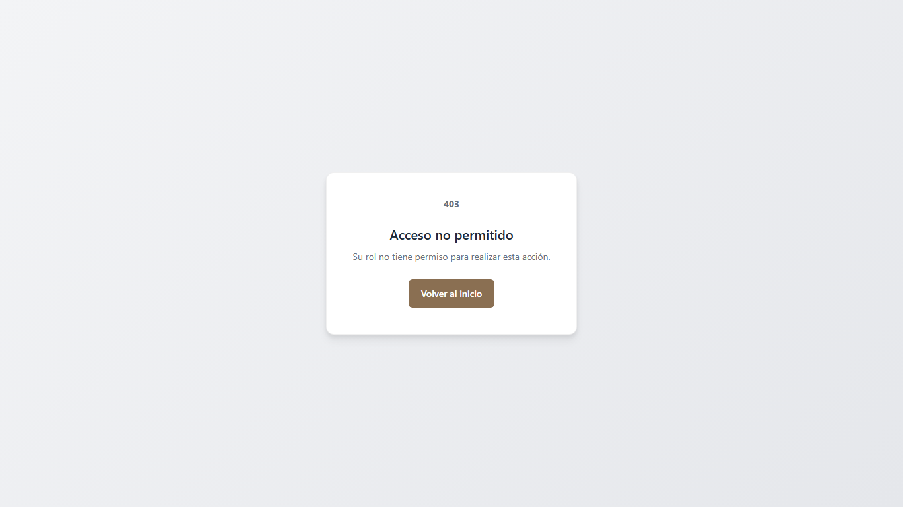

| Pantalla | Qué significa | Qué hacer |
|---|---|---|
| Acceso no permitido | Su rol no tiene permiso para esa página o acción. | Vuelva al inicio. Si necesita ese permiso, hable con un Administrador. |
| Página no encontrada | La dirección no existe, o el registro fue eliminado. | Vuelva al inicio y búsquelo desde el menú. |
| Formulario vencido | La página estuvo abierta demasiado tiempo antes de enviar el formulario. | Vuelva a la página anterior, recárguela e intente de nuevo. |
| Error inesperado | Ocurrió una falla que el sistema no esperaba. | Intente de nuevo. Si se repite, avise al administrador y cuéntele qué estaba haciendo. |

## 14. Preguntas frecuentes

**¿Cómo cambio mi propia contraseña?**
No hay una pantalla para que cada persona cambie la suya. Pídale a un Administrador que la cambie desde Usuarios (ver [11.3](#113-editar-un-usuario-y-cambiar-su-contraseña)). Un Administrador puede cambiar la propia editando su cuenta.

**¿Por qué no veo el botón Eliminar, o el módulo Usuarios?**
Porque su rol no tiene ese permiso. El sistema oculta lo que usted no puede usar. Vea la tabla del [capítulo 4](#4-roles-qué-puede-hacer-cada-persona).

**Soy Administrador y tampoco veo el botón Eliminar en una fila. ¿Por qué?**
El sistema lo oculta cuando el registro no se puede eliminar: un apartamento vendido, una venta con pagos o su propia cuenta de usuario.

**¿Por qué un apartamento no aparece en la lista al registrar una venta?**
Porque ya está vendido. Solo aparecen los disponibles y los reservados.

**¿Por qué una venta no aparece en la lista al registrar un pago?**
Porque ya está pagada por completo: no tiene saldo.

**¿Cómo marco un apartamento como vendido?**
No se marca a mano. Registre la venta en el módulo Ventas y el sistema lo cambia.

**¿Puedo vender un apartamento reservado?**
Sí. Al registrar la venta pasa de reservado a vendido.

**Me equivoqué en el monto de un pago. ¿Qué hago?**
Un Administrador o un Vendedor puede corregirlo con **Editar** en la fila del pago. Si el pago no debía existir, un Administrador lo elimina.

**¿Cómo anulo una venta?**
Lo hace un Administrador: primero elimina los pagos de la venta, si los tiene, y luego elimina la venta. El apartamento vuelve a quedar disponible.

**¿Puedo registrar pagos programados o cuotas futuras?**
No. Solo se registran abonos que ya se recibieron; por eso la fecha no puede ser futura.

**¿Puedo registrar una empresa como cliente?**
No. Los clientes se registran como personas, con nombre y apellido.

**¿El sistema guarda quién registró o cambió cada dato?**
No. No lleva un historial de cambios.

**Escribí en el buscador y la tabla quedó vacía. ¿Se borraron los datos?**
No. El buscador solo oculta las filas que no coinciden. Borre lo que escribió y deje los filtros en "Todos".

**¿Puedo recuperar algo que eliminé?**
No. Por eso el sistema pide confirmación antes de eliminar. Tendría que registrarlo de nuevo.

**Dejé el sistema abierto y al volver me pidió iniciar sesión. ¿Es normal?**
Sí. La sesión se cierra después de 8 horas sin uso, o si desactivaron su cuenta.

**Una persona dejó la empresa. ¿Elimino su usuario?**
Lo recomendado es **desactivarlo**: pierde el acceso de inmediato y la cuenta se conserva. Si era gestor de algún proyecto, el sistema no deja eliminarlo.

**¿Puedo usar el sistema desde el celular?**
Sí, con el navegador del celular. Vea [3.7](#37-uso-en-celular).
