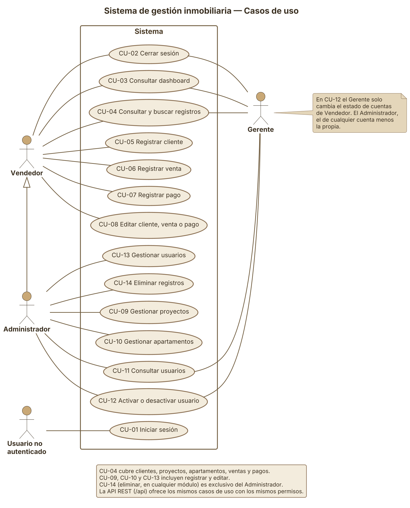

# Requisitos y casos de uso

## Control del documento

| Dato | Valor |
|---|---|
| Código | ARKHE-RQ-001 |
| Documento | Requisitos y casos de uso |
| Versión | 1.0 |
| Fecha | 2026-11-16 |
| Elaborado por | Pedro Alba Méndez |

### Historial de cambios

| Versión | Fecha | Autor | Descripción |
|---|---|---|---|
| 1.0 | 2026-11-16 | Pedro Alba Méndez | Versión inicial. |

Describe qué hace el sistema (requisitos funcionales), con qué calidad lo hace (requisitos no funcionales), quién lo usa (actores y casos de uso) y **con qué prueba se comprueba cada cosa**. Está dirigido a quien evalúa o mantiene el sistema.

Es un documento escrito a partir del sistema ya construido: cada requisito corresponde a algo que existe en el código. Lo que no está implementado no aparece como requisito; aparece en [2.3](#23-lo-que-quedó-fuera) y en [9](#9-brechas-de-verificación).

Documentos relacionados: el [manual técnico](manual_tecnico.md), el [manual de usuario](manual_usuario.md), la [referencia de la API](api.md) y el [diccionario de datos](diccionario_de_datos.md).

Todo lo que aquí se afirma se verificó el 2026-11-16 contra el código. Ese día se ejecutó `pytest` y pasaron las 300 pruebas. La colección de Postman se ejecuta a mano con el *Runner* y no se volvió a ejecutar para este documento.

## Contenido

1. [Convenciones](#1-convenciones)
2. [Requisitos anteriores](#2-requisitos-anteriores)
3. [Actores](#3-actores)
4. [Requisitos funcionales](#4-requisitos-funcionales)
5. [Requisitos no funcionales](#5-requisitos-no-funcionales)
6. [Casos de uso](#6-casos-de-uso)
7. [Especificación de los casos de uso principales](#7-especificación-de-los-casos-de-uso-principales)
8. [Matriz de trazabilidad](#8-matriz-de-trazabilidad)
9. [Brechas de verificación](#9-brechas-de-verificación)

## 1. Convenciones

**Códigos**

| Código | Qué identifica |
|---|---|
| RF-nn | Requisito funcional. |
| RNF-nn | Requisito no funcional. |
| CU-nn | Caso de uso. |
| HU-nn, CP-nn | Historias de usuario y casos de prueba de entregas anteriores. Conservan su código original (ver [2](#2-requisitos-anteriores)). |

**Prioridad.** Las entregas anteriores no priorizaban los requisitos; la prioridad se asigna en este documento con este criterio:

| Prioridad | Criterio |
|---|---|
| Alta | Sin el requisito no se puede completar el flujo Cliente → Proyecto → Apartamento → Venta → Pago, o se compromete la seguridad o la integridad de los datos. |
| Media | Completa la gestión de un módulo (editar, eliminar, consultar con detalle). |
| Baja | Comodidad de uso. |

**Cómo se citan las pruebas**

- **pytest:** por el nombre completo de la función, por ejemplo `test_au04_login_correcto_abre_la_sesion`. El prefijo indica el archivo:

  | Prefijo | Archivo | Tema |
  |---|---|---|
  | `test_au` | `tests/test_auth.py` | Inicio y cierre de sesión. |
  | `test_pe` | `tests/test_permisos.py` | Roles y permisos. |
  | `test_rn` | `tests/test_reglas.py` | Reglas de negocio. |
  | `test_sg` | `tests/test_seguridad.py` | Seguridad de formularios y errores. |
  | `test_in` | `tests/test_interfaz.py` | Interfaz. |
  | `test_is` | `tests/test_instalacion.py` | Instalación y datos de demostración. |
  | `test_cp` | `tests/test_validaciones.py` y `tests/test_formato.py` | Validadores y formato. |
  | `test_rq` | `tests/test_requisitos.py` | Brechas detectadas al escribir este documento. |

  Una prueba se ejecuta sola con su identificador: `pytest -k au04`. En la [matriz final](#8-matriz-de-trazabilidad) se usa la forma corta (AU-04).

- **Postman:** por su posición en la colección `ARKHE_API.postman_collection.json` y su nombre, por ejemplo *PM-04 · Crear cliente*. Cada petición comprueba el **código de respuesta** (la primera comprueba además que la respuesta no trae la contraseña). No revisan el contenido del cuerpo, así que por sí solas prueban que la operación responde lo esperado, no cada dato devuelto.

- **Verificación manual:** cuando un requisito o una parte de él no tiene prueba automática, se dice de forma explícita y se indica cómo se revisa a mano.

Las pruebas de pytest corren contra una base SQLite en memoria; las de Postman, contra el servidor encendido y la base MySQL real.

## 2. Requisitos anteriores

Antes de escribir este documento se buscaron requisitos e historias de usuario en `docs/`, `docs/evidencias/`, el `README.md`, los comentarios del código y el historial de Git.

**Lo que se encontró:**

- **No existía un documento de requisitos.** Ningún archivo del repositorio usa códigos RF o RNF.
- **Dos historias de usuario, HU-01 y HU-02.** Aparecen citadas en la cabecera de `tests/test_validaciones.py` y en el taller de pruebas de la evidencia GA9-220501096-AA1-EV01. Su texto es el de la versión final de la evidencia GA7-220501096-AA3-EV02. Ese texto no estaba versionado en el repositorio: se transcribe en [2.1](#21-historias-de-usuario) para que quede registrado.
- **Trece casos de prueba, CP-01 a CP-13,** trazados a esas historias y al módulo de Pagos.
- **El alcance de cada entrega,** en `docs/evidencias/`.

### 2.1 Historias de usuario

Texto original de cada historia (versión final, GA7-220501096-AA3-EV02) y su contraste, frase por frase, con el sistema actual.

#### HU-01 — Registro de Cliente

> Como Vendedor, quiero registrar los datos de un cliente potencial (nombre, apellido, documento, correo electrónico y teléfono), validando que la información tenga un formato correcto, para mantener un registro confiable de clientes que pueda asociarse posteriormente a un proyecto y a una venta dentro del sistema.

**Estado: cumplida.**

| Lo que pide la historia | Cómo lo cumple el sistema | Requisito |
|---|---|---|
| "Como Vendedor, quiero registrar…" | El Vendedor registra clientes. También puede hacerlo el Administrador. | RF-12, RF-08 |
| "…nombre, apellido, documento, correo electrónico y teléfono" | Son exactamente los cinco campos del cliente. | RF-12 |
| "…validando que la información tenga un formato correcto" | Cada campo se valida en el servidor. | RF-13 |
| "…un registro confiable de clientes" | No se admiten dos clientes con el mismo documento o el mismo correo. | RF-14 |
| "…que pueda asociarse posteriormente a un proyecto y a una venta" | El cliente se elige como propietario de un proyecto y como comprador en una venta. | RF-26, RF-37 |

Lo que el sistema hace además de lo pedido: consultar, editar y eliminar clientes (RF-15 a RF-17), validar la longitud máxima de cada campo e impedir que se elimine un cliente con proyectos o ventas.

Precisión: en un proyecto, el cliente asociado es el **propietario o promotor**, no un comprador. El comprador se asocia en la venta.

#### HU-02 — Gestión de Usuarios del Sistema

> Como Administrador, quiero registrar, editar y desactivar las cuentas de los demás usuarios del sistema, asignándoles un rol (Administrador, Vendedor o Gerente) y controlando su estado (activo o inactivo), para gestionar de forma segura quién tiene acceso al sistema y conservar el historial de un usuario aun cuando ya no esté activo. La contraseña de cada usuario se almacena cifrada, nunca en texto plano.

**Estado: cumplida.** El requisito evolucionó en dos puntos después de escrita la historia; ambos se explican debajo de la tabla.

| Lo que pide la historia | Cómo lo cumple el sistema | Requisito |
|---|---|---|
| "Como Administrador, quiero registrar, editar y desactivar las cuentas…" | El Administrador registra, edita, desactiva y vuelve a activar cuentas. | RF-18, RF-21, RF-22 |
| "…de los demás usuarios" | Nadie puede desactivar ni eliminar su propia cuenta. El Administrador sí puede editar sus propios datos (nombre, correo, contraseña). | RF-23 |
| "…asignándoles un rol (Administrador, Vendedor o Gerente)" | Solo se aceptan esos tres roles. | RF-19 |
| "…y controlando su estado (activo o inactivo)" | Solo se aceptan esos dos estados. Una cuenta inactiva no inicia sesión y pierde la sesión que tuviera abierta. | RF-19, RF-03, RF-07 |
| "…gestionar de forma segura quién tiene acceso al sistema" | Inicio de sesión obligatorio, permisos por rol y protección del último Administrador activo. Todo esto se construyó después de la historia. | RF-01 a RF-09, RF-23 |
| "…conservar el historial de un usuario aun cuando ya no esté activo" | Desactivar no borra nada: la cuenta y los proyectos que gestiona se conservan. Una cuenta con proyectos asociados no se puede eliminar, solo desactivar (ver *Eliminación de cuentas*). | RF-22, RF-24 |
| "La contraseña […] se almacena cifrada, nunca en texto plano" | Se guarda solo su hash y nunca se muestra ni se devuelve. Precisión técnica: es un hash de un solo sentido, no un cifrado reversible; nadie puede recuperar la contraseña original. | RNF-01 |

**Eliminación de cuentas.** La historia habla de registrar, editar y desactivar; el sistema permite además eliminar. Eliminar **solo es posible en cuentas sin proyectos**, es decir, sin historial asociado: los proyectos son el único dato del sistema que queda enlazado a un usuario. Si la cuenta gestiona algún proyecto, el sistema rechaza la eliminación con el mensaje "No se puede eliminar: el usuario gestiona proyectos. Puede desactivarlo." y la única opción es desactivarla, que lo conserva todo. Así se cumple el propósito de la historia: nunca se pierde el historial de un usuario. Lo comprueban `test_rn14_usuario_que_gestiona_proyectos` y `test_sg08_eliminar_usuario_que_gestiona_proyectos_muestra_mensaje`.

**Permiso del Gerente.** La historia reserva la gestión de cuentas al Administrador. Hoy el Gerente también puede activar y desactivar cuentas, pero solo las de Vendedor; no puede registrar, editar ni eliminar usuarios, ni cambiar el estado de un Administrador o de otro Gerente (RF-22). Es una **evolución aprobada del requisito**: se decidió el 2026-11-12, al definir la matriz de permisos, y no una desviación. Lo comprueban `test_pe10_el_gerente_activa_y_desactiva_usuarios` y `test_pe12_el_gerente_no_cambia_el_estado_de_administradores_ni_gerentes`.

Sobre la palabra "historial": el sistema conserva el registro del usuario y sus proyectos, pero no guarda un historial de cambios (quién modificó qué y cuándo). Esa es una limitación declarada (ver [2.3](#23-lo-que-quedó-fuera)).

Otros cambios posteriores a la historia: la contraseña ya no admite espacios al inicio ni al final (el defecto que detectó CP-06 se corrigió en la evidencia GA9-220501096-AA1-EV01) y existe un script de consola para restablecerla (RF-25).

Ninguna historia de usuario anterior quedó sin implementar.

### 2.2 Casos de prueba anteriores

Los trece casos conservan su código y siguen en la batería: todos pasan.

| Casos | Historia | Función de prueba | Requisito actual |
|---|---|---|---|
| CP-01 a CP-04 | HU-01 | `test_cp01_nombre_solo_letras`, `test_cp02_documento`, `test_cp03_correo`, `test_cp04_telefono` | RF-13 |
| CP-05 a CP-08 | HU-02 | `test_cp05_contrasena_longitud`, `test_cp06_contrasena_solo_espacios`, `test_cp07_rol`, `test_cp08_estado` | RF-19 |
| CP-09 a CP-12 | Pagos (sin historia) | `test_cp09_id_venta_entero`, `test_cp10_monto_decimal`, `test_cp11_fecha_pago`, `test_cp12_fecha_futura` | RF-43 |
| CP-13 | Sin historia | `test_cp13_formato_pesos` | RNF-18 |

### 2.3 Lo que quedó fuera

Ningún requisito anterior se descartó. Lo siguiente está declarado como fuera del alcance o como limitación conocida en el `README.md` y en el manual técnico, y **no está implementado**:

| Tema | Situación |
|---|---|
| Inventario, materiales, obra y proveedores | Fuera del alcance del proyecto. |
| Clientes empresa (razón social y NIT) | No implementado: solo personas naturales. Mejora futura. |
| Recuperación de contraseña por correo | No implementada. La restablece un Administrador (RF-21) o el script de consola (RF-25). |
| Límite de intentos de inicio de sesión | No implementado. |
| Paginación de los listados | No implementada: los listados cargan todos los registros. |
| Historial de cambios (quién creó o modificó cada dato) | No implementado. |
| Servidor de producción y HTTPS | No incluidos: `python app.py` usa el servidor de desarrollo de Flask. |
| Instalador para otros sistemas operativos | No existe: el instalador es solo para Windows. |

### 2.4 Entregas anteriores

| Evidencia | Módulos | Diferencia con el estado actual |
|---|---|---|
| GA7-220501096-AA3-EV01 | Clientes | — |
| GA7-220501096-AA3-EV02 | Usuarios | — |
| GA7-220501096-AA5-EV03 | Proyectos, Apartamentos, Ventas, Pagos, panel de inicio y API REST | Su lista de verificación (`evidencias/INSTRUCCIONES_ENTREGA.txt`) describe una versión sin inicio de sesión y con 35 peticiones de Postman. Hoy todo exige sesión y la colección tiene 36: la primera inicia sesión. |
| GA9-220501096-AA1-EV01 | Pruebas unitarias con pytest | Tenía 13 casos (50 verificaciones). Hoy la batería tiene 300 pruebas. |

## 3. Actores

| Actor | Quién es | Qué puede hacer |
|---|---|---|
| Usuario no autenticado | Cualquier persona que abre el sistema sin haber iniciado sesión. | Solo ver la pantalla de inicio de sesión e iniciar sesión. Cualquier otra dirección lo lleva al login. |
| Administrador | Usuario con rol `Administrador`. | Todo: consulta, registra, edita y elimina en todos los módulos, y gestiona los usuarios. |
| Vendedor | Usuario con rol `Vendedor`. | Consulta todo salvo Usuarios. Registra y edita clientes, ventas y pagos. No elimina nada. |
| Gerente | Usuario con rol `Gerente`. | Consulta todo, incluidos los usuarios. Activa y desactiva cuentas de Vendedor. No registra, edita ni elimina nada más. |

Los tres roles son usuarios de la tabla `usuarios` con estado `activo`. Un programa externo que use la API REST no es un actor distinto: inicia sesión con una de esas cuentas y tiene exactamente los permisos de su rol.

**Matriz de permisos** (definida en un solo lugar: `PERMISOS`, en `utils/seguridad.py`):

| Módulo | Administrador | Vendedor | Gerente |
|---|---|---|---|
| Dashboard | Consulta | Consulta | Consulta |
| Clientes | Consulta, registra, edita, elimina | Consulta, registra, edita | Consulta |
| Proyectos | Consulta, registra, edita, elimina | Consulta | Consulta |
| Apartamentos | Consulta, registra, edita, elimina | Consulta | Consulta |
| Ventas | Consulta, registra, edita, elimina | Consulta, registra, edita | Consulta |
| Pagos | Consulta, registra, edita, elimina | Consulta, registra, edita | Consulta |
| Usuarios | Consulta, registra, edita, elimina, activa y desactiva | Sin acceso | Consulta; activa y desactiva solo Vendedores |

## 4. Requisitos funcionales

Son 51 requisitos, agrupados por módulo. La columna **Prueba** es la trazabilidad: indica qué prueba falla si el requisito deja de cumplirse.

### 4.1 Autenticación y sesión

| Código | Requisito | Rol | Prioridad | Criterio de aceptación | Prueba |
|---|---|---|---|---|---|
| RF-01 | Iniciar sesión con correo y contraseña. | Usuario no autenticado | Alta | Con el correo y la contraseña de una cuenta activa, el sistema abre la sesión y muestra el Dashboard, con el nombre de la persona y el botón "Cerrar sesión" en el encabezado. El correo no distingue mayúsculas de minúsculas. | `test_au04_login_correcto_abre_la_sesion` `test_au05_el_correo_no_distingue_mayusculas` `test_sg02_login_con_token_funciona` PM-01 · Iniciar sesion |
| RF-02 | Rechazar credenciales incorrectas sin revelar qué correos existen. | Usuario no autenticado | Alta | Con una contraseña equivocada o un correo no registrado no se abre sesión y se muestra el mismo mensaje en ambos casos: "Correo o contraseña incorrectos." | `test_au06_contrasena_incorrecta_no_entra` `test_au07_mismo_mensaje_si_el_correo_no_existe` |
| RF-03 | Impedir el ingreso de cuentas inactivas. | Usuario no autenticado | Alta | Una cuenta inactiva no abre sesión aunque la contraseña sea correcta. Mensaje: "Su cuenta está inactiva. Comuníquese con el administrador." | `test_au08_usuario_inactivo_no_puede_entrar` `test_pe05_api_usuario_inactivo_no_inicia_sesion` |
| RF-04 | Exigir sesión en todo el sistema. | Todos | Alta | Sin sesión, toda pantalla redirige al login y ninguna operación modifica datos; la API responde 401 en JSON. Solo el login y los archivos estáticos se abren sin sesión. | `test_au01_sin_sesion_toda_pagina_redirige_al_login` `test_au02_sin_sesion_no_se_puede_modificar_nada` `test_au03_login_y_estaticos_se_abren_sin_sesion` `test_pe03_api_sin_sesion_responde_401_en_json` |
| RF-05 | Cerrar sesión. | Administrador, Vendedor, Gerente | Alta | Al pulsar "Cerrar sesión" la sesión termina, se vuelve al login con el mensaje "Sesión cerrada correctamente." y las pantallas dejan de abrirse. El cierre solo se acepta por POST. | `test_au10_logout_cierra_la_sesion` `test_au11_logout_solo_acepta_post` |
| RF-06 | Volver a la página pedida después de iniciar sesión. | Usuario no autenticado | Baja | Si la persona pidió una página interna sin sesión, tras iniciar sesión llega a esa página. Una dirección externa se ignora y se abre el Dashboard. | `test_au13_despues_del_login_vuelve_a_la_pagina_pedida` `test_au14_next_externo_se_ignora` |
| RF-07 | Retirar el acceso de inmediato a una cuenta desactivada. | Administrador, Gerente (quien desactiva) | Alta | Si una cuenta se desactiva mientras tiene la sesión abierta, su siguiente petición la devuelve al login. | `test_au12_desactivar_al_usuario_le_cierra_la_sesion_abierta` |

### 4.2 Roles y permisos

| Código | Requisito | Rol | Prioridad | Criterio de aceptación | Prueba |
|---|---|---|---|---|---|
| RF-08 | Controlar en el servidor qué puede hacer cada rol, según la matriz de la [sección 3](#3-actores). | Todos | Alta | Una acción que el rol no tiene permitida responde 403 ("Su rol no tiene permiso para realizar esta acción."), en las pantallas y en la API, aunque la petición se envíe a mano. Las acciones permitidas responden con normalidad. | `test_pe02_matriz_de_permisos` `test_pe06_api_403_segun_el_rol` `test_pe08_pantallas_403_segun_el_rol` `test_pe07_todos_los_roles_consultan_los_listados` `test_pe15_el_administrador_si_elimina_ventas_y_pagos` |
| RF-09 | Mostrar a cada rol solo el menú y los botones que puede usar. | Todos | Media | El Vendedor no ve "Usuarios" en el menú ni botones de eliminar. El Gerente no ve botones de crear, editar ni eliminar, y solo ve "Desactivar" en las filas de Vendedores. El Administrador ve todos. | `test_pe09_el_menu_y_los_botones_dependen_del_rol` `test_in07_estado_vacio_sin_boton_si_el_rol_no_puede_crear` |

### 4.3 Dashboard

| Código | Requisito | Rol | Prioridad | Criterio de aceptación | Prueba |
|---|---|---|---|---|---|
| RF-10 | Consultar los indicadores generales del negocio. | Administrador, Vendedor, Gerente | Alta | El Dashboard muestra: total de clientes, total de proyectos, apartamentos disponibles, valor vendido, valor recaudado con su porcentaje sobre lo vendido, apartamentos por estado, ventas por estado y saldo por cobrar. Las cifras son las mismas que devuelve `GET /api/resumen`. | `test_in24_el_dashboard_muestra_las_mismas_cifras_que_la_api` `test_in23_api_resumen_conserva_su_contrato_y_usa_el_calculo_comun` `test_pe07_todos_los_roles_consultan_los_listados` PM-03 · Resumen |
| RF-11 | Consultar las ventas de los últimos seis meses y los movimientos más recientes. | Administrador, Vendedor, Gerente | Media | El Dashboard muestra un gráfico con el valor vendido por mes en los últimos seis meses, las cinco últimas ventas y los cinco últimos pagos. Si no hay ventas o pagos, muestra un estado vacío. | **Verificación manual** del gráfico mensual y del límite de cinco registros, en el navegador. Como apoyo automático: `test_in27_el_metodo_se_muestra_con_tilde_pero_se_guarda_igual` (un pago aparece en "Últimos pagos") y `test_in07_estado_vacio_sin_boton_si_el_rol_no_puede_crear` (estado vacío). |

### 4.4 Clientes

| Código | Requisito | Rol | Prioridad | Criterio de aceptación | Prueba |
|---|---|---|---|---|---|
| RF-12 | Registrar un cliente con nombre, apellido, documento, correo y teléfono. | Administrador, Vendedor | Alta | Con datos válidos, el cliente queda guardado y aparece en el listado, con el mensaje "Cliente '…' creado correctamente." | `test_sg03_un_post_sin_token_no_modifica_nada` (con el token, el cliente se crea) `test_in08_estado_vacio_de_clientes_abre_el_modal` PM-04 · Crear cliente |
| RF-13 | Validar los datos del cliente en el servidor. | Administrador, Vendedor | Alta | Nombre y apellido: solo letras y espacios, hasta 100 caracteres. Documento: solo números, de 6 a 15 dígitos. Correo: formato válido, hasta 150 caracteres. Teléfono: solo números, de 7 a 15 dígitos. Si algo falla no se guarda nada, se indica cada error y el formulario conserva lo escrito. | `test_cp01_nombre_solo_letras` `test_cp02_documento` `test_cp03_correo` `test_cp04_telefono` `test_sg09_longitud_maxima_en_clientes_y_usuarios` `test_sg10_la_api_responde_400_y_no_500_con_un_nombre_demasiado_largo` `test_rn16_datos_invalidos_responden_400_con_lista_de_errores` `test_in09_cliente_invalido_reabre_el_modal_con_lo_escrito` PM-05 · Crear cliente INVALIDO |
| RF-14 | Impedir dos clientes con el mismo documento o el mismo correo. | Administrador, Vendedor | Alta | Al repetir un documento o un correo no se guarda y se muestra "Ya existe un cliente registrado con ese documento o correo." La API responde 409. | `test_in10_cliente_duplicado_reabre_el_modal_con_lo_escrito` (pantalla) `test_rq04_la_api_responde_409_al_crear_un_cliente_repetido` `test_rq05_la_api_responde_409_al_editar_un_cliente_con_datos_de_otro` |
| RF-15 | Consultar el listado de clientes y un cliente en particular. | Administrador, Vendedor, Gerente | Alta | El listado muestra código, nombre completo, documento, correo y teléfono, ordenado por nombre. | `test_pe07_todos_los_roles_consultan_los_listados` PM-06 · Listar clientes PM-07 · Consultar cliente |
| RF-16 | Editar los datos de un cliente. | Administrador, Vendedor | Media | Los cambios pasan por las mismas validaciones del registro (RF-13 y RF-14) y quedan guardados. | `test_rq12_editar_cliente_por_la_pantalla` `test_rq13_editar_cliente_por_la_pantalla_con_datos_incorrectos` `test_rq05_la_api_responde_409_al_editar_un_cliente_con_datos_de_otro` `test_pe08_pantallas_403_segun_el_rol` (el Gerente no puede) PM-08 · Actualizar cliente |
| RF-17 | Eliminar un cliente que no tenga proyectos ni ventas. | Administrador | Media | Un cliente sin dependencias se elimina. Si tiene proyectos o ventas no se elimina y se muestra "No se puede eliminar: el cliente tiene proyectos o ventas asociados." (409 en la API). | `test_rn13_cliente_con_proyectos_o_ventas` `test_sg07_eliminar_cliente_con_proyectos_muestra_mensaje` PM-36 · Eliminar cliente |

### 4.5 Usuarios

| Código | Requisito | Rol | Prioridad | Criterio de aceptación | Prueba |
|---|---|---|---|---|---|
| RF-18 | Registrar un usuario con nombre, apellido, correo, contraseña y rol. | Administrador | Alta | Con datos válidos, el usuario queda guardado en estado `activo` y puede iniciar sesión. La contraseña se guarda como hash. | PM-09 · Crear usuario `test_pe14_con_dos_administradores_si_se_puede_desactivar_a_uno` (crea un usuario por la API y opera con él) `test_is07_los_usuarios_demo_pueden_iniciar_sesion` |
| RF-19 | Validar los datos del usuario en el servidor. | Administrador | Alta | Nombre y apellido: solo letras, hasta 100 caracteres. Correo: formato válido, hasta 150 caracteres, único. Contraseña: mínimo 8 caracteres, sin espacios al inicio ni al final. Rol: Administrador, Vendedor o Gerente. Estado: activo o inactivo. | `test_cp05_contrasena_longitud` `test_cp06_contrasena_solo_espacios` `test_cp07_rol` `test_cp08_estado` `test_au16_contrasena_sin_espacios_en_los_extremos` `test_sg09_longitud_maxima_en_clientes_y_usuarios` `test_in11_usuario_invalido_reabre_el_modal_sin_devolver_la_contrasena` PM-10 · Crear usuario INVALIDO |
| RF-20 | Consultar el listado de usuarios. | Administrador, Gerente | Media | El listado muestra código, nombre completo, correo, rol y estado. El Vendedor recibe 403. La contraseña nunca se muestra ni se devuelve. | `test_pe08_pantallas_403_segun_el_rol` `test_pe06_api_403_segun_el_rol` `test_rn17_la_api_nunca_devuelve_la_contrasena` PM-11 · Listar usuarios |
| RF-21 | Editar un usuario: datos, rol, estado y, de forma opcional, la contraseña. | Administrador | Media | Los cambios quedan guardados. Si el campo de contraseña se deja vacío, se conserva la contraseña actual; si se escribe una nueva, se guarda su hash y la anterior deja de servir. | `test_rq01_editar_usuario_por_la_api_sin_contrasena_conserva_la_actual` `test_rq02_editar_usuario_por_la_api_con_contrasena_la_cambia` `test_rq03_editar_usuario_por_la_pantalla` `test_pe13_el_ultimo_administrador_no_puede_quitarse_el_rol` `test_pe08_pantallas_403_segun_el_rol` (el Gerente no puede) |
| RF-22 | Activar o desactivar una cuenta sin cambiar sus demás datos. | Administrador (cualquier cuenta), Gerente (solo cuentas de Vendedor) | Alta | El estado pasa de activo a inactivo o al revés, con el mensaje "Usuario '…' desactivado." o "…activado." El Gerente recibe 403 si la cuenta es de un Administrador o de otro Gerente. | `test_pe10_el_gerente_activa_y_desactiva_usuarios` `test_pe12_el_gerente_no_cambia_el_estado_de_administradores_ni_gerentes` `test_pe14_con_dos_administradores_si_se_puede_desactivar_a_uno` |
| RF-23 | Proteger las cuentas: nadie se bloquea a sí mismo y siempre queda un Administrador activo. | Administrador, Gerente | Alta | Nadie puede eliminar ni desactivar su propia cuenta. No se puede eliminar, desactivar ni cambiar de rol al último Administrador activo. La API responde 409. | `test_pe11_nadie_desactiva_ni_elimina_su_propia_cuenta` `test_pe13_el_ultimo_administrador_no_puede_quitarse_el_rol` `test_pe14_con_dos_administradores_si_se_puede_desactivar_a_uno` |
| RF-24 | Eliminar un usuario que no gestione proyectos. | Administrador | Media | Un usuario sin proyectos se elimina. Si gestiona proyectos no se elimina y se muestra "No se puede eliminar: el usuario gestiona proyectos. Puede desactivarlo." (409 en la API). | `test_rn14_usuario_que_gestiona_proyectos` `test_sg08_eliminar_usuario_que_gestiona_proyectos_muestra_mensaje` PM-35 · Eliminar usuario |
| RF-25 | Restablecer la contraseña de un usuario desde la consola del servidor. | Quien administra el servidor (no es un actor de la aplicación web) | Baja | `python scripts\cambiar_contrasena.py` pide el correo y la nueva contraseña dos veces, aplica la misma regla de RF-19 y cambia solo la contraseña de ese usuario. Si el correo no existe, las contraseñas no coinciden o la nueva no es válida, no cambia nada. | `test_rq10_el_script_cambia_solo_la_contrasena_de_ese_usuario` `test_rq11_el_script_no_cambia_nada_si_algo_falla` |

### 4.6 Proyectos

| Código | Requisito | Rol | Prioridad | Criterio de aceptación | Prueba |
|---|---|---|---|---|---|
| RF-26 | Registrar un proyecto con nombre, dirección, ciudad, descripción opcional, cliente propietario y usuario gestor. | Administrador | Alta | Con datos válidos, el proyecto queda guardado, con el mensaje "Proyecto '…' creado correctamente." El formulario aclara que el cliente es el propietario o promotor, no un comprador. | PM-12 · Crear proyecto `test_in20_proyecto_aclara_que_el_cliente_es_el_propietario` |
| RF-27 | Validar los datos del proyecto en el servidor. | Administrador | Alta | Nombre: obligatorio, único, hasta 150 caracteres. Dirección: obligatoria, hasta 200. Ciudad: obligatoria, solo letras y espacios, hasta 100. El cliente debe existir. El gestor debe existir y estar activo. | `test_rq06_el_nombre_del_proyecto_no_se_repite` `test_rq07_el_gestor_del_proyecto_debe_estar_activo` `test_rq08_datos_obligatorios_y_existentes_del_proyecto` `test_rq09_longitud_maxima_en_proyectos` PM-13 · Crear proyecto INVALIDO |
| RF-28 | Consultar los proyectos con el conteo de sus apartamentos por estado. | Administrador, Vendedor, Gerente | Alta | El listado muestra, por proyecto, cuántos apartamentos tiene en total y cuántos están disponibles, reservados y vendidos. El conteo se calcula al consultar; no se guarda. | `test_in21_resumen_de_apartamentos_del_proyecto_es_calculado` `test_in22_listado_de_proyectos_muestra_el_conteo_por_estado` PM-14 · Listar proyectos |
| RF-29 | Editar un proyecto. | Administrador | Media | Los cambios pasan por las validaciones de RF-27 y quedan guardados. | PM-15 · Actualizar proyecto |
| RF-30 | Eliminar un proyecto que no tenga apartamentos. | Administrador | Media | Un proyecto sin apartamentos se elimina. Si tiene apartamentos no se elimina y se muestra "No se puede eliminar: el proyecto tiene apartamentos registrados. Elimine primero sus apartamentos." (409 en la API). | `test_rn10_proyecto_con_apartamentos` PM-29 · Eliminar proyecto con apartamentos (bloqueado) PM-34 · Eliminar proyecto |

### 4.7 Apartamentos

| Código | Requisito | Rol | Prioridad | Criterio de aceptación | Prueba |
|---|---|---|---|---|---|
| RF-31 | Registrar un apartamento con proyecto, número, área, habitaciones, baños, precio y estado. | Administrador | Alta | Con datos válidos, el apartamento queda guardado en estado `disponible` o `reservado`. | PM-16 · Crear apartamento |
| RF-32 | Validar los datos del apartamento en el servidor. | Administrador | Alta | El proyecto debe existir. Número: obligatorio, hasta 20 caracteres, solo letras, números, guion y espacios, único dentro del proyecto. Área: mayor que 0 y hasta 9999.99 m². Habitaciones y baños: enteros de 1 a 10. Precio: mayor que 0. Estado: disponible o reservado. | PM-17 · Crear apartamento INVALIDO `test_in25_los_mensajes_de_validacion_llevan_tilde` |
| RF-33 | Consultar los apartamentos, con filtro por proyecto y por estado. | Administrador, Vendedor, Gerente | Alta | El listado muestra los apartamentos con su proyecto, datos y estado. La API filtra con `?estado=` y `?proyecto=`. | `test_pe07_todos_los_roles_consultan_los_listados` PM-19 · Listar apartamentos reservados PM-22 · Consultar apartamento (ahora vendido) |
| RF-34 | Editar un apartamento que no se ha vendido. | Administrador | Media | Se pueden cambiar todos sus datos, incluidos el proyecto, el precio y el estado (entre disponible y reservado). | PM-18 · Actualizar apartamento (reservado) `test_rn29b_sin_venta_el_proyecto_y_el_precio_si_se_pueden_cambiar` |
| RF-35 | Proteger los datos con los que se vendió un apartamento. | Administrador | Alta | Un apartamento vendido no cambia de proyecto ni de precio (error de validación). Su área, habitaciones y baños sí se pueden corregir. Su estado solo cambia al anular la venta: si se pide otro estado, se guarda lo demás y se avisa. | `test_rn27_vendido_no_cambia_de_proyecto_ni_de_precio_por_la_api` `test_rn28_vendido_no_cambia_de_proyecto_ni_de_precio_por_la_pantalla` `test_rn29_vendido_si_permite_corregir_area_habitaciones_y_banos` `test_rn21_la_api_avisa_y_conserva_vendido` `test_rn22_la_pantalla_muestra_el_aviso` `test_rn23_sin_cambio_de_estado_no_hay_aviso` |
| RF-36 | Eliminar un apartamento que no tenga venta. | Administrador | Media | Un apartamento sin venta se elimina. Si tiene venta no se elimina y se muestra "No se puede eliminar: el apartamento ya tiene una venta registrada." (409 en la API). | `test_rn11_apartamento_con_venta` PM-33 · Eliminar apartamento |

### 4.8 Ventas

| Código | Requisito | Rol | Prioridad | Criterio de aceptación | Prueba |
|---|---|---|---|---|---|
| RF-37 | Registrar la venta de un apartamento a un cliente, con fecha y valor. | Administrador, Vendedor | Alta | Al guardar la venta, el apartamento pasa a `vendido` en la misma operación. | `test_rn01_registrar_venta_deja_el_apartamento_vendido` PM-20 · Crear venta (el apartamento pasa a vendido) PM-22 · Consultar apartamento (ahora vendido) |
| RF-38 | Validar los datos de la venta en el servidor. | Administrador, Vendedor | Alta | El cliente y el apartamento deben existir. El apartamento debe estar disponible o reservado: no se vende dos veces. La fecha no puede ser futura. El valor debe ser mayor que 0. | `test_rn03_un_apartamento_no_se_vende_dos_veces` `test_rn04_la_fecha_de_venta_no_puede_ser_futura` PM-21 · Crear venta INVALIDA |
| RF-39 | Consultar las ventas con su total pagado, su saldo y su estado. | Administrador, Vendedor, Gerente | Alta | Cada venta muestra lo pagado, el saldo y un estado calculado a partir de sus pagos: `pendiente` (sin pagos), `en-pago` (pagos parciales) o `pagada` (saldo en cero). El estado no se guarda. | `test_rn09_el_estado_de_la_venta_se_calcula_con_los_pagos` `test_pe07_todos_los_roles_consultan_los_listados` PM-23 · Consultar venta (con pagos y saldo) PM-27 · Consultar venta (estado en-pago) |
| RF-40 | Editar una venta. | Administrador, Vendedor | Media | Si se cambia de apartamento, el anterior vuelve a `disponible` y el nuevo pasa a `vendido`; no se acepta un apartamento ya vendido. El valor no puede quedar por debajo de lo ya pagado, ni la fecha después del primer pago. | `test_rn18_cambiar_el_apartamento_de_una_venta_por_la_api` `test_rn19_cambiar_el_apartamento_de_una_venta_por_la_pantalla` `test_rn20_no_se_cambia_la_venta_a_un_apartamento_ya_vendido` `test_rn31_el_valor_y_la_fecha_se_validan_contra_los_pagos` |
| RF-41 | Eliminar (anular) una venta que no tenga pagos. | Administrador | Media | Al eliminarla, el apartamento vuelve a `disponible`. Si tiene pagos no se elimina y se muestra "No se puede eliminar: la venta tiene pagos registrados. Elimine primero sus pagos." (409 en la API). El Vendedor recibe 403. | `test_rn02_eliminar_venta_devuelve_el_apartamento_a_disponible` `test_rn12_venta_con_pagos` `test_pe15_el_administrador_si_elimina_ventas_y_pagos` PM-28 · Eliminar venta con pagos (bloqueado) PM-32 · Eliminar venta |

### 4.9 Pagos

| Código | Requisito | Rol | Prioridad | Criterio de aceptación | Prueba |
|---|---|---|---|---|---|
| RF-42 | Registrar un pago (abono) a una venta, con fecha, monto y método. | Administrador, Vendedor | Alta | El pago queda guardado y el saldo y el estado de la venta se actualizan solos. | `test_rn09_el_estado_de_la_venta_se_calcula_con_los_pagos` `test_rn24_crear_pago_bloquea_la_venta_y_sus_pagos` (por la API y por la pantalla) PM-25 · Crear pago |
| RF-43 | Validar los datos del pago en el servidor. | Administrador, Vendedor | Alta | La venta debe existir. El monto debe ser mayor que 0 y no superar el saldo de la venta. La fecha no puede ser futura ni anterior a la fecha de la venta. El método debe ser uno de: Efectivo, Transferencia, Tarjeta de crédito, Tarjeta débito, Cheque o Crédito hipotecario. | `test_rn05_el_pago_no_puede_superar_el_saldo` `test_rn06_la_fecha_de_pago_no_puede_ser_futura` `test_rn07_la_fecha_de_pago_no_puede_ser_anterior_a_la_venta` `test_rn08_el_metodo_de_pago_debe_estar_en_la_lista` `test_cp09_id_venta_entero` `test_cp10_monto_decimal` `test_cp11_fecha_pago` `test_cp12_fecha_futura` PM-24 · Crear pago INVALIDO |
| RF-44 | Consultar los pagos, todos o los de una venta. | Administrador, Vendedor, Gerente | Alta | El listado muestra los pagos con su venta, cliente, fecha, monto y método. Desde una venta se abren solo sus pagos. | `test_pe07_todos_los_roles_consultan_los_listados` PM-26 · Listar pagos de la venta |
| RF-45 | Editar un pago. | Administrador, Vendedor | Media | Se aplican las validaciones de RF-43. Al calcular el saldo disponible no se cuenta el propio pago que se edita. | `test_rn26_el_saldo_se_calcula_igual_con_el_bloqueo` `test_rn25_editar_pago_bloquea_la_venta_y_sus_pagos` `test_pe15_el_administrador_si_elimina_ventas_y_pagos` (el Vendedor edita) |
| RF-46 | Eliminar un pago. | Administrador | Media | El pago se elimina y el saldo de la venta aumenta en ese monto. El Vendedor recibe 403. | `test_pe15_el_administrador_si_elimina_ventas_y_pagos` PM-31 · Eliminar pago |

### 4.10 Búsqueda en los listados

| Código | Requisito | Rol | Prioridad | Criterio de aceptación | Prueba |
|---|---|---|---|---|---|
| RF-47 | Buscar y filtrar dentro de un listado. | Administrador, Vendedor, Gerente | Baja | Al escribir en el buscador solo quedan visibles las filas que contienen el texto, y el contador "Mostrando N de M" se actualiza. Hay filtros por rol y estado (usuarios), por proyecto y estado (apartamentos), por estado (ventas) y por método (pagos). Si nada coincide: "Ningún registro coincide con la búsqueda o los filtros." | **Verificación manual,** en el navegador: el filtro lo hace JavaScript (`static/js/arkhe.js`) y pytest no ejecuta JavaScript. Como apoyo automático, `test_in27_el_metodo_se_muestra_con_tilde_pero_se_guarda_igual` comprueba que las filas llevan el dato del filtro. |

### 4.11 API REST

| Código | Requisito | Rol | Prioridad | Criterio de aceptación | Prueba |
|---|---|---|---|---|---|
| RF-48 | Ofrecer por la API las mismas operaciones de las pantallas (listar, consultar, crear, actualizar y eliminar) sobre los seis recursos, en JSON y con las mismas reglas y permisos. | Administrador, Vendedor, Gerente | Alta | Cada operación responde 200 o 201 con el registro. `GET /api` lista los servicios disponibles. | La colección completa de Postman (PM-01 a PM-36), en especial PM-02 · Indice de servicios `test_sg05_la_api_queda_exenta_del_token` `test_in25_los_mensajes_de_validacion_llevan_tilde` (mismos mensajes que las pantallas) |
| RF-49 | Iniciar sesión por la API. | Usuario no autenticado | Alta | `POST /api/login` con correo y contraseña correctos responde 200 con los datos del usuario, sin la contraseña, y abre la sesión. Con credenciales incorrectas o cuenta inactiva responde 401. | `test_pe04_api_login` `test_pe05_api_usuario_inactivo_no_inicia_sesion` `test_sg17_el_login_de_la_api_tambien_exige_json` PM-01 · Iniciar sesion |
| RF-50 | Responder los errores de la API con un código y un cuerpo JSON uniformes. | Administrador, Vendedor, Gerente | Alta | 400 con `{"errores": [...]}` si los datos no pasan la validación o el cuerpo no es JSON; 401 sin sesión; 403 sin permiso; 404 si el registro o la ruta no existen; 409 si se rompe una regla de negocio o un dato único ya existe. | `test_rn16_datos_invalidos_responden_400_con_lista_de_errores` `test_rn15_registro_inexistente_responde_404` `test_pe03_api_sin_sesion_responde_401_en_json` `test_pe06_api_403_segun_el_rol` `test_sg11_404_con_pagina_propia_y_json_en_la_api` `test_sg13_500_en_la_api_responde_json` `test_sg16_la_api_rechaza_cuerpos_que_no_declaran_json` PM-30 · Consultar registro que no existe |
| RF-51 | Filtrar los listados de la API. | Administrador, Vendedor, Gerente | Baja | `/api/apartamentos?estado=` y `?proyecto=`, `/api/ventas?estado=` y `/api/pagos?venta=` devuelven solo los registros que cumplen el filtro. Los dos filtros de apartamentos se pueden combinar. Un valor que nada cumple devuelve una lista vacía. | `test_rq14_la_api_filtra_los_apartamentos_por_estado_y_por_proyecto` `test_rq15_la_api_filtra_las_ventas_por_estado_y_los_pagos_por_venta` PM-19 · Listar apartamentos reservados PM-26 · Listar pagos de la venta |

## 5. Requisitos no funcionales

La columna **Cómo se verifica** dice con qué prueba o revisión se comprueba cada uno. Donde no hay verificación, se indica como **No verificado**.

### 5.1 Seguridad

| Código | Requisito | Cómo se verifica |
|---|---|---|
| RNF-01 | Las contraseñas se guardan solo como hash (`werkzeug.security`) y nunca se devuelven ni se muestran. | `test_rn17_la_api_nunca_devuelve_la_contrasena`, `test_in11_usuario_invalido_reabre_el_modal_sin_devolver_la_contrasena`, PM-01 (la respuesta no incluye la contraseña). Que lo guardado es un hash y no el texto: `test_rq02_editar_usuario_por_la_api_con_contrasena_la_cambia` y `test_rq10_el_script_cambia_solo_la_contrasena_de_ese_usuario`. |
| RNF-02 | La sesión viaja en una cookie firmada que solo contiene el ID del usuario, con `HttpOnly`, `SameSite=Lax` y caducidad de ocho horas. | `test_au09_la_cookie_no_lleva_contrasena_ni_rol`, `test_sg15_secret_key_obligatoria_y_cookie_protegida`. La caducidad de ocho horas se comprueba por revisión de `config.py`: no tiene prueba automática. |
| RNF-03 | La clave de firma (`SECRET_KEY`) sale solo del archivo `.env`; sin ella la aplicación no arranca. | `test_sg15_secret_key_obligatoria_y_cookie_protegida`. |
| RNF-04 | Todo formulario lleva un token CSRF y una petición sin token válido no modifica nada. | `test_sg01_login_sin_token_se_rechaza`, `test_sg02_login_con_token_funciona`, `test_sg03_un_post_sin_token_no_modifica_nada`, `test_sg04_todos_los_formularios_post_llevan_token`. |
| RNF-05 | La API solo acepta cuerpos `application/json` y no habilita CORS. | `test_sg16_la_api_rechaza_cuerpos_que_no_declaran_json`, `test_sg17_el_login_de_la_api_tambien_exige_json`, `test_sg18_la_api_no_habilita_cors`. |
| RNF-06 | Protección contra XSS: los datos se muestran escapados, las pantallas no llevan JavaScript en línea y la cabecera `Content-Security-Policy` solo permite scripts propios. | `test_in01_ninguna_pantalla_lleva_javascript_en_linea`, `test_in02_un_nombre_malicioso_queda_como_dato_y_no_como_codigo`, `test_in03b_el_script_usa_textcontent_y_no_innerhtml`, `test_in15_cabecera_csp`, `test_in16_ninguna_pantalla_tiene_script_en_linea`. |
| RNF-07 | Todas las respuestas llevan `X-Frame-Options: DENY`, `X-Content-Type-Options: nosniff` y `Referrer-Policy: same-origin`. | `test_sg14_cabeceras_de_seguridad`. |
| RNF-08 | Los mensajes de error no muestran detalles técnicos; los errores 403, 404 y 500 tienen página propia, o JSON en la API. | `test_sg06_un_error_de_base_de_datos_no_se_muestra_al_usuario`, `test_sg11_404_con_pagina_propia_y_json_en_la_api`, `test_sg12_500_en_pantalla_sin_detalles`, `test_sg13_500_en_la_api_responde_json`. |
| RNF-09 | Ninguna ruta queda sin control de permisos. | `test_pe01_todas_las_rutas_declaran_su_permiso` (falla si una ruta nueva no declara su permiso), `test_au15_decorador_login_requerido`. |
| RNF-10 | El inicio de sesión no redirige a sitios externos. | `test_au14_next_externo_se_ignora`. |
| RNF-11 | Las consultas a la base usan el ORM con parámetros (protección contra inyección SQL). | Revisión de código: no hay consultas armadas con texto en `routes/` ni `models/`. No tiene prueba automática específica. `test_is09_nombre_de_base_valido` cubre el único nombre que el instalador inserta en una sentencia. |

No implementado y, por tanto, fuera de estos requisitos: límite de intentos de inicio de sesión y HTTPS (ver [2.3](#23-lo-que-quedó-fuera)).

### 5.2 Integridad de los datos

| Código | Requisito | Cómo se verifica |
|---|---|---|
| RNF-12 | Dos operaciones simultáneas sobre la misma venta no pueden dejar los pagos por encima de su valor: al registrar o editar un pago, y al editar una venta, se bloquea la fila de la venta. | `test_rn24_crear_pago_bloquea_la_venta_y_sus_pagos`, `test_rn25_editar_pago_bloquea_la_venta_y_sus_pagos`, `test_rn30_editar_venta_bloquea_la_venta_y_sus_pagos`. **Verificación parcial:** estas pruebas comprueban que la aplicación pide el bloqueo. La espera real entre dos transacciones solo ocurre en MySQL (SQLite ignora `FOR UPDATE`) y no tiene prueba automática. |
| RNF-13 | Toda validación se hace en el servidor; la del navegador es solo una ayuda. | `test_rn16_datos_invalidos_responden_400_con_lista_de_errores`, `test_sg10_la_api_responde_400_y_no_500_con_un_nombre_demasiado_largo`, `test_is06_los_datos_demo_pasan_las_validaciones_de_los_formularios`. |

### 5.3 Usabilidad

| Código | Requisito | Cómo se verifica |
|---|---|---|
| RNF-14 | Eliminar un registro o desactivar un usuario pide confirmación en una ventana propia. | `test_in03_cada_formulario_de_eliminar_pide_confirmacion`. |
| RNF-15 | El resultado de cada acción se informa con un mensaje (éxito, error o información) con icono y botón de cierre, también en el login. | `test_in04_mensaje_flash_con_icono_y_boton_de_cierre`, `test_in05_el_login_tambien_muestra_los_mensajes_con_estilo`. |
| RNF-16 | Un listado vacío explica qué falta y ofrece el botón para crear el primer registro, solo si el rol puede crearlo. | `test_in06_estado_vacio_con_llamada_a_la_accion`, `test_in07_estado_vacio_sin_boton_si_el_rol_no_puede_crear`, `test_in08_estado_vacio_de_clientes_abre_el_modal`. |
| RNF-17 | Si un formulario tiene errores, conserva lo escrito para corregir solo lo que falló. La contraseña nunca se devuelve. | `test_in09_cliente_invalido_reabre_el_modal_con_lo_escrito`, `test_in10_cliente_duplicado_reabre_el_modal_con_lo_escrito`, `test_in11_usuario_invalido_reabre_el_modal_sin_devolver_la_contrasena`, `test_in12_el_listado_normal_no_abre_el_modal`. |
| RNF-18 | Textos en español con sus tildes, valores de dinero en pesos (`$350.000.000`) y métodos de pago con tilde. | `test_in13_textos_con_tilde_en_todas_las_pantallas`, `test_in14_la_marca_no_se_repite_en_titulos_ni_menu`, `test_in25_los_mensajes_de_validacion_llevan_tilde`, `test_in26_etiqueta_de_metodo_de_pago`, `test_in27_el_metodo_se_muestra_con_tilde_pero_se_guarda_igual`, `test_cp13_formato_pesos`. |

No se han hecho pruebas de usabilidad con personas (tiempos de tarea, encuestas): la facilidad de uso real está **no verificada**.

### 5.4 Accesibilidad

| Código | Requisito | Cómo se verifica |
|---|---|---|
| RNF-19 | Todo campo visible de un formulario tiene su etiqueta (`<label>` o `aria-label`). | `test_in17_cada_campo_tiene_su_etiqueta`. |
| RNF-20 | La navegación es accesible: enlace "Saltar al contenido", menú identificado, opción actual marcada y botón de menú que declara qué controla y si está abierto. | `test_in18_menu_accesible_y_plegable`. |
| RNF-21 | Las ventanas modales se manejan con el teclado (Esc cierra, Tab no sale de la ventana, el foco vuelve al punto de partida), el foco es visible y se respeta la preferencia de reducir animaciones. | `test_in19_estilos_paleta_completa_y_vista_de_celular` comprueba solo la regla `prefers-reduced-motion`. **El manejo del teclado y del foco no tiene prueba automática** (es JavaScript del navegador): se revisa a mano. |

No se ha hecho una auditoría de accesibilidad con una herramienta ni con un lector de pantalla, y el contraste de color no se ha medido. El cumplimiento de una norma como WCAG está **no verificado**.

### 5.5 Compatibilidad

| Código | Requisito | Cómo se verifica |
|---|---|---|
| RNF-22 | La interfaz se adapta a pantallas pequeñas: bajo 900 px el menú se pliega tras un botón, y bajo 600 px el contenido pasa a una columna. | `test_in18_menu_accesible_y_plegable` y `test_in19_estilos_paleta_completa_y_vista_de_celular` comprueban que el botón y las reglas de estilo existen. El resultado visual se revisó a mano (captura `capturas/celular-menu.png` del manual de usuario). |
| RNF-23 | El sistema funciona en un navegador actual (el manual de usuario cita Chrome, Edge y Firefox), sin instalar nada en el equipo de quien lo usa. | **No verificado de forma sistemática.** No hay pruebas automáticas en navegadores ni un registro de las versiones probadas. La interfaz usa HTML, CSS y JavaScript estándar, sin bibliotecas externas. |
| RNF-24 | Otros programas pueden usar el sistema por una API REST con JSON sobre HTTP. | La colección de Postman (36 peticiones, 37 pruebas). |

### 5.6 Mantenibilidad

| Código | Requisito | Cómo se verifica |
|---|---|---|
| RNF-25 | Los permisos se definen en un único lugar (`PERMISOS`), que consultan las rutas, las plantillas y la API. | `test_pe01_todas_las_rutas_declaran_su_permiso`, `test_pe02_matriz_de_permisos`. |
| RNF-26 | Las pantallas y la API comparten las mismas validaciones y el mismo cálculo de cifras. | `test_in25_los_mensajes_de_validacion_llevan_tilde`, `test_in23_api_resumen_conserva_su_contrato_y_usa_el_calculo_comun`. Limitación conocida: no hay capa de servicios y algunas reglas de eliminación están escritas dos veces, una para la pantalla y otra para la API. |
| RNF-27 | El sistema tiene una batería de pruebas de regresión que no toca la base real. | 300 pruebas de pytest sobre SQLite en memoria (ejecutadas el 2026-11-16: todas pasan) y la colección de Postman. `test_la_base_de_pruebas_exige_llaves_foraneas` comprueba que la base de pruebas rechaza lo mismo que MySQL. |
| RNF-28 | Las dependencias tienen versión fija. | `test_is14_versiones_fijas_en_requirements`. |
| RNF-29 | Los modelos del código y el esquema SQL de instalación describen la misma estructura. | `test_is03_cada_columna_de_los_modelos_esta_en_el_esquema`. |

No se mide la cobertura de código ni se usa un analizador de estilo: esos indicadores están **no verificados**.

### 5.7 Portabilidad e instalación

| Código | Requisito | Cómo se verifica |
|---|---|---|
| RNF-30 | El sistema se instala en Windows 10 u 11 con un solo comando (`.\instalar.ps1`), que crea el entorno virtual, instala las dependencias, crea el `.env`, la base y los datos de demostración. | `test_is13_instalar_ps1_explica_el_bloqueo_y_no_usa_mysql_exe`, `test_is01_el_esquema_crea_las_seis_tablas_en_orden_de_dependencia`, `test_is11_dividir_sql_ignora_comentarios`. **Verificación parcial:** la ejecución real del instalador contra un servidor MySQL se prueba a mano en una carpeta limpia; no tiene prueba automática. |
| RNF-31 | El instalador nunca borra ni modifica una base existente y nunca sobrescribe un `.env`. | `test_is12_el_instalador_nunca_borra_ni_sobrescribe`, `test_is02_el_esquema_no_borra_ni_elige_base`, `test_is08_la_carga_no_toca_una_base_con_datos`. |
| RNF-32 | La configuración (conexión a la base y clave de sesión) vive en un archivo `.env` fuera del repositorio, y admite contraseñas con caracteres especiales. | `test_is10_el_env_generado_se_lee_igual_que_se_escribio`, `test_is09_nombre_de_base_valido`. |
| RNF-33 | La instalación deja datos de demostración coherentes con las reglas del sistema y un usuario por rol. | `test_is04_carga_completa_en_una_base_vacia`, `test_is05_los_datos_demo_cumplen_las_reglas_del_sistema`, `test_is06_los_datos_demo_pasan_las_validaciones_de_los_formularios`, `test_is07_los_usuarios_demo_pueden_iniciar_sesion`. |
| RNF-34 | Requisitos del servidor: Python 3.10 o superior y MySQL 8. | El instalador comprueba la versión de Python. Desarrollado y probado con Python 3.13 y MySQL 8.4. **No verificado** en otros sistemas operativos (solo existe instalación manual) ni con otros motores de base de datos. |

### 5.8 Rendimiento

| Código | Requisito | Cómo se verifica |
|---|---|---|
| RNF-35 | Tiempo de respuesta y usuarios simultáneos. | **No verificado.** No hay pruebas de carga ni de estrés, no se ha medido ningún tiempo de respuesta y no existe una meta definida. No se puede afirmar cuántos usuarios simultáneos soporta el sistema. |
| RNF-36 | Comportamiento con grandes volúmenes de datos. | **No verificado.** Solo se ha usado con los datos de demostración (6 clientes, 10 apartamentos, 4 ventas, 6 pagos). |

Lo que sí se sabe, por revisión del código, y que limita el rendimiento:

- Los listados no tienen paginación: cargan todos los registros y el buscador filtra en el navegador.
- El Dashboard lee todas las ventas para calcular el gráfico y los estados, y el estado de cada venta se calcula leyendo sus pagos.
- `python app.py` usa el servidor de desarrollo de Flask, que no está pensado para carga real.

Antes de un uso con datos reales habría que definir una meta, medirla con una prueba de carga y agregar paginación en el servidor.

## 6. Casos de uso

### 6.1 Diagrama

El código fuente del diagrama es [`diagrama_casos_uso.puml`](diagrama_casos_uso.puml) (PlantUML). En el diagrama, la flecha del Administrador hacia el Vendedor indica que el Administrador puede hacer todo lo que hace el Vendedor.

### 6.2 Lista de casos de uso

| Código | Caso de uso | Actores | Requisitos |
|---|---|---|---|
| CU-01 | Iniciar sesión | Usuario no autenticado | RF-01, RF-02, RF-03, RF-06, RF-49 |
| CU-02 | Cerrar sesión | Administrador, Vendedor, Gerente | RF-05 |
| CU-03 | Consultar dashboard | Administrador, Vendedor, Gerente | RF-10, RF-11 |
| CU-04 | Consultar y buscar registros (clientes, proyectos, apartamentos, ventas y pagos) | Administrador, Vendedor, Gerente | RF-15, RF-28, RF-33, RF-39, RF-44, RF-47, RF-51 |
| CU-05 | Registrar cliente | Administrador, Vendedor | RF-12, RF-13, RF-14 |
| CU-06 | Registrar venta | Administrador, Vendedor | RF-37, RF-38 |
| CU-07 | Registrar pago | Administrador, Vendedor | RF-42, RF-43 |
| CU-08 | Editar cliente, venta o pago | Administrador, Vendedor | RF-16, RF-40, RF-45 |
| CU-09 | Gestionar proyectos (registrar y editar) | Administrador | RF-26, RF-27, RF-29 |
| CU-10 | Gestionar apartamentos (registrar y editar) | Administrador | RF-31, RF-32, RF-34, RF-35 |
| CU-11 | Consultar usuarios | Administrador, Gerente | RF-20 |
| CU-12 | Activar o desactivar usuario | Administrador, Gerente | RF-22, RF-23, RF-07 |
| CU-13 | Gestionar usuarios (registrar y editar) | Administrador | RF-18, RF-19, RF-21, RF-23 |
| CU-14 | Eliminar registros (en cualquier módulo) | Administrador | RF-17, RF-24, RF-30, RF-36, RF-41, RF-46 |

Requisitos que no pertenecen a un solo caso de uso:

- **RF-04, RF-08 y RF-09** (exigir sesión y controlar permisos) son condiciones de todos los casos de uso.
- **RF-48 y RF-50** (API REST) son otro canal para los mismos casos de uso: cada operación de la API equivale a una de las pantallas, con los mismos permisos.
- **RF-25** (restablecer contraseña por consola) ocurre fuera de la aplicación web.

## 7. Especificación de los casos de uso principales

Los mensajes entre comillas son los textos reales del sistema. Donde aparece `…`, el sistema escribe el dato del registro (un nombre, un número o un valor).

En todos los casos, salvo CU-01, aplican estas dos excepciones comunes:

- **Sin sesión.** Si la sesión caducó o la cuenta fue desactivada, el sistema redirige al login. Nada se guarda.
- **Formulario vencido.** Si el token CSRF falta o venció, el sistema responde con la página "Formulario vencido": "El formulario venció o no es válido. Vuelva a la página anterior, recárguela e intente de nuevo."

### CU-01 Iniciar sesión

| | |
|---|---|
| **Actor** | Usuario no autenticado |
| **Propósito** | Identificarse para entrar al sistema. |
| **Requisitos** | RF-01, RF-02, RF-03, RF-06, RF-49 |
| **Precondiciones** | La persona tiene una cuenta registrada por un Administrador. No tiene una sesión abierta. |

**Flujo principal**

1. La persona abre la dirección del sistema.
2. El sistema muestra la pantalla de inicio de sesión, con los campos "Correo electrónico" y "Contraseña".
3. La persona escribe su correo y su contraseña y pulsa "Iniciar sesión".
4. El sistema busca la cuenta por el correo, sin distinguir mayúsculas de minúsculas, y compara la contraseña con el hash guardado.
5. El sistema comprueba que la cuenta esté activa.
6. El sistema abre la sesión y muestra el Dashboard, con el nombre y el rol de la persona en el encabezado.

**Flujos alternativos**

- **A1. Ya hay una sesión abierta.** En el paso 1, el sistema muestra el Dashboard directamente.
- **A2. Se pidió una página interna.** Si la persona había pedido una página sin tener sesión (por ejemplo, `/pagos/`), en el paso 6 el sistema la lleva a esa página en lugar del Dashboard.
- **A3. Por la API.** Un programa envía `POST /api/login` con `{"correo": "…", "contrasena": "…"}`. El sistema responde 200 con `{"mensaje": "Sesion iniciada.", "usuario": {…}}` y la cookie de sesión.

**Excepciones**

| Excepción | Respuesta del sistema |
|---|---|
| E1. El correo no está registrado o la contraseña es incorrecta (paso 4). | "Correo o contraseña incorrectos." El mensaje es el mismo en los dos casos. El correo escrito se conserva en el campo. Por la API: 401. |
| E2. La cuenta está inactiva (paso 5). | "Su cuenta está inactiva. Comuníquese con el administrador." Solo aparece si la contraseña es correcta. Por la API: 401. |
| E3. Falta un campo (paso 3). | El navegador señala el campo obligatorio y no envía el formulario. |
| E4. La dirección de regreso apunta a otro sitio (A2). | El sistema la ignora y muestra el Dashboard. |
| E5. El token del formulario falta o venció. | Página "Formulario vencido" (400). |
| E6. Por la API, el cuerpo no es JSON. | 400: "El cuerpo de la peticion debe ser un objeto JSON (Content-Type: application/json)." |

**Postcondiciones**

- **Éxito:** hay una sesión abierta, que caduca a las ocho horas. La cookie guarda solo el ID del usuario.
- **Fallo:** no se abre ninguna sesión. No hay límite de intentos.

**Pruebas:** `test_au04`, `test_au05`, `test_au06`, `test_au07`, `test_au08`, `test_au13`, `test_au14`, `test_sg01`, `test_sg02`, `test_pe04`, `test_pe05`, `test_sg17`, PM-01.

### CU-05 Registrar cliente

| | |
|---|---|
| **Actores** | Administrador, Vendedor |
| **Propósito** | Guardar los datos de una persona para poder asociarla a proyectos y ventas. |
| **Requisitos** | RF-12, RF-13, RF-14 |
| **Precondiciones** | El actor tiene la sesión abierta. |

**Flujo principal**

1. El actor abre "Clientes" en el menú.
2. El sistema muestra el listado de clientes.
3. El actor pulsa "+ Nuevo Cliente".
4. El sistema abre la ventana "Nuevo Cliente" con los campos Nombre, Apellido, Número de documento, Correo electrónico y Teléfono.
5. El actor completa los cinco campos y pulsa "Guardar cliente".
6. El sistema valida los datos (RF-13) y comprueba que el documento y el correo no estén repetidos (RF-14).
7. El sistema guarda el cliente, vuelve al listado y muestra "Cliente '…' creado correctamente."

**Flujos alternativos**

- **A1. Aún no hay clientes.** En el paso 2 el sistema muestra "Aún no hay clientes registrados" con el botón "+ Nuevo Cliente", que abre la misma ventana.
- **A2. Por la API.** `POST /api/clientes` con los cinco campos. El sistema responde 201 con el cliente creado.

**Excepciones**

| Excepción | Respuesta del sistema |
|---|---|
| E1. El nombre o el apellido tienen números o símbolos, o están vacíos. | "El nombre solo puede contener letras y espacios." / "El apellido solo puede contener letras y espacios." |
| E2. El nombre o el apellido superan 100 caracteres. | "El nombre no puede exceder 100 caracteres." / "El apellido no puede exceder 100 caracteres." |
| E3. El documento no tiene entre 6 y 15 dígitos, o tiene letras. | "El documento debe contener solo números (6 a 15 dígitos)." |
| E4. El correo no tiene formato válido o supera 150 caracteres. | "El correo electrónico no tiene un formato válido." / "El correo electrónico no puede exceder 150 caracteres." |
| E5. El teléfono no tiene entre 7 y 15 dígitos, o tiene otros caracteres. | "El teléfono debe contener solo números (7 a 15 dígitos)." |
| E6. Ya existe un cliente con ese documento o ese correo. | "Ya existe un cliente registrado con ese documento o correo." Por la API: 409. |
| E7. El actor es un Gerente. | No ve el botón "+ Nuevo Cliente". Si envía la petición de todos modos: página "Acceso no permitido" (403), "Su rol no tiene permiso para realizar esta acción." |

En E1 a E6 el sistema no guarda nada y vuelve a mostrar la ventana abierta, con los mensajes y con lo que el actor había escrito. Por la API, E1 a E5 responden 400 con la lista de errores.

**Postcondiciones**

- **Éxito:** existe un cliente nuevo, que se puede elegir como propietario de un proyecto o como comprador en una venta.
- **Fallo:** la base de datos no cambia.

**Pruebas:** `test_sg03`, `test_in08`, `test_in09`, `test_in10`, `test_rq04`, `test_rq05`, `test_cp01` a `test_cp04`, `test_sg09`, `test_sg10`, `test_rn16`, `test_pe06`, `test_pe08`, PM-04, PM-05.

### CU-06 Registrar venta

| | |
|---|---|
| **Actores** | Administrador, Vendedor |
| **Propósito** | Dejar constancia de que un cliente compró un apartamento, y por qué valor. |
| **Requisitos** | RF-37, RF-38 |
| **Precondiciones** | El actor tiene la sesión abierta. Existe el cliente comprador. Existe al menos un apartamento en estado disponible o reservado. |

**Flujo principal**

1. El actor abre "Ventas" en el menú y pulsa "+ Nueva Venta".
2. El sistema muestra el formulario "Nueva Venta": Cliente comprador, Apartamento (solo los disponibles o reservados, con su proyecto y su precio), Fecha de venta (propone la de hoy) y Valor de venta.
3. El actor elige el cliente y el apartamento.
4. El sistema sugiere el precio del apartamento como valor de venta, si el campo está vacío.
5. El actor ajusta la fecha y el valor si hace falta y pulsa "Registrar venta".
6. El sistema valida los datos (RF-38).
7. El sistema guarda la venta y cambia el apartamento a `vendido`, en una sola operación.
8. El sistema vuelve al listado de ventas y muestra "Venta del apartamento '…' registrada correctamente." La venta aparece en estado `pendiente`.

**Flujos alternativos**

- **A1. No hay apartamentos para vender.** En el paso 2 el sistema muestra "No hay apartamentos disponibles o reservados para vender." Si el actor es Administrador, ofrece el botón "Crear un apartamento".
- **A2. Por la API.** `POST /api/ventas` con `id_cliente`, `id_apartamento`, `fecha_venta` y `valor_venta`. El sistema responde 201 con la venta, su saldo y su estado.

**Excepciones**

| Excepción | Respuesta del sistema |
|---|---|
| E1. No se eligió un cliente, o no existe. | "Debe seleccionar un cliente existente." |
| E2. No se eligió un apartamento, o no existe. | "Debe seleccionar un apartamento existente." |
| E3. El apartamento ya está vendido. | "El apartamento '…' no está disponible para la venta." |
| E4. La fecha falta o no es válida. | "La fecha de venta es obligatoria y debe ser válida." |
| E5. La fecha es posterior a hoy. | "La fecha de venta no puede ser futura." |
| E6. El valor falta, no es un número o no es mayor que 0. | "El valor de venta debe ser un número mayor que 0 (sin puntos de miles)." |
| E7. Dos personas venden el mismo apartamento a la vez y la base rechaza la segunda venta. | Por la pantalla: "Error al registrar la venta. Intente de nuevo o avise al administrador." Por la API: 409, "El apartamento ya tiene una venta registrada." |
| E8. Ocurre un error inesperado al guardar. | "Error al registrar la venta. Intente de nuevo o avise al administrador." El detalle queda en el registro del servidor. |
| E9. El actor es un Gerente. | No ve el botón "+ Nueva Venta". Si envía la petición: 403. |

En E1 a E6 el sistema no guarda nada y vuelve a mostrar el formulario con lo escrito. Por la API responden 400 con la lista de errores.

**Postcondiciones**

- **Éxito:** existe la venta; el apartamento está `vendido` y deja de aparecer en el formulario de ventas; la venta tiene estado `pendiente` y su saldo es igual a su valor; el apartamento ya no puede cambiar de proyecto ni de precio (RF-35).
- **Fallo:** no se crea la venta y el apartamento conserva su estado.

**Pruebas:** `test_rn01`, `test_rn03`, `test_rn04`, `test_pe06`, `test_pe08`, PM-20, PM-21, PM-22. El registro desde la pantalla no tiene una prueba propia; la edición desde la pantalla sí (`test_rn19`).

### CU-07 Registrar pago

| | |
|---|---|
| **Actores** | Administrador, Vendedor |
| **Propósito** | Registrar un abono que el cliente hizo a su venta. |
| **Requisitos** | RF-42, RF-43 |
| **Precondiciones** | El actor tiene la sesión abierta. Existe al menos una venta con saldo pendiente. |

**Flujo principal**

1. El actor abre "Pagos" en el menú y pulsa "+ Registrar Pago".
2. El sistema muestra el formulario "Registrar Pago": Venta (solo las que tienen saldo, cada una con su cliente, su apartamento y su saldo), Fecha de pago (propone la de hoy), Monto y Método de pago.
3. El actor elige la venta, escribe el monto, elige el método y pulsa "Registrar pago".
4. El sistema bloquea la venta mientras valida, para que otro pago simultáneo no supere el saldo (RNF-12).
5. El sistema valida los datos (RF-43).
6. El sistema guarda el pago, vuelve al listado de pagos y muestra "Pago de $… registrado para la venta #…."
7. El saldo y el estado de la venta quedan actualizados: `en-pago` si aún hay saldo, `pagada` si el saldo llegó a cero.

**Flujos alternativos**

- **A1. No hay ventas con saldo.** En el paso 2 el sistema muestra "No hay ventas con saldo pendiente." con el botón "Registrar una venta".
- **A2. Desde una venta.** En el listado de ventas, el botón "Pagos (n)" abre los pagos de esa venta.
- **A3. Por la API.** `POST /api/pagos` con `id_venta`, `fecha_pago`, `monto` y `metodo_pago`. El sistema responde 201 con el pago. El método se envía sin tilde (por ejemplo, `Tarjeta de credito`).

**Excepciones**

| Excepción | Respuesta del sistema |
|---|---|
| E1. No se eligió una venta, o no existe. | "Debe seleccionar una venta existente." |
| E2. La fecha falta o no es válida. | "La fecha de pago es obligatoria y debe ser válida." |
| E3. La fecha es posterior a hoy. | "La fecha de pago no puede ser futura." |
| E4. La fecha es anterior a la fecha de la venta. | "La fecha de pago no puede ser anterior a la fecha de la venta." |
| E5. El monto falta, no es un número o no es mayor que 0. | "El monto debe ser un número mayor que 0 (sin puntos de miles)." |
| E6. El monto es mayor que el saldo de la venta. | "El monto supera el saldo pendiente de la venta ($…)." El mensaje indica el saldo disponible. |
| E7. El método no está en la lista. | "Seleccione un método de pago válido." |
| E8. Ocurre un error inesperado al guardar. | "Error al registrar el pago. Intente de nuevo o avise al administrador." |
| E9. El actor es un Gerente. | No ve el botón "+ Registrar Pago". Si envía la petición: 403. |

En E1 a E7 el sistema no guarda nada y vuelve a mostrar el formulario con lo escrito. Por la API responden 400 con la lista de errores.

**Postcondiciones**

- **Éxito:** existe el pago; el saldo de la venta disminuye en ese monto y su estado se recalcula; una venta `pagada` deja de aparecer en el formulario de pagos; la venta ya no se puede eliminar mientras tenga pagos (RF-41).
- **Fallo:** no se crea el pago y la venta no cambia.

**Pruebas:** `test_rn05`, `test_rn06`, `test_rn07`, `test_rn08`, `test_rn09`, `test_rn24`, `test_cp09` a `test_cp12`, `test_in27`, `test_pe06`, `test_pe08`, PM-24, PM-25, PM-26, PM-27.

### CU-12 Activar o desactivar usuario

| | |
|---|---|
| **Actores** | Administrador, Gerente |
| **Propósito** | Quitar o devolver el acceso al sistema a una persona, sin borrar su cuenta. |
| **Requisitos** | RF-22, RF-23, RF-07 |
| **Precondiciones** | El actor tiene la sesión abierta. La cuenta existe y no es la del propio actor. Si el actor es Gerente, la cuenta es de un Vendedor. |

**Flujo principal (desactivar)**

1. El actor abre "Usuarios" en el menú.
2. El sistema muestra el listado. En cada fila que el actor puede cambiar aparece el botón "Desactivar" (cuenta activa) o "Activar" (cuenta inactiva). En su propia fila no aparece.
3. El actor pulsa "Desactivar" en la fila de la cuenta.
4. El sistema pide confirmación: "¿Desactivar a …? No podrá iniciar sesión hasta que se active de nuevo."
5. El actor confirma con el botón "Desactivar".
6. El sistema comprueba los permisos y las reglas de protección de cuentas (RF-23).
7. El sistema cambia el estado a `inactivo`, vuelve al listado y muestra "Usuario '…' desactivado."

**Flujos alternativos**

- **A1. Activar.** En el paso 3 el actor pulsa "Activar". El sistema no pide confirmación, cambia el estado a `activo` y muestra "Usuario '…' activado."
- **A2. Cancelar.** En el paso 5 el actor pulsa "Cancelar". No cambia nada.
- **A3. Por la API.** `PUT /api/usuarios/<id>/estado` con `{"estado": "activo"}` o `{"estado": "inactivo"}`. El sistema responde 200 con el usuario.

**Excepciones**

| Excepción | Respuesta del sistema |
|---|---|
| E1. Un Administrador intenta desactivar su propia cuenta (enviando la petición a mano). | "No puede desactivar su propia cuenta." Por la API: 409. Un Gerente que lo intenta con la suya recibe 403, porque su cuenta no es de Vendedor (E3). |
| E2. La cuenta es del último Administrador activo. | "No se permite: el sistema quedaría sin ningún Administrador activo." Por la API: 409. |
| E3. El actor es Gerente y la cuenta es de un Administrador o de otro Gerente. | No ve el botón. Si envía la petición: página "Acceso no permitido" (403), "Su rol no tiene permiso para realizar esta acción." |
| E4. El actor es un Vendedor. | No tiene acceso al módulo Usuarios: 403. |
| E5. La cuenta no existe. | Página "Página no encontrada" (404). |
| E6. Por la API, el estado enviado no es válido. | 400: "El estado debe ser 'activo' o 'inactivo'." |

**Postcondiciones**

- **Éxito al desactivar:** la cuenta queda `inactivo`; no puede iniciar sesión (RF-03) y, si tenía una sesión abierta, la pierde en su siguiente petición (RF-07). No se borra ningún dato: sus proyectos siguen asociados a ella. La cuenta no se puede elegir como gestor de un proyecto nuevo.
- **Éxito al activar:** la cuenta queda `activo` y puede iniciar sesión con su misma contraseña.
- **Fallo:** el estado de la cuenta no cambia.

**Pruebas:** `test_pe10`, `test_pe11`, `test_pe12`, `test_pe14`, `test_pe09`, `test_pe08`, `test_in03`, `test_au08`, `test_au12`.

### CU-03 Consultar dashboard

| | |
|---|---|
| **Actores** | Administrador, Vendedor, Gerente |
| **Propósito** | Ver de un vistazo el estado del negocio. |
| **Requisitos** | RF-10, RF-11 |
| **Precondiciones** | El actor tiene la sesión abierta. |

**Flujo principal**

1. El actor inicia sesión, o pulsa "Dashboard" o el logo en el menú.
2. El sistema calcula las cifras a partir de los datos guardados en ese momento.
3. El sistema muestra cinco indicadores, cada uno con enlace a su módulo:
   - "Total clientes", con el número de usuarios activos.
   - "Total proyectos", con el número de apartamentos registrados.
   - "Apartamentos disponibles", sobre el total.
   - "Ventas realizadas": el valor vendido y el número de ventas.
   - "Pagos registrados": el valor recaudado y su porcentaje sobre lo vendido.
4. El sistema muestra el gráfico "Ventas mensuales", con el valor vendido en cada uno de los últimos seis meses.
5. El sistema muestra "Estado de apartamentos" (Disponibles, Reservados, Vendidos), "Estado de ventas" (Pendientes, En pago, Pagadas) y el "Saldo por cobrar".
6. El sistema muestra "Últimas ventas registradas" y "Últimos pagos registrados", con los cinco más recientes de cada uno.

**Flujos alternativos**

- **A1. Aún no hay ventas o pagos.** En el paso 6 el sistema muestra "Aún no hay ventas registradas" o "Aún no hay pagos registrados". Si el rol puede registrar (Administrador o Vendedor), ofrece el botón "+ Nueva Venta" o "+ Registrar Pago"; al Gerente no se lo muestra.
- **A2. Ir a un módulo.** El actor pulsa un indicador y el sistema abre el listado correspondiente.
- **A3. Por la API.** `GET /api/resumen` devuelve las mismas cifras en JSON: `clientes`, `usuarios`, `proyectos`, `apartamentos`, `ventas`, `valor_vendido`, `recaudado` y `saldo_por_cobrar`. No incluye el gráfico ni los últimos movimientos.

**Excepciones**

| Excepción | Respuesta del sistema |
|---|---|
| E1. No hay sesión, o caducó. | El sistema redirige al login y, tras iniciar sesión, vuelve al Dashboard. |
| E2. Ocurre un error inesperado. | Página "Error inesperado" (500): "Ocurrió un error inesperado. Intente de nuevo; si el problema continúa, avise al administrador." |

**Postcondiciones**

- Ninguna: es una consulta y no modifica datos. Las cifras no se guardan; se calculan cada vez.

**Pruebas:** `test_pe07`, `test_in24`, `test_in23`, `test_in07`, `test_in27`, `test_au04`, PM-03. El gráfico mensual y el límite de cinco registros son de verificación manual.

## 8. Matriz de trazabilidad

Cada fila une un requisito con el caso de uso que lo realiza y con las pruebas que lo verifican.

**Cómo leer la columna de pruebas:** AU-04 es la función cuyo nombre empieza por `test_au04` y RQ-01 la que empieza por `test_rq01` (ver [1](#1-convenciones)); PM-04 es la cuarta petición de la colección de Postman. "—" significa que no hay prueba automática.

### 8.1 Requisitos funcionales

| Requisito | Caso de uso | pytest | Postman | Cobertura |
|---|---|---|---|---|
| RF-01 Iniciar sesión | CU-01 | AU-04, AU-05, SG-02 | PM-01 | Completa |
| RF-02 Credenciales incorrectas | CU-01 | AU-06, AU-07 | — | Completa |
| RF-03 Cuenta inactiva | CU-01 | AU-08, PE-05 | — | Completa |
| RF-04 Exigir sesión | Todos | AU-01, AU-02, AU-03, PE-03 | — | Completa |
| RF-05 Cerrar sesión | CU-02 | AU-10, AU-11 | — | Completa |
| RF-06 Volver a la página pedida | CU-01 | AU-13, AU-14 | — | Completa |
| RF-07 Retirar acceso al desactivar | CU-12 | AU-12 | — | Completa |
| RF-08 Permisos por rol | Todos | PE-02, PE-06, PE-07, PE-08, PE-15 | — | Completa |
| RF-09 Menú y botones por rol | Todos | PE-09, IN-07 | — | Completa |
| RF-10 Indicadores del dashboard | CU-03 | IN-23, IN-24, PE-07 | PM-03 | Completa |
| RF-11 Gráfico y últimos movimientos | CU-03 | IN-07, IN-27 (apoyo) | — | Verificación manual |
| RF-12 Registrar cliente | CU-05 | SG-03, IN-08 | PM-04 | Completa |
| RF-13 Validar cliente | CU-05 | CP-01 a CP-04, SG-09, SG-10, RN-16, IN-09 | PM-05 | Completa |
| RF-14 Cliente sin duplicados | CU-05 | IN-10, RQ-04, RQ-05 | — | Completa |
| RF-15 Consultar clientes | CU-04 | PE-07 | PM-06, PM-07 | Completa |
| RF-16 Editar cliente | CU-08 | RQ-12, RQ-13, RQ-05, PE-08 | PM-08 | Completa |
| RF-17 Eliminar cliente | CU-14 | RN-13, SG-07 | PM-36 | Completa |
| RF-18 Registrar usuario | CU-13 | PE-14, IS-07 | PM-09 | Completa |
| RF-19 Validar usuario | CU-13 | CP-05 a CP-08, AU-16, SG-09, IN-11 | PM-10 | Completa |
| RF-20 Consultar usuarios | CU-11 | PE-06, PE-08, RN-17 | PM-11 | Completa |
| RF-21 Editar usuario | CU-13 | RQ-01, RQ-02, RQ-03, PE-08, PE-13 | — | Completa |
| RF-22 Activar o desactivar | CU-12 | PE-10, PE-12, PE-14 | — | Completa |
| RF-23 Proteger cuentas | CU-12, CU-13 | PE-11, PE-13, PE-14 | — | Completa |
| RF-24 Eliminar usuario | CU-14 | RN-14, SG-08 | PM-35 | Completa |
| RF-25 Restablecer contraseña por consola | Fuera de la aplicación web | RQ-10, RQ-11 | — | Completa |
| RF-26 Registrar proyecto | CU-09 | IN-20 | PM-12 | Completa |
| RF-27 Validar proyecto | CU-09 | RQ-06, RQ-07, RQ-08, RQ-09 | PM-13 | Completa |
| RF-28 Consultar proyectos | CU-04 | IN-21, IN-22, PE-07 | PM-14 | Completa |
| RF-29 Editar proyecto | CU-09 | — | PM-15 | Completa (solo API) |
| RF-30 Eliminar proyecto | CU-14 | RN-10 | PM-29, PM-34 | Completa |
| RF-31 Registrar apartamento | CU-10 | — | PM-16 | Completa (solo API) |
| RF-32 Validar apartamento | CU-10 | IN-25 | PM-17 | Completa |
| RF-33 Consultar apartamentos | CU-04 | PE-07 | PM-19, PM-22 | Completa |
| RF-34 Editar apartamento | CU-10 | RN-29b | PM-18 | Completa |
| RF-35 Proteger apartamento vendido | CU-10 | RN-21, RN-22, RN-23, RN-27, RN-28, RN-29 | — | Completa |
| RF-36 Eliminar apartamento | CU-14 | RN-11 | PM-33 | Completa |
| RF-37 Registrar venta | CU-06 | RN-01 | PM-20, PM-22 | Completa |
| RF-38 Validar venta | CU-06 | RN-03, RN-04 | PM-21 | Completa |
| RF-39 Consultar ventas y su estado | CU-04 | RN-09, PE-07 | PM-23, PM-27 | Completa |
| RF-40 Editar venta | CU-08 | RN-18, RN-19, RN-20, RN-31 | — | Completa |
| RF-41 Eliminar venta | CU-14 | RN-02, RN-12, PE-15 | PM-28, PM-32 | Completa |
| RF-42 Registrar pago | CU-07 | RN-09, RN-24 | PM-25 | Completa |
| RF-43 Validar pago | CU-07 | RN-05, RN-06, RN-07, RN-08, CP-09 a CP-12 | PM-24 | Completa |
| RF-44 Consultar pagos | CU-04 | PE-07 | PM-26 | Completa |
| RF-45 Editar pago | CU-08 | RN-25, RN-26, PE-15 | — | Completa |
| RF-46 Eliminar pago | CU-14 | PE-15 | PM-31 | Completa |
| RF-47 Buscar y filtrar | CU-04 | IN-27 (apoyo) | — | Verificación manual |
| RF-48 API REST | Todos (canal API) | SG-05, IN-25 | PM-01 a PM-36 | Completa |
| RF-49 Iniciar sesión por la API | CU-01 | PE-04, PE-05, SG-17 | PM-01 | Completa |
| RF-50 Errores uniformes de la API | Todos (canal API) | RN-15, RN-16, PE-03, PE-06, SG-11, SG-13, SG-16 | PM-30 | Completa |
| RF-51 Filtros de la API | CU-04 | RQ-14, RQ-15 | PM-19, PM-26 | Completa |

"Completa" significa que al menos una prueba automática comprueba el criterio de aceptación por un canal (pantalla o API). No significa que estén probadas todas las combinaciones de datos.

### 8.2 Requisitos no funcionales

| Requisito | Categoría | Casos de uso | pytest | Postman | Verificación |
|---|---|---|---|---|---|
| RNF-01 Contraseñas como hash | Seguridad | CU-01, CU-13 | RN-17, IN-11, RQ-02, RQ-10 | PM-01 | Automática |
| RNF-02 Cookie de sesión | Seguridad | CU-01 | AU-09, SG-15 | — | Automática; la caducidad, por revisión |
| RNF-03 `SECRET_KEY` obligatoria | Seguridad | Todos | SG-15 | — | Automática |
| RNF-04 Token CSRF | Seguridad | Todos | SG-01 a SG-04 | — | Automática |
| RNF-05 API solo JSON, sin CORS | Seguridad | Todos (canal API) | SG-16, SG-17, SG-18 | — | Automática |
| RNF-06 Protección contra XSS | Seguridad | Todos | IN-01, IN-02, IN-03b, IN-15, IN-16 | — | Automática |
| RNF-07 Cabeceras de seguridad | Seguridad | Todos | SG-14 | — | Automática |
| RNF-08 Errores sin detalles técnicos | Seguridad | Todos | SG-06, SG-11, SG-12, SG-13 | — | Automática |
| RNF-09 Ninguna ruta sin permiso | Seguridad | Todos | PE-01, AU-15 | — | Automática |
| RNF-10 Sin redirección externa | Seguridad | CU-01 | AU-14 | — | Automática |
| RNF-11 Consultas con parámetros | Seguridad | Todos | IS-09 | — | Revisión de código |
| RNF-12 Bloqueo de la venta | Integridad | CU-07, CU-08 | RN-24, RN-25, RN-30 | — | Parcial: la espera real en MySQL no se prueba |
| RNF-13 Validación en el servidor | Integridad | CU-05 a CU-10, CU-13 | RN-16, SG-10, IS-06 | PM-05, PM-10, PM-13, PM-17, PM-21, PM-24 | Automática |
| RNF-14 Confirmación al eliminar | Usabilidad | CU-12, CU-14 | IN-03 | — | Automática |
| RNF-15 Mensajes de resultado | Usabilidad | Todos | IN-04, IN-05 | — | Automática |
| RNF-16 Estados vacíos | Usabilidad | CU-03, CU-04 | IN-06, IN-07, IN-08 | — | Automática |
| RNF-17 Formularios que conservan lo escrito | Usabilidad | CU-05, CU-13 | IN-09 a IN-12 | — | Automática |
| RNF-18 Idioma y formatos | Usabilidad | Todos | IN-13, IN-14, IN-25, IN-26, IN-27, CP-13 | — | Automática |
| RNF-19 Campos con etiqueta | Accesibilidad | Todos | IN-17 | — | Automática |
| RNF-20 Navegación accesible | Accesibilidad | Todos | IN-18 | — | Automática |
| RNF-21 Teclado, foco y animaciones | Accesibilidad | Todos | IN-19 (solo animaciones) | — | Manual |
| RNF-22 Pantallas pequeñas | Compatibilidad | Todos | IN-18, IN-19 | — | Automática (existencia) y manual (aspecto) |
| RNF-23 Navegadores | Compatibilidad | Todos | — | — | **No verificado** |
| RNF-24 API interoperable | Compatibilidad | Todos (canal API) | — | PM-01 a PM-36 | Automática |
| RNF-25 Permisos en un solo lugar | Mantenibilidad | Todos | PE-01, PE-02 | — | Automática |
| RNF-26 Reglas compartidas | Mantenibilidad | Todos | IN-23, IN-25 | — | Automática |
| RNF-27 Batería de regresión | Mantenibilidad | Todos | Las 300 pruebas | Las 36 peticiones | Automática |
| RNF-28 Versiones fijas | Mantenibilidad | — | IS-14 | — | Automática |
| RNF-29 Modelos iguales al esquema | Mantenibilidad | — | IS-03 | — | Automática |
| RNF-30 Instalación con un comando | Instalación | — | IS-01, IS-11, IS-13 | — | Parcial: la instalación real es manual |
| RNF-31 Instalador no destructivo | Instalación | — | IS-02, IS-08, IS-12 | — | Automática |
| RNF-32 Configuración en `.env` | Instalación | — | IS-09, IS-10 | — | Automática |
| RNF-33 Datos de demostración | Instalación | — | IS-04 a IS-07 | — | Automática |
| RNF-34 Requisitos del servidor | Portabilidad | — | — | — | Solo en Windows con MySQL 8.4; el resto, **no verificado** |
| RNF-35 Tiempo de respuesta | Rendimiento | Todos | — | — | **No verificado** |
| RNF-36 Volumen de datos | Rendimiento | Todos | — | — | **No verificado** |

## 9. Brechas de verificación

Resumen de lo que hoy **no** está cubierto por una prueba automática.

**Brechas cerradas el 2026-11-16.** Al escribir este documento se detectaron seis requisitos implementados sin prueba propia, o con una prueba incompleta. Se cubrieron con `tests/test_requisitos.py` (28 pruebas, que llevan la batería de 272 a 300):

| Requisito | Qué faltaba | Prueba que lo cubre ahora |
|---|---|---|
| RF-14 | La respuesta 409 de la API al repetir un documento o un correo. | `test_rq04`, `test_rq05` |
| RF-21 | La edición correcta de un usuario y la conservación de la contraseña. | `test_rq01`, `test_rq02`, `test_rq03` |
| RF-25 | El script `scripts\cambiar_contrasena.py`. | `test_rq10`, `test_rq11` |
| RF-27 | Nombre de proyecto repetido, gestor inactivo y longitudes máximas. | `test_rq06` a `test_rq09` |
| RF-16 | La edición de un cliente desde la pantalla. | `test_rq12`, `test_rq13` |
| RF-51 | Los filtros `/api/apartamentos?proyecto=` y `/api/ventas?estado=`. | `test_rq14`, `test_rq15` |

**Requisitos funcionales de verificación manual**

| Requisito | Qué se revisa a mano | Por qué |
|---|---|---|
| RF-11 | El gráfico de ventas mensuales y el límite de cinco registros en las tablas del Dashboard. | Es presentación en el navegador. |
| RF-47 | El buscador y los filtros de los listados. | Los ejecuta JavaScript en el navegador, que pytest no ejecuta. |

**Requisitos funcionales con cobertura parcial:** ninguno.

Queda una observación: registrar un proyecto, un apartamento o una venta **desde la pantalla** no tiene una prueba propia del caso correcto: esas operaciones se prueban por la API, que usa las mismas funciones de validación.

**Requisitos no funcionales**

| Requisito | Situación |
|---|---|
| RNF-35, RNF-36 (rendimiento) | No verificado: sin pruebas de carga, sin mediciones y sin meta definida. |
| RNF-23 (navegadores) | No verificado de forma sistemática. |
| RNF-34 (otros sistemas operativos) | No verificado. |
| RNF-21 (teclado y foco) | Solo revisión manual. |
| RNF-12 (concurrencia) | Se prueba que el bloqueo se pide, no la espera real entre dos transacciones en MySQL. |
| RNF-02 (caducidad de la sesión) | Solo revisión de `config.py`. |
| Accesibilidad en general | Sin auditoría con herramienta ni con lector de pantalla; contraste sin medir. |
| Usabilidad en general | Sin pruebas con personas. |
| Mantenibilidad | Sin medición de cobertura de código. |

**Limitación declarada de la colección de Postman:** sus pruebas comprueban el código de respuesta de cada petición, no el contenido del cuerpo. Donde un requisito aparece verificado solo por Postman (RF-29 y RF-31), lo comprobado es que la operación responde 200 o 201.
